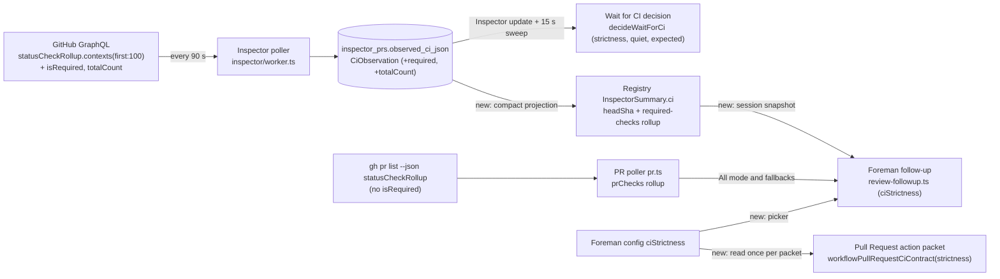

# Wait for CI strictness

Fork feature `fork:ci-strictness` on `ramiro314/mission-control`. Status: shaped from a two-round
interview; this document records every decision with the answer the human gave.

## Summary

The Wait for CI workflow node passes only when CI includes a check named exactly "Flaky tests"
(`FLAKY_TESTS_CHECK_NAME`). Only Mission Control's own CI publishes that check, so on any other
repository a fully green pull request blocks with `ci_flake_report_missing`. Two
upstart-web-frontend runs are blocked on it today.

This plan removes that requirement and lets each Wait for CI node choose how strict it is:

- **Strictness**: "All checks must pass" (default) or "Required checks must pass".
- **Quiet period**: 0 to 30 minutes (default 3) during which every counted check has to stay
  settled and unchanged. It replaces the completion signal "Flaky tests" used to give.
- **Expected checks**: an optional list of exact check names that must appear and pass in either
  mode. Once all of them have settled, the quiet period is skipped.

"Flaky tests" becomes an ordinary check. When a run has it, its flake report is still parsed and
shown, but it never gates. Foreman's CI follow-through gets the same All/Required choice for
which failures count, and the Pull Request action's CI wording follows that choice.

## Verified facts

These were checked against the code and GitHub before the interview.

- The flake check's exemption from failing is dead code. `src/flake-report-action/publish.ts`
  only ever concludes `success` or `neutral`. What the check really does is (a) act as a
  completion sentinel, because its job runs after every other test job, and (b) carry the flake
  report shown on a pass (`WaitForCiPanel.tsx`; the engine records the flake count).
- The node never calls GitHub. It judges the snapshot that the GitHub Inspector's PR query stores
  (`src/server/inspector/github.ts`, `statusCheckRollup.contexts(first:100)`, stored as
  `inspector_prs.observed_ci_json`) for the exact head the Pull Request action captured. It is
  re-observed on each Inspector update and on the manager's 15-second sweep.
- The Inspector polls each pull request every 90 seconds (`INSPECTOR_POLL_MS` in
  `src/server/inspector/worker.ts`), so a 3-minute quiet period spans two to three observations.
- GitHub's `isRequired(pullRequestNumber:)` works on both `CheckRun` and `StatusContext`. On
  teamupstart/upstart-web-frontend#13933 it marks 4 of 29 contexts: `checks-status`,
  `PR / playwright`, `SonarQube Code Analysis` and `Vercel Deployments – Upstart`. This account
  cannot read the repository's list of required check names (it has no branch protection rule,
  and the ref's rules show no status-check rule), so a required check that has not posted yet is
  invisible. In that repository `PR / playwright` and `Vercel Deployments – Upstart` are commit
  statuses that other jobs post late.
- `gh pr list --json statusCheckRollup` and `gh pr view --json statusCheckRollup` do **not**
  return `isRequired`. Their fields are `__typename`, `name`/`context`, `status`, `conclusion`,
  `state`, `detailsUrl`, `startedAt`, `completedAt` and `workflowName`. Those calls feed the PR
  poller (`src/server/pr.ts`), and through it the session's `prChecks`.
- Foreman's CI nudge (`src/server/foreman/review-followup.ts`) reads only that rollup (`prChecks`,
  or `repoPrs[].feedback.prChecks`), never individual checks. When no Wait for CI node follows a
  Pull Request action, the action's CI instructions (`workflowPullRequestCiContract` in
  `src/server/workflows/agent-contract.ts`) come from the same Foreman CI preference
  (`trackCiFailures`).
- Wait for CI is fork-only code: `src/shared/wait-for-ci.ts`, `src/shared/ci-checks.ts`,
  `src/web/workflows/WaitForCiFields.tsx` and `src/web/workflows/WaitForCiPanel.tsx` do not
  exist upstream. It belongs to `fork:flake-aware-testing` (#296), whose behavior contract today
  reads "Wait for CI passes only when every check is green and a 'Flaky tests' check is present."
- The node already copies `timeoutMinutes` into the attempt's `WaitForCiState` when it
  activates. "Wait for CI again" re-creates the waiting attempt with
  `initialWaitForCiState({ ...ciWait, now })` (`src/server/workflows/store.ts`).
- The published Persona arm's `executionOverride` is the precedent for new node fields: it is
  `.optional()` with no `.default()`, so legacy graphs are never rewritten when they are read.
- The built-in No-Mistakes Review (Affected tests) v1 graph sets
  `timeoutMinutes: WAIT_FOR_CI_TIMEOUT_MINUTES.default`, which reads a live constant inside an
  immutable version.
- `.github/workflows/ci.yml` (lines 32 and 714-715) and `docs/flaky-tests.md` say Wait for CI
  requires "Flaky tests". `test/docs-only-ci-scripts.test.ts` names that requirement as the
  reason a docs-only run passes.

## Decisions

All of these are settled. The review reads them; it does not reopen them.

### Settled before the interview

**Wait for CI node**

1. Strictness is a node setting chosen in the workflow editor: "All checks must pass" or
   "Required checks must pass". All is the default, both for nodes in already-published versions
   (which have no field) and for newly added nodes.
2. "Flaky tests" is an ordinary check. Its flake report stays as optional enrichment: parsed and
   shown when that check exists, never a gate.
3. The completion signal is a per-node quiet period: every counted check settled and unchanged
   for N minutes, 0 to 30 minutes, default 3. 0 means pass as soon as everything counted has
   settled. Publish refuses a quiet period at or above the node's timeout, with an editor
   diagnostic on the node.
4. Each node has an optional expected-checks list of exact, case-sensitive names. Each expected
   check must appear and pass in both modes, even if it is not marked required. When every
   expected check is present and settled, the quiet period is skipped. Checks that are still
   pending are never skipped.
5. An expected check that never appears blocks at the timeout, with a new append-only block
   reason that names the missing checks.
6. The node passes only once every counted check has settled. In All mode that means every
   observed check; in Required mode, every required check plus every expected one.
7. A failure fails the node once every counted check has settled, with no quiet period, and the
   repair packet lists every failure. Round 1 `required-packet` narrows this for Required mode
   (see [S1](#supersessions-and-source-notes)).
8. Required mode ignores non-required checks for the decision but still shows them in the run
   panel. If nothing is marked required after the quiet period, the node judges all checks
   instead. That fallback is recorded on the attempt and shown in the run panel.
9. SKIPPED and NEUTRAL keep counting as passing.
10. Built-in workflows that contain Wait for CI get All, a 3-minute quiet period and no expected
    checks.
11. Runs already blocked with `ci_flake_report_missing` stay blocked. "Wait for CI again"
    re-judges them under the new rules. The code stays in the append-only list, but nothing
    produces it any more.

**Foreman**

12. One strictness picker sits beside "Keep sessions on track with CI" in the Foreman popover.
    The default is All.
13. The picker only decides which failures count. Foreman gets no quiet period and no expected
    checks.
14. In Required mode with nothing marked required, Foreman falls back to all failures.
15. The Pull Request action's CI wording follows the picker. In Required mode it says to wait for
    and fix the required checks.

**Landing**

16. This is a fork feature on `ramiro314/mission-control` with the label `fork:ci-strictness` and
    a `fork-feature` tracking issue (see `docs/fork/README.md`). Because it changes
    upstream-owned code, this plan says where upstream syncs will conflict.

### Interview round 1

| Id | Question | Answer |
| --- | --- | --- |
| node-fields | Persisted node fields and what absence means | Flat optional fields on both the draft and published `wait_for_ci` arms: `strictness: "all" \| "required"`, `quietMinutes: 0-30`, `expectedChecks: string[]`. All are `.optional()` with no `.default()`. Absence reads as a frozen `WAIT_FOR_CI_LEGACY_SETTINGS` (All, 3, none) that never follows later default changes. New nodes write all three. The attempt state copies them at activation, like `timeoutMinutes`. |
| expected-rules | Expected-checks list rules | Up to 20 names, each 1-500 characters after trimming. Publish refuses duplicates. A name matches every check with that name: it is present when at least one check of that name exists, settled when all of them have settled, and passing when all of them pass. |
| required-none-marked | Required mode while no check is marked required | Watch all checks, and wait out the quiet period before any verdict, failures included. Then judge all checks and record the fallback. A quiet period of 0 decides at once. |
| failure-vs-missing-expected | A counted check failed and every present counted check has settled, but an expected check has not appeared | Fail now. The repair packet lists the failures and names the expected checks that have not appeared. |
| quiet-measurement | How "settled and unchanged for N minutes" is measured | By observation. The clock starts at the Inspector observation that first saw this settled set, and the node passes only on an observation at least N minutes later with the same set. The set is each counted check's name, state and conclusion; in Required mode, changes to non-required checks do not reset it. |
| quiet-at-timeout | The quiet period is still running when the timeout hits | Finish the quiet period past the timeout, bounded by its length. The timeout blocks only while something counted is pending or missing. |
| required-packet | Repair packet contents in Required mode | Only counted failures (required and expected) become requested changes. Non-required failures stay out of the packet and are shown in the run panel tagged "Not required". This narrows decision 7 in Required mode ([S1](#supersessions-and-source-notes)). |
| new-ids | New append-only identifiers | Block code `ci_expected_missing` (recovery `retry`, which is "Wait for CI again"). Diagnostics `wait_for_ci_quiet_period` and `wait_for_ci_expected_checks`. |
| inspector-query | Inspector PR query change | Always read `isRequired(pullRequestNumber:$number)` on `CheckRun` and `StatusContext`, plus `contexts.totalCount`. |
| foreman-source | Where Foreman learns which checks are required | From the Inspector's stored snapshot, projected onto each follow-up PR. Foreman holds the CI nudge while the snapshot is for another head, and counts all failures when the Inspector never adopted the PR. |
| foreman-ui-wording | Foreman field, picker and nudge wording | `ciStrictness: "all" \| "required"` (default `all`, sharing an enum with the node). A select labeled "Which failures count" under the CI checkbox, disabled when that checkbox is off. The nudge says "its required CI checks are failing" and points at `gh pr checks <url> --required`. |
| pr-action-wording | Pull Request action CI contract in Required mode | Use the proposed text (see [Pull Request action wording](#7-pull-request-action-wording)). The strictness is read once per prepared packet and frozen with it. |
| builtin-version | Built-in workflows with Wait for CI | No new version. Existing versions omit the fields and read as All/3/none, which is the decided setting. Pin their timeout to a literal 45, and update the description and docs. |
| editor-layout | Node fields in both editors | A strictness radio pair with one-line descriptions, a quiet-period number field (0-30) with the timeout diagnostic inline, and an expected-checks textarea with one name per line. |
| fork-tracking | Fork tracking | `fork:ci-strictness` is its own feature. Implementation PRs also carry `fork:flake-aware-testing` and rewrite its Wait for CI contract line. The label and tracking issue (`fork-status:in-progress`) are created when the plan's PR opens, not by the shaping turn. |
| test-coverage | Test and e2e coverage | Unit tables in `test/` for every decision edge, plus e2e coverage for the editor, the Publish diagnostic, the run panel and the Foreman picker. |

### Interview round 2

| Id | Question | Answer |
| --- | --- | --- |
| run-panel-copy | Run panel content and copy | Accepted as proposed (see [Run panel](#9-run-panel)). |
| quiet-chip | Stage chip during the quiet period | Keep "Waiting for CI". The quiet period shows only in the run panel headline. |
| editor-copy | Editor copy and diagnostics | Accepted, with one edit: the quiet-period hint's second sentence becomes "Set 0 to pass as soon as they settle." (see [Workflow editor](#8-workflow-editor)). |
| foreman-copy | Foreman picker copy | Accepted as proposed (see [Foreman](#6-foreman)). |
| pr-chip | Should the session's PR CI chip follow the Foreman picker? | No. The chip keeps showing GitHub's whole rollup; only Foreman's nudge decision follows the picker. |

### Derived rules

These rules follow from the decisions above, and the plan writes them down so the review can
confirm them.

- **D1.** The skip for expected checks applies in every mode. In Required mode with nothing
  marked, the fallback is decided at the moment of the skip.
- **D2.** Past the timeout, only a quiet period that is already running with an unchanged set may
  finish, and it must finish by `timeout + quietMinutes` of wall time. Any other state past the
  timeout blocks: a new pending check, a changed set, or no fresh observation by that bound.
- **D3.** At the timeout, the block reason is chosen in order. No check was ever observed:
  `ci_missing`. A counted check is pending, or the set kept changing: `ci_timeout`, whose detail
  names the pending counted checks. Otherwise expected checks are missing: `ci_expected_missing`,
  whose detail names them.
- **D4.** Marking a check required (or unmarking it) changes the counted set, so it resets the
  quiet clock. The `required` flag is part of what "unchanged" compares.
- **D5.** "Inspector off" for Foreman means `InspectorConfig.enabled` is false, even for a PR the
  Inspector adopted earlier. Foreman then counts all failures, which matches the hint "With none
  marked, or the Inspector off, every check counts." A PR that is adopted while the Inspector is
  enabled, but has no observation for the current head yet, is held.
- **D6.** A draft saved in the editor keeps absent fields absent until the author edits any of
  the three; an edit then writes all three. Publishing an untouched legacy draft does not change
  its graph bytes.
- **D7.** `WaitForCiState.greenWithoutReportSince` stays in the schema and is always written as
  `null`, so a downgraded daemon can still read new attempt rows.

### Supersessions and source notes

- **S1. Round 1 `required-packet` narrows decision 7 in Required mode.** In Required mode the
  round 1 answer is the authority: the repair packet lists every counted failure (required and
  expected checks), and non-required failures stay out of the packet and appear in the run panel
  tagged "Not required". In All mode every observed check is counted, so decision 7 holds as
  written: the packet lists every failure.
- **S2. Decision 4 relies on the full wording from the task request.** The goal text handed to
  the plan review was truncated after "the quiet period". The plan relies on the full sentence
  from the task request this session received: "When every expected check is present and
  settled, the quiet period is skipped; checks still pending are never skipped." Decision 4
  states it in full, and the human approved revision 1 with that wording.
- **S3. The e2e requirement is met by extending two existing specs.** The goal asks for "a
  Playwright spec in e2e/" for the editor and run-panel changes. The plan extends
  `e2e/specs/workflow-wait-for-ci.spec.ts`, which already authors Wait for CI nodes and seeds
  `inspector_prs.observed_ci_json` for its run views, and `e2e/specs/foreman-pr-defaults.spec.ts`,
  which already covers the Foreman popover's Pull requests controls. No new spec file is added,
  because a new one would duplicate those fixtures. Round 1 `test-coverage` chose this placement.
- **S4. The plan supersedes fork:flake-aware-testing's Wait for CI contract.** #296's
  "Behavior contracts" line saying Wait for CI passes only with a "Flaky tests" check is replaced
  by the line in [fork:flake-aware-testing amendment](#forkflake-aware-testing-amendment), and the
  docs that repeat the old rule are rewritten (see [Docs](#12-docs)).

## Design

The diagram shows CI data flow after the change. New or changed edges are drawn in the accent
color; everything else exists today.



### 1. Shared contract

`src/shared/ci-checks.ts` (fork-only, browser-safe):

- `CI_STRICTNESS = ["all", "required"] as const` and `type CiStrictness`. The tuple is persisted
  in workflow graphs and in Foreman config, so it is **append-only**.
- `requiredChecksRollup(runs): PrChecks | null`. It returns null when no check is marked
  required, `failing` when any required check fails, `pending` when any is pending, and
  `passing` otherwise. This one classification is shared by the node's fallback test and by
  Foreman's projection, so the two cannot disagree.

`src/shared/wait-for-ci.ts` (fork-only):

- `WAIT_FOR_CI_QUIET_MINUTES = { default: 3, min: 0, max: 30 }` and
  `WAIT_FOR_CI_EXPECTED_CHECKS = { max: 20, nameMax: 500, schemaMax: 100 }`. `schemaMax` bounds
  the bytes of a stored list; the 20 limit is enforced at Publish so the editor can show it on
  the node.
- `WAIT_FOR_CI_LEGACY_SETTINGS = { strictness: "all", quietMinutes: 3, expectedChecks: [] }`.
  These are literals, and they deliberately do not reference the defaults above.
- `WAIT_FOR_CI_NEW_NODE_SETTINGS`, built from the defaults, is what a newly added node writes.
- `waitForCiSettings(nodeOrState)` is the one resolver: present fields win, and absent fields
  take the legacy value. Every reader goes through it.
- `waitForCiQuietFits(settings, timeoutMinutes)` is the one predicate behind both the Publish
  diagnostic and the editor's inline message.
- `CiCheckRunSchema` gains `required: z.boolean().optional()`. Absent means not marked, which is
  how snapshots stored before this change read.
- `CiObservationSchema` gains `totalCount: z.number().int().nullable().optional()`.
- `ciCheckRunsFromRollup(contexts, parseReport, totalCount)` reads `isRequired` into `required`
  and returns `totalCount` as well. Flake-report parsing is unchanged.
- `WAIT_FOR_CI_BLOCK_CODES` gets `ci_expected_missing` appended. `ci_flake_report_missing` stays,
  with its comment changed to say that nothing produces it any more.
- `WaitForCiStateSchema` gains these optional fields: `strictness`, `quietMinutes`,
  `expectedChecks` (resolved at activation), `quietSince: number | null` (the `observedAt` of the
  observation that started the clock), `requiredFallback: boolean` (set on a verdict reached
  through the fallback), `missingExpected: string[]` (written on every decision), and
  `checksTotal: number | null`. `greenWithoutReportSince` stays (D7).
- `WAIT_FOR_CI_FLAKE_REPORT_GRACE_MS` is deleted.
- `initialWaitForCiState` takes the resolved settings, which lets the re-wait path carry them
  through its existing spread.

`src/shared/protocol.ts`: both `wait_for_ci` arms (`WorkflowDraftNodeSchema` and
`PublishedWorkflowNodeSchema`) gain `strictness: z.enum(CI_STRICTNESS).optional()`,
`quietMinutes: z.number().int().min(0).max(30).optional()` and
`expectedChecks: z.array(z.string().trim().min(1).max(500)).max(100).optional()`, with no
`.default()`. `ForemanConfigSchema` gains `ciStrictness: z.enum(CI_STRICTNESS).default("all")`.

`src/shared/workflow-stages.ts`: the `wait_for_ci` stage member carries the three optional fields,
and the stage-to-graph conversion round-trips them, keeping absent fields absent (D6).

`src/shared/workflow.ts`: `WORKFLOW_DIAGNOSTIC_CODES` gets `wait_for_ci_quiet_period` and
`wait_for_ci_expected_checks` appended.

`src/shared/types.ts`: `InspectorSummary` gains an optional `ci` projection (see
[Foreman](#6-foreman)). `src/shared/app-config-entries.ts` registers `ciStrictness` as a
`setting`.

### 2. The decision

`decideWaitForCi` stays the one pure decision. The unknown-head block and the merge-conflict fail
come first and are unchanged. The `FLAKY_TESTS_CHECK_NAME` exemption is removed from the decision
and from the panel. For one observation of the expected head:

**Terms**

- *observed*: every check run on the head.
- *marked*: observed checks with `required: true`.
- *counted*:
  - All mode: every observed check.
  - Required mode with marked checks: the marked checks, plus observed checks whose name is
    expected.
  - Required mode with nothing marked: every observed check. This is provisional; if a verdict
    is reached this way, it becomes the recorded fallback.
- *missing*: expected names with no observed check.
- *settled*: counted is non-empty and no counted check is pending.
- *unchanged*: the counted projection (name, state, conclusion, required) equals the projection
  of the state's stored `checkRuns` from the previous observation. Every change happens between
  two consecutive observations, so comparing consecutive observations needs no stored
  fingerprint.

**Rules, in order**

| Situation | Outcome |
| --- | --- |
| No observation for the expected head | Keep waiting; the timeout rules apply. |
| Not settled | Clear `quietSince`; keep waiting. |
| Settled, a counted check failing, All mode or Required mode with marked checks | **Fail now.** Requested changes come from the failing counted checks. The summary names `missing`. |
| Settled, a counted check failing, Required mode with nothing marked | Run the quiet clock (or skip it, per D1). When it completes, **fail** judging all checks, with `requiredFallback: true`. |
| Settled, all counted checks passing, `missing` non-empty | Keep waiting for the expected checks. |
| Settled, all passing, nothing missing, expected list non-empty | **Pass now** (quiet period skipped). Fallback recorded if nothing is marked in Required mode. |
| Settled, all passing, nothing missing, quiet period 0 | **Pass now.** |
| Settled, all passing, nothing missing, otherwise | If `quietSince` is null or the set changed, set `quietSince = observation.observedAt`. **Pass** once `observation.observedAt - quietSince >= quietMinutes * 60_000`. |
| Timeout reached | Apply D2 and D3. |

The pass keeps carrying `observation.flakeReport` in every mode. The quiet clock advances only on
a new observation: the 15-second sweep re-decides the same observation and cannot pass the node
on its own, which is what makes the quiet period observed rather than assumed.

### 3. Engine, manager and store

- `engine.ts` `initialCiWait` takes the node, resolves its settings through `waitForCiSettings`,
  and writes them into the new attempt state.
- `waitForCiVerdict` builds requested changes from `decision.failing`, which now holds only
  counted failures. A fail summary appends `Not reported when CI failed: "deploy".` when
  something is missing. A fallback pass or fail says
  `No check was marked required, so every check was judged.`
- The `wait_for_ci_outcome` event payload gains `strictness`, `requiredFallback` and
  `missingExpected` (a count). The `wait_for_ci_blocked` detail carries the D3 names.
- `store.ts`: the re-wait path (`initialWaitForCiState({ ...ciWait, now })`) carries the settings
  through. A legacy attempt state has no settings, resolves to the legacy constant, and
  re-judges an old `ci_flake_report_missing` block as All, quiet 3, no expected checks.
  `quietSince` and `missingExpected` reset with the fresh timeout.
- `recovery.ts`: `WORKFLOW_PHASE_RECOVERY.ci_expected_missing = "retry"`. Every
  `Record<WaitForCiBlockCode, …>` gains the entry; the compiler finds them.

### 4. Publish validation

In `src/shared/workflow-graph.ts`, next to the `wait_for_ci_placement` rule:

- `wait_for_ci_quiet_period` (error, on the node) when `!waitForCiQuietFits(...)`. Message:
  `The quiet period must be shorter than the timeout.`
- `wait_for_ci_expected_checks` (error, on the node) when the trimmed names repeat or there are
  more than 20. Message: `Expected checks must be unique, and there can be at most 20.`

A node with absent fields validates as the legacy settings (quiet 3, which is below the 5-minute
minimum timeout), so no published version gains a diagnostic.

### 5. Inspector query

`src/server/inspector/github.ts` `PR_QUERY`:

```graphql
statusCheckRollup{ state contexts(first:100){ totalCount nodes{
  ... on CheckRun{ name status conclusion detailsUrl title summary isRequired(pullRequestNumber:$number) }
  ... on StatusContext{ context state targetUrl description isRequired(pullRequestNumber:$number) }
} } }
```

`toSnapshot` passes `contexts.totalCount` through, and `PrSnapshot.ci` gains `totalCount`. The
worker's `recordInspectorCiObservation` is unchanged apart from the new fields. Mission Control
still makes no new GitHub call: this is the same one query, with two more fields.

### 6. Foreman

**Config.** `ciStrictness` (default `all`) is added to `ForemanConfigSchema`. It needs no
migration, because the default covers stored configs. `ReviewFollowupConfig` gains `ciStrictness`,
and `src/server/foreman/worker.ts` passes it at both places that build the config (the first pass
and the post-read re-check).

**Projection.** `src/server/db.ts` `loadInspectorInspections` also reads `observed_ci_json` and
derives a compact `ci` for the cached ledger row. The registry's `inspectorSummaryForUrl` puts it
on `InspectorSummary.ci`, together with whether the Inspector is enabled. The full check list
never travels on the session wire. `inspectionUpdated` already reloads the row after every
observation, so nothing new is read per session snapshot. Both the session PR and each
`repoPrs[].feedback.inspector` get it, because both go through `inspectorSummaryForUrl`.

**Decision.** In `review-followup.ts`, `feedbackState`'s `ciFailing` and the re-arm in
`advanceFollowupMark` both read one predicate:

| ciStrictness | Condition | CI counts as failing when |
| --- | --- | --- |
| all | always | `pr.checks === "failing"` (today's rule) |
| required | Inspector never adopted the PR, or the Inspector is disabled (D5) | `pr.checks === "failing"` (fallback) |
| required | adopted and enabled, but no observation for `pr.headSha` | never: **held**. A held pass neither nudges nor re-arms. |
| required | observed for `pr.headSha`, nothing marked required | `pr.checks === "failing"` (fallback) |
| required | observed for `pr.headSha`, checks marked required | `requiredChecksRollup === "failing"` |

**Nudge wording** (`buildPayload`), when the required rollup decided (not a fallback): the problem
reads `its required CI checks are failing`, the step reads
``Look at the failing required checks (`gh pr checks <url> --required`), reproduce them locally, and fix them.``,
and the closing step says "until the required checks are green". A fallback uses today's wording.

**Popover** (`src/web/components/ForemanBar.tsx`): a select labeled `Which failures count` with
`All checks` and `Required checks`, placed under "Keep sessions on track with CI" and disabled
while that box is unchecked. It reads `config.ciStrictness ?? "all"` so a newer web build talking
to an older daemon shows the daemon's real behavior. Hint:
`Required checks: only checks GitHub marks required on the PR count, read through GitHub Inspector. With none marked, or the Inspector off, every check counts.`

**Unchanged.** The session's PR CI chip (`src/server/pr.ts`) keeps showing GitHub's whole rollup.

### 7. Pull Request action wording

`src/server/index.ts` wires `ciStrictness: () => getForemanConfig().ciStrictness` into the
manager. `manager.ts` passes `pullRequestCiStrictness` next to `pullRequestCi` (same
preparation, same `waitForCiFollows` exclusion). `feedback.ts` renders
`workflowPullRequestCiContract(strictness)`. The text is part of the prepared payload, so it is
frozen with the packet across retries and restarts.

In Required mode the contract's opening line adds that Required checks was chosen, and the second
paragraph reads:

> After opening or updating the PR, keep watching the checks GitHub marks required
> (`gh pr checks <url> --required`). Wait for pending required checks and inspect failing ones'
> logs. A failing check that is not required does not block; leave it alone unless the task asks.
> If no check is marked required, follow every check. Follow only this action's PR and
> repository, on the same branch.

The repair and verify paragraphs then say "required checks": "Repair actionable failures of
required checks…" and "After every repair push, verify the required checks for the newly pushed
head… Continue until the required checks pass or…". All mode keeps today's text byte for byte.

### 8. Workflow editor

`src/web/workflows/WaitForCiFields.tsx` gains three fields, used by both the Graph rail
(`WorkflowProperties.tsx`) and the Pipeline editor (`PipelineEditor.tsx`):

- **Strictness** radio pair:
  - `All checks must pass`: `Every check GitHub reports on the head commit counts.`
  - `Required checks must pass`: `Only checks GitHub marks required, plus any expected checks, count. When none are marked required, every check counts.`
- **Quiet period (minutes)**, a number field from 0 to 30 that commits only whole numbers in
  range, like the timeout field. Hint:
  `Passes once every counted check has settled and stayed unchanged this long. Set 0 to pass as soon as they settle.`
  When `waitForCiQuietFits` fails, the hint is replaced by
  `The quiet period must be shorter than the timeout.`
- **Expected checks**, a textarea with one name per line. Lines are trimmed and blank lines
  dropped. Hint:
  `One check name per line, exactly as GitHub shows it. Each must appear and pass in either mode. Once all have settled, the quiet period is skipped.`
- `WAIT_FOR_CI_EXPLANATION` becomes:
  `Waits for the pull request's CI on the head the Pull Request action proved. It passes once every counted check has passed and stayed settled for the quiet period, and returns a failing check to the session by name. It blocks the run when CI times out, never appears, or an expected check never appears. It reads CI through the GitHub Inspector, which must be on.`
- The Pipeline row summary (`PipelineEditor.tsx`) becomes
  `All checks · quiet 3 min · blocks after 45 min`, or
  `Required checks · quiet 3 min · blocks after 45 min`, with ` · expects 2 checks` appended when
  the list is non-empty. The live announcement next to it follows the same wording.
- A new node from the palette or the stage inserter writes `WAIT_FOR_CI_NEW_NODE_SETTINGS`. An
  existing node shows resolved values and writes all three fields on its first edit (D6).

### 9. Run panel

`WaitForCiPanel.tsx` and `run-model.ts`:

- The settings line, under the PR link, reads `All checks · quiet 3 min · limit 45 min`, or
  `Required checks · expects "deploy", "e2e" · quiet 3 min · limit 45 min`.
- While counted checks run, the headline is unchanged:
  `Waiting for CI on PR #77 at abc123def456 · 4 of 45 min.`
- During the quiet period the headline reads:
  `Every counted check has settled on PR #77 at abc123def456. Passing once nothing changes for 3 min (1 of 3 so far).`
- In Required mode, check rows gain a tag: `Required`, `Expected`, or `Not required`. Expected
  names that have not been reported appear as their own rows: `deploy · Expected · Not reported yet`.
- Fallback note: `No check on this head is marked required, so every check was judged.`
- Truncation note, when `checksTotal > 100`:
  `GitHub reported 140 checks; only the first 100 were read.`
- On a fail with missing expected checks, under Failing checks:
  `Not reported when CI failed: "deploy".` The Failing checks list shows only counted failures.
- `ci_expected_missing` sentence, with the names taken from the attempt state:
  `These expected checks never appeared on the head commit before the timeout: "deploy", "e2e". Check that the workflows producing them run on pull requests, or correct the names in a new version, then wait for CI again.`
- `ci_flake_report_missing` sentence, now seen only on old runs:
  `Blocked under an earlier rule that required a "Flaky tests" check. Wait for CI again to judge this run under the current rules.`
- `ci_timeout` detail names the counted checks still pending: `Still running after 45 minutes: "e2e", "build".`
- The stage chip stays `Waiting for CI` for the whole wait, including the quiet period.
- On a pass, the flake list shows whenever a flake report exists, in either mode.

### 10. Built-in workflows

`src/server/workflows/builtin-workflows.ts`:

- No new version. The No-Mistakes Review (Affected tests) versions keep omitting the three
  fields, so they read as All, 3, none.
- `NO_MISTAKES_REVIEW_AFFECTED_TESTS_V1` replaces `WAIT_FOR_CI_TIMEOUT_MINUTES.default` with the
  literal `45`. The bytes are identical, and a frozen version no longer follows a live constant.
- The workflow description drops "passing when the only failures were flakes that passed on
  rerun" and reads: "Wait for CI then holds the run until every check on the pull request's head
  has passed and stayed settled for three minutes, returning real failures for repair, before the
  final GitHub Inspector gate."

### 11. Compatibility and upgrade

- **Published versions** have no new fields and resolve to the legacy constant, which matches
  the decided default. Their graph bytes are unchanged.
- **In-flight attempts at upgrade** have no settings in their state and resolve to legacy
  values. A stale `greenWithoutReportSince` is ignored, and the next observation decides under
  the new rules.
- **Blocked `ci_flake_report_missing` runs** stay blocked. "Wait for CI again" re-judges them
  (decision 11).
- **Older snapshots** have no `required` and no `totalCount`. Required mode reads them as
  nothing marked, and the next 90-second poll replaces them.
- **Downgrade**: new attempt rows still parse under the old schema (unknown keys are stripped,
  and `greenWithoutReportSince` is present). A new graph with `strictness`, `quietMinutes` or
  `expectedChecks` would be refused by an older daemon's strict schema, which is the same posture
  as any new node field.
- **Foreman config** without `ciStrictness` reads as `all`.

### 12. Docs

- `docs/workflows.md#wait-for-ci`: the node's four settings, a rewritten outcome table (both
  modes, the quiet period, expected checks, the fallback, `ci_expected_missing`, the legacy
  `ci_flake_report_missing`), how the quiet period is measured and how it interacts with the
  timeout, and the flake report as enrichment. Rewrite the sentence that says "Flaky tests" never
  fails the node.
- `docs/workflows.md` built-in section (the Affected tests paragraph): remove "bind it in a
  repository whose CI publishes 'Flaky tests' … Without that check, Wait for CI blocks the run";
  say it works on any repository whose CI runs on pull requests, and that the flake report adds
  the flake list.
- `docs/workflows.md` "Conditional CI instructions": the wording follows Foreman's picker.
- `docs/work-queues.md#keeping-a-pr-on-track`: the "Which failures count" picker, what Required
  reads (the Inspector's snapshot), the fallbacks, the hold, and that the PR chip is unchanged.
- `docs/inspector-and-shipping.md` "CI and flaky tests": the query also reads `isRequired` and
  `totalCount`, and Foreman's Required mode reads the snapshot too.
- `docs/flaky-tests.md` (lines 155-160 and 230-234): "Flaky tests" is no longer required. Wait
  for CI shows its report when the check is present, and the docs-only rationale changes to
  "so a docs-only run still records its (empty) flake report".
- `docs/agent-guides/change-contracts.md` "### Wait for CI": absence means
  `WAIT_FOR_CI_LEGACY_SETTINGS` and never a live default; `CI_STRICTNESS` is append-only; the
  quiet period is observed, never assumed; Foreman's Required mode reads the same stored snapshot
  and adds no poll.
- `.github/workflows/ci.yml`, comment-only edits at lines 32 and 714-715, which this change makes
  false. The rationale becomes "so the docs-only run still publishes its flake report"; no job,
  step or permission changes.

## Tests

The focused files run with
`node --test --import ./test/setup-state.mjs --import tsx test/<file>`.

- `test/wait-for-ci.test.ts`, the decision table:
  - All mode: settled then quiet passes only on an observation at least 3 minutes later; a
    change resets the clock; quiet 0 passes on the first settled observation; the 15-second
    sweep alone never passes.
  - A failure fails with no quiet period; a failure with an expected check missing fails and
    names it.
  - Expected checks: all present and settled skips the quiet period; pending is never skipped;
    duplicate names match every check of that name.
  - Timeout: a running quiet period finishes past the timeout up to its bound (D2); a change or
    a new pending check past the timeout blocks `ci_timeout`; D3 ordering
    (`ci_missing`, `ci_timeout` with names, `ci_expected_missing` with names).
  - Required mode: non-required failures are ignored; marking a check required resets the clock
    (D4); with nothing marked, the node waits out the quiet period before failing, then falls
    back with `requiredFallback`; D1.
  - "Flaky tests" failing counts as a failure; the flake report is carried on a pass in both
    modes.
  - A legacy state without settings resolves to the legacy constant; a re-judged legacy
    `ci_flake_report_missing` state passes.
  - `ciCheckRunsFromRollup` reads `isRequired` and `totalCount`.
  - Schema: both node arms accept absent fields and do not add them; `WAIT_FOR_CI_LEGACY_SETTINGS`
    is pinned by value.
  - D7: every state that `initialWaitForCiState` and `decideWaitForCi` produce carries
    `greenWithoutReportSince: null`, and a state with all the new fields still parses under a
    pinned copy of the pre-change `WaitForCiStateSchema` kept in the test as a fixture.
- `test/workflow-stages.test.ts` (D6): a legacy `wait_for_ci` node with none of the three fields
  round-trips through the stage model to a byte-identical graph with the fields still absent;
  editing any one of the three writes all three; a node added through the stage inserter writes
  `WAIT_FOR_CI_NEW_NODE_SETTINGS`.
- `test/wait-for-ci-render.test.ts`: the settings line, row tags, rows for unreported expected
  checks, the fallback and truncation notes, the quiet headline, the new and rewritten block
  sentences, and the absence of tags in All mode.
- `test/workflow-graph.test.ts`: both new diagnostics fire on the node with their messages; a
  legacy node and a new default node produce neither.
- `test/builtin-workflows.test.ts`: the Affected tests graphs are byte-identical to before, and
  the v1 timeout is the literal 45.
- `test/foreman-review-followup.test.ts`: the five-row predicate table, a held pass neither
  nudging nor re-arming, re-arm on the required rollup, D5, and Required versus fallback nudge
  wording.
- `test/session-action-ci-policy.test.ts`: All text unchanged; Required text present; strictness
  frozen in a prepared packet across a setting change.
- The registry projection: `InspectorSummary.ci` derives from the stored observation, reports
  the Inspector disabled, and never carries the check list. This goes in the existing test that
  covers `inspectorSummaryForUrl`, or in a new `test/inspector-ci-projection.test.ts`.
- The Inspector query: `PR_QUERY` requests `isRequired(pullRequestNumber:$number)` on both
  fragments and `totalCount`. This goes beside the existing parse tests in
  `test/wait-for-ci.test.ts`.
- `test/foreman-review-followup.test.ts` or the Foreman config test: `ciStrictness` defaults to
  `all` on a stored config without it.
- `test/docs-only-ci-scripts.test.ts`: rename the case ("a docs-only run's checks pass Wait for
  CI") and drop the "because flake report still publishes Flaky tests" rationale.

Where each derived rule is verified:

| Rule | Test |
| --- | --- |
| D1 | `test/wait-for-ci.test.ts`, Required mode with nothing marked and the expected-check skip |
| D2 | `test/wait-for-ci.test.ts`, timeout cases |
| D3 | `test/wait-for-ci.test.ts`, block ordering at the timeout |
| D4 | `test/wait-for-ci.test.ts`, marking a check required resets the clock |
| D5 | `test/foreman-review-followup.test.ts`, Inspector disabled after adoption, and the hold |
| D6 | `test/workflow-stages.test.ts`, legacy round trip and the first edit; e2e case 2 reads the published fields back |
| D7 | `test/wait-for-ci.test.ts`, null field and the pinned pre-change schema |

## End-to-end specs

The plan extends two existing spec files rather than adding a new one (see
[S3](#supersessions-and-source-notes)). Both stand in for GitHub the way `workflow-wait-for-ci.spec.ts` already does: they write
`inspector_prs.observed_ci_json` directly, with chosen `observedAt` values, so the quiet period is
exercised deterministically without waiting real minutes. No model tokens are spent, and nothing
uses `data-testid`.

`e2e/specs/workflow-wait-for-ci.spec.ts`, extended:

1. **Pipeline editor**: a new node shows `All checks must pass` selected, quiet 3 and an empty
   expected list, and the row reads `All checks · quiet 3 min · blocks after 45 min`. Switching
   to Required and entering two names changes it to
   `Required checks · quiet 3 min · blocks after 45 min · expects 2 checks`.
2. **Publish diagnostic**: a quiet period of at least the timeout shows
   `The quiet period must be shorter than the timeout.` inline, and Publish is refused with the
   node diagnostic. Fixing it publishes, and the published graph read through the API carries the
   three fields.
3. **Graph rail**: the same three fields, edited on a palette-added node.
4. **Required run**: a snapshot with a failing non-required check and passing required checks,
   observed twice 3 minutes apart, passes. The panel shows the `Not required` tag and the
   settings line.
5. **Quiet headline**: after one settled observation, the panel reads
   `Every counted check has settled … (0 of 3 so far)` and the chip still reads `Waiting for CI`.
6. **Fallback**: in Required mode with no check marked, after the quiet period, the run passes
   with `No check on this head is marked required, so every check was judged.`
7. **Expected missing**: with the attempt's `waitingSince` moved past the timeout, the run blocks
   with the `ci_expected_missing` sentence naming the check, and offers "Wait for CI again".
8. **Legacy block**: a seeded `ci_flake_report_missing` block shows the rewritten sentence. "Wait
   for CI again" over a green snapshot passes it.

`e2e/specs/foreman-pr-defaults.spec.ts`, extended: `Which failures count` defaults to `All checks`
on a fresh install, is disabled while "Keep sessions on track with CI" is off, and persists
`Required checks` (`ciStrictness: "required"` from `/api/foreman/config`) across a reload. The
hint text is visible.

## Upstream sync: where it will conflict

Fork-only files never conflict: `src/shared/wait-for-ci.ts`, `src/shared/ci-checks.ts`,
`src/web/workflows/WaitForCiFields.tsx`, `src/web/workflows/WaitForCiPanel.tsx`,
`docs/flaky-tests.md`, and `docs/plans/ci-strictness/`.

Upstream-owned files this feature edits, by expected risk:

| Risk | File | Why |
| --- | --- | --- |
| High | `src/server/foreman/review-followup.ts` | Upstream changes Foreman follow-through often. The CI predicate, re-arm and payload wording sit in functions upstream edits (`feedbackState`, `advanceFollowupMark`, `buildPayload`). |
| High | `src/server/registry.ts` | A high-churn file. The `inspectorSummaryForUrl` projection gains the `ci` field. |
| High | `src/server/inspector/github.ts` | `PR_QUERY` is one template string; any upstream field change there conflicts textually. |
| Medium | `src/shared/protocol.ts` | `ForemanConfigSchema` gains `ciStrictness` beside upstream-owned keys. The `wait_for_ci` arms are fork-added already. |
| Medium | `src/web/components/ForemanBar.tsx` | The Pull requests fieldset, where upstream adds controls. |
| Medium | `src/server/workflows/agent-contract.ts`, `feedback.ts`, `manager.ts` | The CI contract text and the packet input; upstream owns that wording. |
| Medium | `src/shared/types.ts` | `InspectorSummary` gains `ci`. |
| Medium | `src/server/db.ts` | `loadInspectorInspections` also selects `observed_ci_json` (the column is fork-added). |
| Low | `src/shared/workflow.ts` | Appending to `WORKFLOW_DIAGNOSTIC_CODES` conflicts only if upstream appends at the same time; keep both, upstream's first. |
| Low | `src/server/foreman/worker.ts`, `src/server/index.ts`, `src/shared/app-config-entries.ts` | One-line pass-throughs. |
| Low | `src/server/workflows/{engine,store,recovery,builtin-workflows}.ts`, `src/shared/{workflow-graph,workflow-stages}.ts`, `src/web/workflows/{PipelineEditor,WorkflowProperties,run-model}.tsx` | Edits stay inside branches the fork already added for `wait_for_ci`. |
| Low | `docs/workflows.md`, `docs/work-queues.md`, `docs/inspector-and-shipping.md`, `docs/agent-guides/change-contracts.md` | Prose next to upstream prose; resolve by keeping both. |
| Low | `.github/workflows/ci.yml` | Comment-only, inside comments the fork already owns. |

Conceptual conflicts to check on every sync, even when the merge is clean:

- Upstream changes how Foreman decides a CI episode (`prChecks`, `trackCiFailures`, re-arm).
- Upstream rewrites `workflowPullRequestCiContract` or how packets read Foreman preferences.
- Upstream changes the Inspector's PR query, its poll cadence, or `InspectorSummary`'s shape.
- Upstream adds its own CI gate or required-checks reading.

## Fork tracking

The label `fork:ci-strictness` and the tracking issue are created when the plan's pull request
opens, by the turn that opens it, under the standing grant in `AGENTS.md`. If that turn's
authorization refuses the writes, the PR's "Fork feature changes" section carries the body below
under `### fork:ci-strictness`, and the refresh creates both after the merge. The shaping turn
makes no GitHub writes. Each implementation PR carries `fork:ci-strictness` and
`fork:flake-aware-testing`, plus a "Fork feature changes" section with the block for #296 below.

### Tracking issue body

Title: `Fork feature: Wait for CI strictness`. Labels: `fork-feature`, `fork:ci-strictness`,
`fork-status:in-progress`.

```markdown
### Intent

Wait for CI passed only when CI included a "Flaky tests" check, so on every repository but Mission Control's own a green pull request blocked. The fork makes the node usable on any repository: each node chooses All or Required checks, a quiet period stands in for the completion signal, and an optional expected-checks list names checks that must appear. Foreman's CI follow-through gets the same All/Required choice.

### Behavior contracts

- A Wait for CI node's strictness is All or Required. Absent fields mean All, a 3-minute quiet period and no expected checks, fixed forever (`WAIT_FOR_CI_LEGACY_SETTINGS`).
- The node passes only once every counted check has settled and stayed unchanged for the quiet period, measured on Inspector observations; all expected checks present and settled skip it. A counted failure fails once every present counted check has settled, with no quiet period.
- Required mode counts required plus expected checks. With nothing marked required, it waits out the quiet period before any verdict, then judges all checks and records the fallback.
- An expected check that never appears blocks at the timeout as `ci_expected_missing`. Publish refuses a quiet period at or above the timeout, and duplicate or more than 20 expected checks.
- "Flaky tests" is an ordinary check; its flake report is shown when present.
- Foreman's `ciStrictness` decides which failures count. Required reads the Inspector's stored snapshot, holds while it is behind the PR head, and counts all failures when the Inspector is off, never adopted the PR, or nothing is marked required. The PR action's CI wording follows it and is frozen per packet.
- No new GitHub call: the Inspector's one PR query adds `isRequired` and `totalCount`.

### Upstream behavior it assumes

- The Inspector's one PR query and its 90-second poll; `inspector_prs` rows keyed by PR.
- Foreman's review follow-up deciding per `FollowupPr` from `prChecks` and `InspectorSummary`.
- The Pull Request action packet rendering Foreman's CI preference through `workflowPullRequestCiContract`.
- GitHub's `isRequired(pullRequestNumber:)` on `CheckRun` and `StatusContext`.

### Upstream surfaces touched

- Modules: `src/server/foreman/{review-followup,worker}.ts`, `src/server/inspector/github.ts`, `src/server/{registry,db,index}.ts`, `src/server/workflows/{engine,manager,store,recovery,feedback,agent-contract,builtin-workflows}.ts`, `src/shared/{protocol,types,workflow,workflow-graph,workflow-stages,app-config-entries}.ts`.
- Protocol: `wait_for_ci` node fields `strictness`, `quietMinutes`, `expectedChecks`; Foreman config `ciStrictness`; `InspectorSummary.ci`; block code `ci_expected_missing`; diagnostics `wait_for_ci_quiet_period`, `wait_for_ci_expected_checks`.
- UI: `ForemanBar.tsx` (Which failures count), `PipelineEditor.tsx`, `WorkflowProperties.tsx`, `run-model.ts`.
- CI: comment-only edits in `.github/workflows/ci.yml`.

### Fork-only files

`src/shared/{wait-for-ci,ci-checks}.ts` and `src/web/workflows/WaitForCi{Fields,Panel}.tsx` (shared with fork:flake-aware-testing), `docs/plans/ci-strictness/`.

### Plan docs

[ci-strictness/plan.md](https://github.com/ramiro314/mission-control/blob/main/docs/plans/ci-strictness/plan.md)

### Upstream candidate

Only together with Wait for CI (fork:flake-aware-testing #48), which upstream does not have.
```

### fork:flake-aware-testing amendment

Each implementation PR's "Fork feature changes" section replaces #296's **Behavior contracts** in
full. The base comes from `node scripts/fork-delta.mjs base flake-aware-testing "Behavior contracts"`.
The list stays as it is, except that the Wait for CI bullet becomes:

```markdown
- Wait for CI judges the head's checks under its node's strictness, quiet period and expected checks (fork:ci-strictness). It fails with a repair packet on a counted failing check, blocks without spending a repair round on timeout, missing checks or missing expected checks, and adds no GitHub polling of its own. "Flaky tests" is an ordinary check whose flake report is recorded when present.
```

## Build order constraints

These are the edges the ticket slicing must respect. They are not a slicing.

- The shared contract (part 1) comes before everything else.
- The Inspector query (part 5) must land before Required mode can pass on real data, both for the
  node and for Foreman.
- The decision (part 2) and the engine (part 3) come before the run panel (part 9).
- The registry projection comes before Foreman's predicate, and the picker plus config come
  before the PR-action wording.
- Docs and the fork-tracking blocks ship with the PR that changes the behavior they describe.

## Out of scope

- Reading a repository's configured required-check list (branch protection or rulesets). This
  account cannot read it, and the quiet period covers checks that have not posted.
- A quiet period or expected checks for Foreman.
- Changing the PR card's CI chip.
- Suggestions for expected-check names drawn from earlier runs.
- Any new GitHub polling, CI job or permission change.
