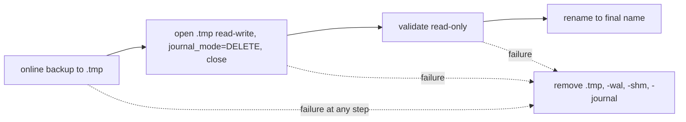
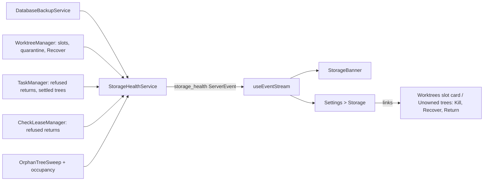

# Reclaim the disk Mission Control does not need

**Status:** Approved on 2026-10-26. The operator approved revision 1, with tickets to be created after this plan merges. Later revisions repair workflow and GitHub Inspector review findings, and Foreman approved each on the operator's behalf, carrying that approval forward.\
**Scope:** `~/.mission-control/backups/database`, worktree pool slots, `worktrees/` and `check-worktrees/`\
**Amends:** `docs/plans/automatic-stale-worktree-cleanup/plan.md` for clean settled task trees only (decision D20)\
**Delivery:** one plan; tickets are sliced from it after it merges

## Goal

A disk audit on 2026-10-26 found about 20 GB under `~/.mission-control` that Mission Control
keeps without needing it, in five problems. After this work:

1. Database backups are bounded by copy counts that are user settings, and every kept copy is a
   valid restore candidate. By default at most 3 hourly, 2 pre-migration and 1 manual copy are
   kept. At today's 452 MB per copy that is about 2.3 GB, which is the operator's "about 2 GB"
   target, stated as 3 hourly plus 2 pre-migration copies. It is about 2.7 GB once a Back up now
   copy exists (D23). Total size grows with the database, since the limit is counts (D1).
2. A backup capture leaves nothing behind but the published copy, on success and on failure.
3. Backups keep their cadence across restarts and sleep, and the app shows when the last one
   happened and when one failed.
4. A slot whose owner has finished is reclaimed or visibly flagged, a process that outlives its
   owner inside a tree is found and can be killed, and a quarantine caused by a stale
   `index.lock` is recoverable from the app.
5. A folder under `worktrees/` or `check-worktrees/` that no live owner references is swept,
   including after a crash or restart.

## What the audit found, and how sure we are

| # | Finding | Basis | Confidence |
| --- | --- | --- | --- |
| 1 | `DATABASE_BACKUP_RETENTION` is hardcoded at 24 scheduled and 10 pre-migration (`src/server/database-backups/service.ts`). Each copy of today's database is 452 MB, so 24 hourly copies hold about 10.4 GB. | Read the code and listed the directory | Verified |
| 2 | `node:sqlite` `backup()` copies the live database's WAL journal mode into the temp file. `validateDatabaseBackupForRestore` then opens it `readOnly`, and a read-only connection cannot clean up its WAL index, so it leaves `.tmp-shm` and `.tmp-wal` behind. Only the main file is renamed. The `VACUUM INTO` pre-migration copy is written in rollback mode and does not leak. | Reproduced on Node 26.10 in a scratch directory | Verified |
| 3 | The operator's daemon runs as `tsx watch src/server/index.ts` under `make start`, so it restarts on every source change in `~/Dev/mission-control`, and its log goes only to that terminal (`daemon.log` was last written on Sep 26). `startDatabaseBackupLoop` waits a full interval after every start. On Oct 25 to 26 the pre-migration copy is at 23:40Z and the first scheduled copy at 00:41Z, one hour later. A Node timer also stops counting while macOS sleeps. Nothing points to failed captures, but no log survives to rule them out. | Process list, backup timestamps, loop code | Inferred, about 80%: restarts reset the timer |
| 4a | The processes inside slots 2 and 7 are `node -e setInterval(() => {}, 1000)` (PIDs 7047 and 36498, parent PID 1, started Oct 5). `test/update-build.test.ts` spawns that exact command `detached`. The child inherits the test's working directory, which is the slot, and is killed only in `t.after`, which never runs when the runner itself is killed. | `lsof -d cwd`, `ps`, test source | Verified that the command matches; inferred which run leaked it |
| 4b | Task `88adcc3b` (slot 7) is `done` and has had a pending `task_worktree_returns` row since it finished. Check `62e0b8f8` (slot 2) is stuck in `returning`. Both retry with backoff (tasks 30 s up to 15 min, checks 60 s up to 1 h) and never give up. The return guard refuses an occupied tree, so **the orphan processes are what blocks both returns**. Nothing records or shows the refusal. | Live rows and the return and occupancy code | Inferred, about 85% |
| 4c | Slot 5 is `quarantined` with "worktree reset failed" because `.git/worktrees/mission-control4/index.lock` existed. The lock is gone now, but nothing un-quarantines a slot: reconcile keeps uncertainty quarantined, and a quarantined slot only offers Destroy. Nothing in `src/` handles `index.lock`. | Live row, `manager.ts` reconcile, slot actions | Verified |
| 4d | Maintenance (`MISSION_WORKTREE_SWEEP_MS`, default 5 min) runs reconcile and check-lease reclamation but never prunes. Safe prune is a button that only takes clean, merged, unleased slots. | Code | Verified |
| 5 | Overflow trees (`WORKTREES_DIR`) are removed only by the task teardown's git arm, and check fallback trees (`CHECK_WORKTREES_DIR`) only by `GitCheckTreeProvider.handBack`. Nothing lists either directory, and nothing in `src/` runs `git worktree prune`. A folder whose row is gone, or whose removal half-failed, stays forever. How the Sep 26 husk was left is not known. | Code | Verified that no sweep exists |
| - | The 30-day retention approved on 2026-08-20 keeps a settled task's worktrees, clean or dirty, after a restart (`src/server/tasks.ts`, "settle and retain"). That contradicts item 5 for task trees. | Code and approved plan | Verified, resolved by D20 |

## Adopted decisions

Every decision below was made by the operator in the shaping interview (four rounds on
2026-10-26). A stale copy of round 3, cut off when Mission Control restarted, came back
dismissed. Round 3 had already been asked again and answered, and those answers are the ones
recorded here.

| ID | Decision | Answer |
| --- | --- | --- |
| D1 | How the backup limit is expressed | Copy counts per kind: **3 hourly and 2 pre-migration** by default |
| D2 | Compression | None. Copies stay plain `.sqlite3` files, so restore is unchanged |
| D3 | Longer-lived tier | None. Hourly plus pre-migration only |
| D4 | Copies above the new limit | Deleted automatically at the next prune |
| D5 | Where status and problems appear | A new **Settings > Storage** section, plus a dashboard warning |
| D6 | A tree whose owner has finished | Reclaimed automatically when clean. A dirty one is flagged, with a one-click discard-and-reclaim |
| D7 | A live owner unchanged for a long time | Flagged after 7 days, never reclaimed automatically |
| D8 | A process that outlives its owner in a tree | Reported (PID, command, start time, tree), with a confirmed Kill button. Reclaim is blocked while it runs |
| D9 | The leak in `test/update-build.test.ts` | Fixed at its source, plus a guard that fails a test file which leaves a detached child alive |
| D10 | A quarantine caused by `index.lock` | A Recover button on any quarantined slot that retries the reset, removing `index.lock` only when no git process uses that worktree. Also retried automatically when the lock is gone or older than 10 minutes |
| D11 | The orphan-folder sweep | Same rule as slots: husks and clean orphans are removed at startup and on the maintenance cadence; dirty ones are flagged |
| D12 | Range of the counts | Hourly 1 to 48, pre-migration 1 to 10. Never 0 |
| D13 | Backup interval | A setting: 1, 3, 6, 12 or 24 hours (default 1) |
| D14 | Back up now | Yes, a button in Settings > Storage |
| D15 | Form of the warning | A dismissible top banner that links to Settings > Storage and returns when a new problem appears |
| D16 | When backups count as a problem | Only when a capture fails. The Storage section always shows the last success |
| D17 | When a refused return is stuck | After 1 hour of refusals, shown with the latest refusal reason and any blocking process |
| D18 | Home of the stale-lease threshold | Settings > Worktrees > Policy |
| D19 | What Kill sends | SIGTERM, then SIGKILL after 5 s if the process is still alive. The kill is refused if the PID's start time or command changed since it was listed |
| D20 | A task tree after a crash, restart or settlement | **Reclaimed at once if clean** (nothing uncommitted, untracked or unpushed). A dirty tree keeps the 30-day window and is flagged with discard-and-reclaim |
| D21 | `git worktree prune` | Yes, but only for registrations whose path is under the state home and no longer exists |
| D22 | Scope of the leaked-child guard | The whole suite, through the test preload |
| D23 | A Back up now copy | Its own `manual` kind. The newest one is kept, outside the hourly limit |
| D24 | Where the fix actions live | On the Worktrees slot card, next to Return and Destroy. Storage lists each problem and links to it |
| D25 | Problems that raise the banner | A failed backup capture, a return refused for over 1 h, a quarantined slot, an orphan process, and an orphan folder kept because it is dirty. A stale live lease is listed in Storage only |

These follow from the decisions above; they were not asked:

- A dirty settled task tree (D20) is listed in Storage but does not raise the banner. It is
  retained by policy, like a stale live lease.
- Overflow and check trees have no slot card, so the Worktrees section gains an
  **Unowned trees** list that carries the same actions (D24).
- Restore stays offline through `npm run recover:database`. The Storage section never restores.
- "Clean" for D6, D11 and D20 means the operator's definition: nothing uncommitted, untracked
  or unpushed, **and no ignored file that cannot be regenerated**.
  - `worktreeReturnBlocker` (`src/server/git/worktree-return-safety.ts`) counts every ignored
    file as work, so any tree with `node_modules` installed would read as dirty and never be
    reclaimed.
  - Treating every ignored file as disposable is also wrong. Gitignored files include workflow
    evidence, which AGENTS.md requires to live in a gitignored location (`.evidence/`,
    `e2e/.artifacts/`), and local config such as `.env`. A routine daemon restart must not
    delete those without a preview.
  - So reclaim and sweep call `worktreeReturnBlocker` with a new `regenerableIgnored` option.
    Ignored paths under the fixed list `REGENERABLE_IGNORED_PATHS` are discounted:
    `node_modules/`, `dist/`, `build/`, `coverage/`, `.cache/`, `.turbo/` and `.next/`, at any
    depth. Any other ignored file still makes the tree dirty, so it is listed and kept: for a
    settled task, within its 30-day window.
  - Kill's guarded return keeps today's stricter check, which counts every ignored file.

## Design

### 1. Bounded, configurable database backups

- A new `backups` entry in `APP_CONFIG_ENTRIES` (class `setting`) with
  `{ scheduledCount: 3, preMigrationCount: 2, intervalHours: 1 }`. The schema enforces D12 and
  D13 and lives in `src/shared/`. `DATABASE_BACKUP_RETENTION` becomes the schema default instead
  of a second source of truth.
- `DatabaseBackupService` reads retention from config when it prunes. Each kind keeps its own
  count; a new `manual` kind (`manual-<timestamp>-<nonce>.sqlite3`, added to `OWNED_BACKUP`)
  keeps exactly 1 (D23).
- `openDb` captures the pre-migration copy before migrations run, so it reads the
  `preMigrationCount` straight from the `app_config` row when that table exists, and falls back
  to the default otherwise. A malformed value falls back rather than blocking startup.
- Prune runs at startup, after every capture, and when the counts are saved (D4). On the
  operator's machine the first run deletes 21 of the 24 hourly copies, about 9.5 GB.
- Prune also deletes any `-wal`, `-shm` or `-journal` file beside a copy it expires.

### 2. Captures that leave nothing behind

- After the online backup, the service opens the temp copy read-write, sets
  `PRAGMA journal_mode=DELETE`, and closes it before validating. Every published copy is then
  one self-contained file, and the read-only validation opens a rollback-mode database that
  creates no sidecars. The `VACUUM INTO` path gets the same check, so both kinds are covered.
- One cleanup helper removes the temp file and its `-wal`, `-shm` and `-journal` siblings. It
  runs in `finally` on both the success and the failure path.
- At startup, before the first capture, the service removes every
  `.database-backup-<32 hex>.tmp` file and its sidecars that it owns in the backup root.
  Startup is the only time no capture is in flight.

### 3. A cadence that survives restarts and sleep, and visible outcomes

- The loop stops timing one full interval from each start. It wakes every 5 minutes (an
  `unref`'d timer) and captures when the newest `scheduled-*` copy on disk is older than
  `intervalHours`, measured by wall clock, and the daemon has been up for at least 5 minutes.
  The 5-minute grace keeps the documented rule that a capture does not compete with startup. A
  restart, a sleep, or a changed interval takes effect at the next wake.
- **A clock that moves backward cannot stall it.** After an NTP correction or an RTC reset, a
  copy can be dated after `now`. The due check ignores any copy dated more than 1 minute in the
  future and measures from the newest copy that is not, so a future-dated copy makes a capture
  due rather than postponing it. Prune sorts such a copy as the oldest, so it is the first one
  expired once newer copies exist. The backoff gate below treats a `lastAttemptAt` in the
  future the same way, as if it were `now`.
- A manual copy neither counts toward the hourly limit nor restarts the interval.
- The service records
  `{ lastAttemptAt, lastSuccessAt, consecutiveFailures, lastFailure: { at, kind, message } }` per
  kind as an `operational` `app_config` value, so status survives the restarts that hid
  problem 3. A success clears that kind's failure and resets `consecutiveFailures` to 0.
- **A failure backs off.** A failed capture publishes no copy, so the due check alone would
  retry a full online backup on every wake. Under a persistent cause, such as ENOSPC on the
  full disk this plan exists for, that is about 12 near-full-size temp writes an hour. So a
  scheduled attempt is also gated on `lastAttemptAt`: after `n` consecutive failures the next
  one waits `min(5 min × 2^(n-1), intervalHours)` from the last attempt. The wait doubles
  from 5 minutes until it would pass the interval, then stays at the interval. At the
  default 1 hour that gives 5, 10, 20, 40, then 60 minutes. At 24 hours it keeps doubling
  through 80, 160, 320, 640 and 1280 minutes before settling at 1440. The gate reads the
  persisted record, so a restart does not reset it. Back up now is an explicit request and is not gated, but its failure counts
  toward the same backoff.
- `POST /api/storage/backups` takes a manual copy through the same single-flight capture.
- A failed capture raises the `backup-failed` problem (D16). Overdue time is shown but never
  raised as a problem.

### 4. Stuck slots, orphan processes and quarantine

- **Refused returns are recorded.** `task_worktree_returns` and `workflow_check_leases` gain
  `first_refused_at INTEGER` and `last_refusal TEXT` (a JSON reason plus any blocking processes),
  added with `addColumn` next to their upgrade path. A successful return clears both. After 1
  hour of refusals the tree raises `stuck-return` (D17).
- **Finished owners (D6, D20).** A completed task already returns its tree. The new rule covers
  a task settled by crash or restart: when every tree it holds is clean
  (`worktreeReturnBlocker` with `regenerableIgnored`), it is
  reclaimed at once through `TaskManager.reclaim()`. Otherwise it keeps the 30-day retention
  and is listed as `dirty-settled-tree`. Discard-and-reclaim goes through the existing
  preview-first Return operation, with an explicit discard consequence where the preview would
  otherwise refuse a dirty tree.
- **Stale live leases (D7, D18).** `WorktreesConfigSchema` gains `staleLeaseDays` (default 7,
  range 1 to 90) in Settings > Worktrees > Policy. A slot whose owner is live but whose
  Git-visible activity (the existing `worktree-activity` probe) has not changed for that long
  is listed as `stale-lease`. It is never reclaimed and never bannered.
- **Orphan processes (D8, D19).** On each maintenance pass, the existing occupancy inspection
  (`ps` plus batched `lsof`) runs over every tree whose owner has finished or is gone: pending
  returns, `returning` check leases, quarantined slots and unreferenced folders. Each process
  found is reported with PID, parent PID, command, start time and tree, as `orphan-process`.
  `POST /api/worktrees/processes/kill` takes `{ path, pid, startedAt, command }`. It may only
  kill a process Mission Control itself reported:
  - It resolves `path` through `realpath` and refuses it unless it equals the tree of an
    `orphan-process` problem in the current storage-health list. That list only ever names
    pool slots and children of `WORKTREES_DIR` and `CHECK_WORKTREES_DIR`, so a request naming
    `$HOME` or any other directory is refused before any process is inspected.
  - That problem must list this `pid` with the same start time and command.
  - It then re-inspects, and refuses if the PID is no longer inside that tree or its start time
    or command differ. Only then does it send SIGTERM, and SIGKILL after 5 s.
  - A successful kill retries that tree's pending return immediately. Reclaim and sweep still
    skip any occupied tree.
- **Recover (D10).** Slot actions gain `recover`, offered on every quarantined slot that no
  live owner references, through the existing preview and execute routes. The preview names
  the lock path, any git process using the worktree, and the discard consequence if the slot
  is dirty. Execute removes `index.lock` from the slot's gitdir (resolved from its `.git` file)
  only when no git process has its working directory in the slot and `lsof` shows no holder of
  the lock. It then runs the existing owner-authorized reset to the pool's requested head, and
  the slot becomes `available`. A quarantine is recognized as lock-caused by git's stable
  "Unable to create '...index.lock': File exists" text in `last_error`, so slot 5's existing row
  qualifies with no migration.
- **Automatic recover (D10).** Each maintenance pass retries a lock-caused quarantine when the
  lock is gone, or when it is older than 10 minutes and the same no-git-process check passes.
  Slot 5 recovers on the first pass.
- **The leak at its source (D9, D22).** The escaped children in `test/update-build.test.ts`
  run with `cwd` set to their temp clone, so even a leaked one can no longer pin a slot. That
  source fix is what prevents the audited case. `test/setup-state.mjs` sets a per-worker
  `MISSION_TEST_LEAK_TAG` of `<worker pid>:<worker start time>` that every descendant inherits.
  Processes carrying a tag are found with `ps -E -ww` on macOS and `/proc/*/environ` on Linux.
  The guard has two halves, because the audited leak happened when the runner itself was
  killed, and a killed worker runs nothing at exit:
  - **At worker exit**, the worker kills every process carrying its own tag, prints each
    one's command, and sets a failing exit code. This catches a test that finishes normally
    but forgets a detached child, including a grandchild already reparented to PID 1.
  - **At worker start**, the preload kills every process carrying a **stale** tag, meaning one
    whose worker PID is gone or now has a different start time, and prints each as leaked by
    an earlier run. This catches the `update-build` case: a runner killed by a timeout or
    SIGKILL whose escaped child survived. A live tag belonging to another concurrent worker
    is never touched. It reports rather than fails, because the leak belongs to the earlier
    run, not to the file now starting.
  - **Outside the test runner**, the daemon's orphan-process report (D8) still finds such a
    process if it sits in a slot. A test that deliberately builds a scrubbed daemon launch
    drops the tag and is not covered; this is the same boundary AGENTS.md already states for
    `openDb`. The preload contract is documented in AGENTS.md, the one place it is written.

### 5. Orphan tree sweep

- An `OrphanTreeSweep` owned by `WorktreeManager` maintenance runs at startup after reconcile
  and on every maintenance pass. It lists the children of `WORKTREES_DIR` and
  `CHECK_WORKTREES_DIR`.
- A child is **referenced** when any `tasks` or `task_repos` row names it as a worktree path
  (any status, so retention still governs terminal tasks), or a `workflow_check_leases` row in
  `held` or `returning` names it as `lease_path`. A referenced child is never touched.
- An unreferenced child is resolved through `realpath` and must stay inside its directory.
  Then:
  - being created: skipped (see below);
  - occupied: skipped, and its processes reported as `orphan-process`;
  - a **husk**, meaning no regular file anywhere under it except git leftovers (a `.git` file
    whose gitdir no longer exists, or empty directories such as the Sep 26 folder's `src/...`
    tree): removed;
  - a clean git worktree (`worktreeReturnBlocker` with `regenerableIgnored`): removed with
    `git worktree remove --force`, and its `harness/*` branch
    is deleted only when that branch is contained in a remote branch;
  - anything else (dirty, untracked or unpushed work, or a folder that is not a valid worktree
    but still holds files, such as a tree whose `.git` file was lost): kept and listed as
    `dirty-orphan-folder`, with discard and remove offered under Worktrees > Unowned trees. The
    sweep never deletes a file it cannot prove is git's own.
- **No race with creation.** Both creation paths make the folder before any row names it: the
  task overflow arm in `dispatcher.ts` runs `git worktree add` and the task row records the path
  later, and `GitCheckTreeProvider.acquire` runs it before `insertHeld`. The sweep closes that
  window two ways:
  - **An in-flight registry.** Each creation path registers its target path in a shared
    in-memory set before `git worktree add` and clears it once its row names the path or its
    unwind removes the tree. The sweep skips every registered path. The check path already
    keeps this kind of pin (`justAcquired`) for its own reaper, and the registry generalizes
    it rather than adding a second mechanism.
  - **An age grace as a backstop.** The sweep also skips any child whose folder, or whose
    `.git` file, was modified in the last 30 minutes. That covers a creation in another
    daemon generation and any path that misses the registry. After a crash nothing is in
    flight, so a half-created tree is swept on the first pass after its grace ends.
- **Scoped `git worktree prune` (D21).** For each source repository Mission Control knows
  (pool repositories and task repositories), it reads `git worktree list --porcelain` and
  removes only the `prunable` registrations whose path is under the state home. It never runs
  an unscoped prune, so the operator's own worktrees elsewhere are untouched.

### Storage health: one aggregate, one event, two views

- `src/shared/storage-health.ts` holds the browser-safe schema: backup status per kind, kept
  copies (kind, time, bytes), the total size, and a list of problems. Each problem has an
  occurrence id, a kind (`backup-failed`, `stuck-return`, `quarantined-slot`, `orphan-process`,
  `dirty-orphan-folder`, `dirty-settled-tree`, `stale-lease`), a `bannered` flag per D25, a
  message, and a link target (a slot id or an unowned tree path). The id names one occurrence,
  not a recurring subject: it joins the subject with the moment that occurrence began, such as
  `backup-failed:scheduled:<first failure at>` or `stuck-return:task:<task id>:<first refused at>`.
  A failure that clears and later recurs therefore gets a new id.
- `StorageHealthService` recomputes after every capture, maintenance pass, sweep and return
  outcome, and publishes a `storage_health` ServerEvent when the result changes. The reconnect
  snapshot carries it, and `useEventStream` handles it exhaustively.
- `GET /api/storage` returns the same aggregate plus the backup config.
  `PUT /api/storage/backups/config` validates with the shared schema through `parseBody` and
  prunes.
- **Settings > Storage** (a new settings category with settings-search entries):
  - a Backups band with the interval select, both counts, Back up now, last success and last
    failure per kind, the total size, and the list of kept copies;
  - a Problems list where each row links to its slot card or Unowned trees row.
- **StorageBanner** appears at the top of the dashboard when any bannered problem id is not
  in the viewer's dismissed set. Dismiss stores the current ids, and every `storage_health`
  event prunes the dismissed set to ids still in the problem list. A new problem, or a cleared
  problem that comes back as a new occurrence, therefore brings the banner back. It links to
  Settings > Storage.
- **Worktrees** gains: a Recover button, orphan-process rows with Kill (behind a confirmation),
  the stuck-return reason, and a `stale` chip on the slot card; `staleLeaseDays` under Policy;
  and the Unowned trees list.

## Acceptance criteria and the tests that pin them

Unit tests live in `test/` (`node:test`, `renderToStaticMarkup` for markup). UI behavior needs
Playwright specs in `e2e/` (AGENTS.md); any new modal calls `expectContentClearsBorder`.

| ID | Criterion | Test |
| --- | --- | --- |
| AC1 | With default config, a capture leaves at most 3 hourly, 2 pre-migration and 1 manual copy, and counts saved in config change what prune keeps | `test/database-backups.test.ts` |
| AC2 | Copies above a lowered limit are deleted at startup, after a capture, and on save | `test/database-backups.test.ts` |
| AC3 | `openDb` keeps `preMigrationCount` copies from stored config, and falls back to the default when `app_config` is missing or malformed | `test/database-backups.test.ts` |
| AC4 | The newest kept copy of each kind passes `verifyDatabaseBackupForRestore`, and each published copy reports `journal_mode=delete` | `test/database-backups.test.ts` |
| AC5 | After a successful capture, and after an injected failure in the online backup, the journal switch, and validation, the backup root holds no `.database-backup-*` file or sidecar | `test/database-backups.test.ts` |
| AC6 | The startup sweep removes leftover temp files and sidecars, and nothing else | `test/database-backups.test.ts` |
| AC7 | A restart 50 minutes after the newest copy captures about 10 minutes later, not 60. A wall-clock jump past the interval captures at the next wake. A backward jump that leaves the newest copy dated 2 hours in the future captures at the next wake, does not capture again on the wake after, and the future-dated copy is the first one pruned; a `lastAttemptAt` in the future does not lengthen the backoff. No capture runs in the first 5 minutes after start | `test/database-backups.test.ts` (loop with injected clock and timers) |
| AC8 | A failed capture is recorded with time and message, survives a restart, raises `backup-failed`, and is cleared by the next success. With an injected persistent failure and clock, scheduled attempts follow `min(5 min × 2^(n-1), intervalHours)` and never come on every 5-minute wake: at a 1-hour interval they are 5, 10, 20, 40, then 60 minutes apart, and at a 24-hour interval 5, 10, 20, 40, 80, 160, 320, 640, 1280, then 1440. A restart mid-backoff keeps the wait, and a success resets it | `test/database-backups.test.ts`, `test/storage-health.test.ts` |
| AC9 | A refused task return and a refused check return record first refusal and reason, become `stuck-return` after 1 h, and clear on success | `test/storage-health.test.ts` plus the task and check-lease tests |
| AC10 | A settled task with only clean trees is reclaimed at once, even when they hold ignored files under `REGENERABLE_IGNORED_PATHS` such as `node_modules/` and `dist/`. One with uncommitted, untracked or unpushed work, or with any other ignored file (for example `.evidence/report.md`, `e2e/.artifacts/` or `.env`), keeps its 30-day window and is listed. The orphan sweep applies the same rule | task retention tests |
| AC11 | A live lease with no Git-visible change for `staleLeaseDays` is listed and never reclaimed | `test/storage-health.test.ts` |
| AC12 | A process inside a finished owner's tree is reported. Kill refuses a changed start time or command, sends SIGTERM then SIGKILL after 5 s, and triggers the pending return. Kill refuses, without signalling anything, a `path` that resolves outside every reported `orphan-process` tree (for example `$HOME` with a real live process's PID, start time and command), a symlink to a reported tree that resolves elsewhere, and a PID the reported problem does not list | worktree operations tests |
| AC13 | Recover removes `index.lock` only when no git process uses the worktree, resets the slot to `available`, and refuses while a live owner references it. The automatic pass recovers a slot whose lock is gone or older than 10 minutes | worktree manager tests |
| AC14 | The sweep removes a husk and a clean unreferenced worktree, keeps and lists a dirty one, skips an occupied one, never touches a referenced one, and never follows a symlink out of its directory. A folder holding any regular file outside git's own leftovers (for example a tree whose `.git` file is gone but whose source files remain) is listed, not removed. A tree caught mid-creation is never removed: one registered as in flight and not yet named by any row, and one younger than the 30-minute grace, both survive a sweep; an unregistered tree older than the grace is swept | `test/orphan-tree-sweep.test.ts` |
| AC15 | Scoped prune removes only missing registrations under the state home | `test/orphan-tree-sweep.test.ts` |
| AC16 | A fixture test file that leaks a detached grandchild and exits normally fails under the preload, and the grandchild is dead afterwards. A fixture runner killed with SIGKILL leaves its tagged grandchild alive; the next worker's preload start kills it and reports it as leaked by an earlier run, while a tagged child of a concurrently live worker survives. `test/update-build.test.ts` passes, and its escaped children run in their temp clone, not the checkout | `test/test-leak-guard.test.ts` |
| AC17 | Settings > Storage shows the backup config, status and kept copies; saving counts round-trips; Back up now adds a manual copy | `e2e/storage.spec.ts` |
| AC18 | The banner appears for a bannered problem, dismisses, stays hidden for the same problems, and returns for a new one. A problem that clears after a dismissal and then recurs, such as a backup that fails, succeeds, then fails again, brings the banner back. A stale lease alone does not raise it | `e2e/storage.spec.ts` |
| AC19 | From a Storage problem link, the slot card offers Recover for a quarantined slot and Kill for an orphan process, and each runs through its preview or confirmation | `e2e/worktree-reclaim.spec.ts` |
| AC20 | A dirty unowned tree under `worktrees/` appears in Worktrees > Unowned trees, and from its Storage problem link too. Its discard-and-remove opens a preview that names the path and the work it discards. Cancel leaves the row and the folder in place. Confirm removes the folder, and the row and the Storage problem disappear after the next `storage_health` event | `e2e/worktree-reclaim.spec.ts` |
| AC21 | A settled task whose tree holds uncommitted work is listed as `dirty-settled-tree`. Its discard-and-reclaim opens the Return preview with the discard consequence stated. Cancel keeps the tree. Confirm reclaims it, and the problem disappears | `e2e/worktree-reclaim.spec.ts` |
| AC22 | `staleLeaseDays` under Worktrees > Policy saves and survives a reload. A leased slot whose fixture activity is older than the saved threshold shows the `stale` chip and a Storage-only problem, with no banner. Raising the threshold above its age removes both | `e2e/worktree-reclaim.spec.ts` |

Every Playwright spec runs against the fake agents (`e2e/fixtures/fake-agents.ts`) and selects by
role, label or placeholder, never `data-testid`. A preview or confirmation that opens as a modal
calls `expectContentClearsBorder`.

## Documentation to update

- `docs/sqlite-database.html#backup` and `docs/database-and-migrations.md`: the new defaults
  and settings, the `manual` kind, wall-clock scheduling, self-contained copies, and where
  status appears.
- `docs/worktrees-and-checks.md`: refused-return visibility, Recover, Kill, the stale
  threshold, the orphan sweep, scoped prune, and the D20 change to settled-task retention.
- `AGENTS.md`: the leak-guard part of the preload contract.

## Expected effect on the audited machine

On the first run after it ships:

- **Backups:** about 9.5 GB freed. Startup prune drops 24 hourly copies to 3.
- **Slot 5:** recovered automatically to `available`, since its lock is already gone.
- **Slots 2 and 7:** each orphan process is reported and its return is flagged as stuck. One
  confirmed Kill per process lets the pending return complete.

A slot returned to `available` still holds its checkout until it is reused or pruned; that is
the pool working as designed, bounded by `maxSlots`.

## Out of scope

- Shrinking `harness.db` itself. `workflow_submissions` holds about 272 MB of the 452 MB.
- Compressing backups, a daily tier, or restoring from the app (D2, D3).
- Automatically pruning `available` slots. Preview safe prune stays a button.
- Any change to the packaged app's log destination.
