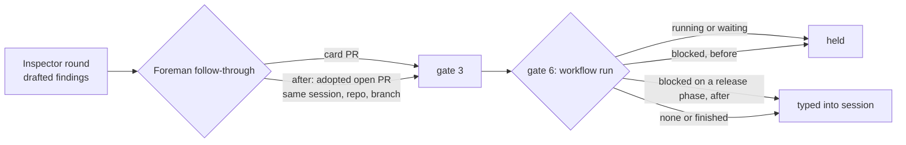

# GitHub Inspector findings that never reach their session

**Status:** Decisions D1 to D4 adopted 2026-11-02 (revision 2). Phased implementation requested.
Fix 1's CodeRabbit note was clarified in review of PR #721.

**Date:** 2026-11-02

**Owner:** Foreman review follow-through (`src/server/foreman/`), GitHub Inspector panel

**Fork feature:** `fork:inspector-findings` (changes an existing fork feature)

## Goal

Every unresolved GitHub Inspector finding on an open pull request reaches the session that owns
that pull request, unless a gate that protects the session (needs you, still working, a live
work queue, a workflow that can still act) holds it. When one is held, the operator can find out
why.

Non-goals:

- Hand-started terminal sessions stay uninvited. Foreman not typing into a personal chat is a
  deliberate rule (`foremanCannotDrive`, `src/server/foreman/review-followup.ts:427`).
- The Shipping veto a blocked workflow gate holds is unchanged. This plan changes who may
  *type into the session*, never who may merge.
- A dispute channel for not-posted findings. The operator's per-PR **Resolve** stays the only
  way to close one the agent disagrees with.

## Evidence

Taken on 2026-11-02 from the live state DB (read-only), the running daemon's
`GET /api/sessions` and every relay message in the session transcripts. The full write-up is
`docs/reports/inspector-dry-run-relay-gaps/report.html` (untracked).

- 41 findings are unresolved, all `drafted` (Inspector is in dry run), on 24 PRs. 16 are on
  open PRs.
- Only 3 were ever typed into a session.
- Foreman is `live` with every affected repository allowlisted, so its dry-run gate is not a
  factor.

| Cause | Findings | On open PRs | Addressed by |
| --- | --- | --- | --- |
| A blocked workflow run still owns the session | 7 | 4 | Fix 1 |
| A session that carried several PRs, now evicted | 11 | 9 | Fix 2 for the future (not recoverable now) |
| The PR detached from its session card | 1 | 1 | Fix 2 |
| Older than the text relay (`63333a6c8`, 2026-10-15) | 12 | 0 | Already fixed |
| Terminal session, never invited | 4 | 2 | Non-goal |
| Undetermined | 3 | 0 | Fix 4 makes the next one diagnosable |
| Delivered, then the PR merged with it still drafted | 3 | 0 | Fix 3 (labelling) |

25 of the 41 are on PRs that have closed. Those rows can never resolve: a drafted row resolves
only when a later round stops raising it (`resolveLocal`, `src/server/inspector/verdict.ts:313`),
and a closed PR gets no more rounds. The ledger keeps them on purpose, as the record of what the
Inspector said (`resolveInspectorFindings` refuses a closed PR, `src/server/db.ts:14470`).

## Fix 1: a blocked run that cannot act no longer silences the follow-through

### Current behavior

`decideReviewFollowup` gate 6 skips with "an active workflow owns this session" whenever
`activeWorkflowOwnsSession` (`review-followup.ts:416`) finds a run that is not `completed`,
`cancelled` or `failed`. `blocked` is deliberately not terminal (`src/shared/workflow.ts:2573`,
`docs/workflows.md` "Blocked runs are recoverable, not terminal"), so a blocked run keeps
the session. It delivers nothing while blocked, because it is waiting on the operator.

The Inspector keeps reviewing every push in the meantime. On PR #13935, the run blocked on
`round_limit` at 10-27 19:34. A minor finding was drafted at 10-28 10:16 and a major one at
10:37, and both have been re-raised for four more rounds since. None reached the session. On
#14030, the finding was drafted 15:29:44 and the run blocked on `unchanged_evidence_exhausted`
at 15:34, without ever sending it.

The plan `docs/plans/workflow-pr-ci-followthrough/plan.md` already names this
("The blocked workflow retained session ownership and sent no recovery instruction, so Foreman
suppressed Inspector follow-through") and defers it as separate work. This is that work.

### Change

Add one predicate beside `activeWorkflowOwnsSession`, used only by the review follow-through:

```ts
/** A run holds the follow-through unless it has stopped where only you or the session can restart it. */
export function workflowHoldsReviewFollowup(
  runs: readonly Pick<WorkflowRunSummary, "status" | "phase" | "round" | "maxRepairRounds">[],
): boolean
```

A run holds the follow-through when it is open (`activeWorkflowOwnsSession([run])`), unless it is
`blocked` and one of these holds (D1):

- it has spent its repair budget (`workflowRunGaveUp`, `src/shared/workflow.ts:2663`), so a
  `round_limit` run that was granted more rounds holds again;
- its phase is `unchanged_evidence_exhausted`;
- its phase is `session_disappeared`.

The release list is an allowlist (`WORKFLOW_FOLLOWUP_RELEASE_PHASES` beside
`WORKFLOW_RUN_SPENT_PHASES`), so a blocked phase added later keeps holding the follow-through
until someone classifies it.

Call sites switch from `activeWorkflowOwnsSession` to the new predicate:

- `src/server/foreman/worker.ts:1050` and `:1114` (the decision and its freshness recheck).
- `src/server/inspector/code-rabbit-delivery.ts:41`, which runs the same decision.

Call sites that stay on `activeWorkflowOwnsSession`, because they ask a different question:
`src/server/registry.ts:5739`, `src/server/routes.ts:6456` and `:7354`, and
`src/server/foreman/worker.ts:1324` and `:1546` (ship recovery and session release).

The freshness recheck already re-reads workflow ownership right before typing
(`worker.ts:1091`). An operator who grants rounds, reattaches or resubmits moves the run out of
`blocked`, so the next decision holds again.

The daemon's inject route has two refusals, and only one of them checks workflow ownership:

- The general Foreman refusal (`foremanWriteRefusal`, `src/server/routes.ts:924`) does not, so
  findings, CI and conflict nudges into a released session go through.
- The CodeRabbit guard does. A nudge that carries a CodeRabbit claim is refused at
  `routes.ts:6456` while any run is open, and that guard stays on `activeWorkflowOwnsSession`.

So the worker also decides with CodeRabbit auto-resolve **off** whenever a session's open runs
are all released (`activeWorkflowOwnsSession(runs) && !workflowHoldsReviewFollowup(runs)`). It
never sends a claim the guard would refuse, and CodeRabbit follow-up keeps waiting for the run,
as it does today. The phased plan's finding 1 has the trace.

### Behavior after

| Run state | Follow-through |
| --- | --- |
| Running, waiting for PR, Inspector, new head or session | Holds (unchanged) |
| Blocked: spent budget, `unchanged_evidence_exhausted` or `session_disappeared` | Released: findings, CI and conflicts are relayed as for an unbound session |
| Blocked, any other phase (`check_cleanup_unresolved`, `stale_capture`, a new phase) | Holds (unchanged) |
| Completed, cancelled, failed | Released (unchanged) |

### Tests

`test/foreman-review-followup.test.ts`:

- Predicate table: one row per run state above, plus a spent `round_limit` run that was granted
  rounds (`round <= maxRepairRounds`), which holds again.
- `decideReviewFollowup` with a blocked `round_limit` run and unresolved findings returns
  `read-findings`, not the gate-6 skip.

`test/foreman-review-followup-relay.test.ts`:

- a pass where the run is released at the first read and back to `waiting_for_new_head` at the
  freshness recheck types nothing;
- a released session's nudge carries no CodeRabbit claim.

`test/code-rabbit-routing.test.ts`: for a session held only by a released blocked run, the
CodeRabbit candidate (`code-rabbit-delivery.ts:41`) comes back without an error. The route still
refuses at `routes.ts:6456`, and nothing is typed or claimed.

## Fix 2: follow the Inspector's adoption when the session card has no PR

### Current behavior

Gate 3 reads `followupPrs(session)` (`review-followup.ts:272`), which comes from the session card.
The card only holds a PR that the current work episode accepts (`acceptPrForEpisode`,
`src/server/registry.ts:4910`). That check rejects a PR created before the episode started, and a
second PR once the episode holds one.

Session `sdk:5e44203f` opened #13934, then #13970 (merged), then went back to #13934's branch in
a new episode. Its card shows `prUrl: null` while the checkout sits on #13934's head branch. The
Inspector still adopts #13934 under that `session_id` and is on round 8.

The episode rule guards task completion and dependency edges, so this plan does not loosen it.

### Change

The review follow-through also considers the Inspector's own adoption, which rests on observed
authorship (`gh pr create` in that session), not on the branch name.

1. The daemon exposes the open adopted rows: `GET /api/inspector/prs?state=open`, served by a
   new `loadOpenInspectorInspections()` in `src/server/db.ts` that reuses `INSPECTION_TALLY_FROM`
   with `WHERE p.state = 'open'`. `loadOpenInspectorPrs` carries no tallies, so it is not reused. The query parameter
   is parsed with a Zod enum (`open`), and anything else is a 400.
2. Move the projection in `Registry.inspectorSummaryForUrl` (`registry.ts:9228`) into a pure
   `inspectorSummaryOf(row, inspectorConfig, codeRabbit)` in `src/shared/inspector.ts`, so the
   registry and the worker build the same `InspectorSummary`. The registry calls it, with no
   change in behavior.
3. A new `reviewFollowupPrs(session, adopted)` in `review-followup.ts` returns `followupPrs(session)`,
   then appends one `FollowupPr` for each adopted open row where all of these hold:
   - `row.sessionId === session.id`
   - `row.repoRoot === session.repoRoot`
   - the key is not already in the list
   - `row.headRefName === session.gitBranch` (D2: the session's current branch only)

   The appended entry carries `inspector` only. `checks`, `mergeable`, `baseRef` and `headSha` are
   null, so only the findings dimension can fire for it. The card's PR keeps its CI and conflict
   dimensions exactly as today.
4. The worker reads the open rows once per follow-through pass (`worker.ts:999`) and calls
   `reviewFollowupPrs` instead of `followupPrs`, both before the findings read and at the freshness
   recheck. A failed read falls back to `followupPrs` alone for that pass and is logged.

`followupPrs` keeps every other caller (ship recovery's `hasTaskOwnedOpenPr`, the session
release check), so this does not move those decisions.

### Tests

`test/foreman-review-followup.test.ts`:

- `reviewFollowupPrs` keeps the card's PR first, appends a matching adopted row, and ignores a
  row for another session, another repository, a duplicate key, or another branch.
- An adopted-only entry with unresolved findings yields `read-findings`. With failing CI on the
  row and no findings, it yields the "nothing to act on" skip.

`test/inspector-findings-route.test.ts` (or the Inspector PR route test): `?state=open` returns
only open rows, and `?state=closed` and `?state=` are 400s.

A registry test pins that `inspectorSummaryOf` produces the same summary the session card
carried before the move.

## Fix 3: a closed PR's leftover findings say they were left at close

### Current behavior

The panel already files a closed PR under **Closed** (`inspectionBucket`,
`src/web/components/InspectorSettingsPanel.tsx:67`). The row still reads "3 findings"
(`inspectionSummary`, `:94`), and the Findings modal lists them the same way it lists live ones.
On a merged PR that reads as work nobody finished, which is part of what prompted this
investigation.

### Change (D3)

The row and modal keep the record and say what it is:

- `inspectionSummary`: a closed row with `openFindings > 0` reads `3 unresolved at merge`, or
  `3 unresolved at close` when it closed without merging.
- `InspectorFindingsModal`: on a closed PR, one line above the list says
  `This pull request merged with 3 findings unresolved. They are kept as a record and will not be reviewed again.`
  (or "closed"). Rows keep their own posted or not-posted label.

No ledger row changes, and `resolveInspectorFindings` still refuses closed PRs.

### Tests

- `test/` unit cases for `inspectionSummary` on merged, closed and open rows.
- `e2e/specs/inspector-findings.spec.ts`: a merged PR with drafted findings shows
  "unresolved at merge" in its row and the record line in the modal. An open PR's row and modal
  are unchanged. The modal is an existing one, so no new `expectContentClearsBorder` call.

## Fix 4: say why a PR's findings are being held

### Current behavior

`if (decision.kind === "skip") continue;` (`worker.ts:1062`) drops the reason, and Foreman logs
only to its own stdout. This investigation had to rebuild every gate from current state.

### Change (D4)

The pass logs a skip once per `(session, prKey, round, reason)` when
that PR has unresolved findings:

`[foreman] <session name>: holding 3 GitHub Inspector finding(s) on owner/repo#123 (round 7) - an active workflow owns this session`

A skip on a PR with no unresolved findings is never logged, and the "still working" and "already
nudged this round" skips are not logged either, since they are the normal waiting states. The
dedupe map lives beside `reviewNudged` and is pruned with it.

### Tests

`test/foreman-review-followup-relay.test.ts`: two passes with the same blocked state log one line,
a new round logs again, and a PR without findings logs nothing.

## Diagram: who can deliver a finding, before and after



## Documentation

- `docs/work-queues.md` "Keeping a PR on track": the workflow stand-down bullet names the blocked
  phases that release it (Fix 1), the session card or Inspector adoption sentence (Fix 2), and the
  held-findings log line (Fix 4).
- `docs/workflows.md` "Blocked runs are recoverable, not terminal": one paragraph saying a blocked
  run on a release phase keeps its Shipping veto but no longer silences Foreman's follow-through.
- `docs/inspector-and-shipping.md`: the closed-PR wording (Fix 3).
- `docs/plans/workflow-pr-ci-followthrough/plan.md` is historical and is not edited.

## Order and merge shape

The four fixes are independent. Fixes 1 and 4 both edit the follow-through loop in `worker.ts`,
so land Fix 1 first. Suggested order: Fix 1, Fix 2, Fix 4, Fix 3. Each is small enough for one
pull request labelled `fork:inspector-findings`, with a "Fork feature changes" section.

## Verification

- Focused tests above, `npm run typecheck`, `npm run lint`.
- Fix 3: `npm run build` and `npm run test:e2e -- inspector-findings`.
- Live check after Fix 1 and Fix 2 are running: PR #13935 (blocked `round_limit`, session
  `sdk:2be86cf6`) and #13934 (session `sdk:5e44203f`) each get one follow-through carrying their
  drafted findings the next time their session settles idle.

## Risks

- **A grant or resubmission races the nudge.** The freshness recheck reads ownership last, but a
  grant that lands after the inject leaves the agent working Foreman's nudge when the run asks
  for a submission. The run's own delivery waits for a settled session, so the two do not
  interleave in one turn. The agent's push is new evidence the run reviews normally.
- **Adoption under a re-minted session id.** `inspector_prs.session_id` is written at adoption.
  A terminal session's id changes on restart, but terminals are uninvited anyway, and SDK ids are
  stable. Not handled further.
- **Spent run plus Foreman nudges forever.** A spent run never resumes, so each new Inspector
  round re-arms the relay. That is the same cadence an unbound session gets today: once per
  round, only when settled idle.

## Adopted decisions

Submitted 2026-11-02 through the dashboard decision form on revision 1.

- **D1.** Blocked runs on a spent budget, `unchanged_evidence_exhausted` or `session_disappeared`
  stop holding the follow-through. Rejected: spent budget only, every blocked run, and an
  operator-only "Send findings to session" action.
- **D2.** Fix 2 relays an adopted PR only when its head branch is the session's current branch.
  Rejected: any adopted PR with a checkout step, and skipping Fix 2.
- **D3.** A closed PR's leftover findings read "N unresolved at merge" (or "at close"), with one
  record line in the Findings modal and no ledger change. Rejected: no change.
- **D4.** One Foreman log line per session, PR, round and reason. Rejected: also a Foreman errors
  entry, and no change.
- **Follow-up.** Create a phased implementation plan.
