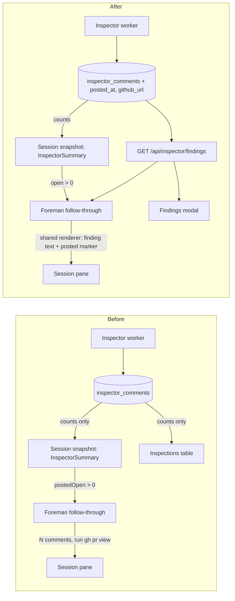

# GitHub Inspector findings: relay them to the session and show them to the operator

**Status:** Approved 2026-10-13. Tickets are filed in a follow-up task after this plan merges.
The decisions from three interview rounds and the plan review are recorded below.

**Date:** 2026-10-13

**Owner:** GitHub Inspector (daemon), Foreman review follow-through, Settings dashboard

**Fork feature:** `fork:inspector-findings`, new (see [Fork feature tracking](#fork-feature-tracking))

## Goals

1. A session can act on GitHub Inspector findings as soon as a review round produces them, in
   both Live and Dry run mode.
2. The operator can read every finding the Inspector generated for a pull request, and see
   whether each one was posted to GitHub.

## Current state

Checked against the code at `0ce9e004`.

### How findings reach a session

- **Workflow-owned sessions** get every unresolved finding, dry-run drafts included, through
  the Inspector final gate's `inspector_feedback` packet:
  - `src/server/workflows/manager.ts` loads `loadInspectorComments(prKey)` minus the resolved
    rows.
  - `renderInspectorFeedback` (`src/server/workflows/feedback.ts`) renders each finding's
    severity, title, location, body and fingerprint.
  - The packet is clipped mid-text at 4 KB per field and 8 KB overall (`WORKFLOW_LIMITS`).
- **Every other session** hears about findings only through Foreman's review follow-through
  (`src/server/foreman/review-followup.ts`):
  - It triggers on `inspector.postedOpen > 0`, so a dry-run draft never triggers it.
  - Its payload says "GitHub Inspector left N unresolved review comments" and points at
    `gh pr view <url> --comments`. A draft is not on GitHub, so the agent has nowhere to read it.
- **Foreman can't read findings at all.** Its worker talks to the daemon over HTTP only
  (`src/server/foreman/client.ts`) and never touches SQLite. No daemon route returns a pull
  request's individual findings. The only route that carries finding rows is
  `GET /api/workflow-runs/:id`, and only for runs that have an Inspector gate.

### What the operator can see

- **Settings → GitHub Inspector → Inspections** (`InspectorSettingsPanel.tsx`) lists per-PR
  counts from `GET /api/inspector/prs`: a finding count, a closed count, the last review time and
  a PR-level **Resolve**. Its footer says the table "is the only place GitHub Inspector's
  findings exist" in dry run, yet it shows no finding text.
- **Finding text** is visible only in a gated workflow run's Completion tab (`CompletionPane` in
  `src/web/workflows/WorkflowRuns.tsx`), as an inline table.

### What the ledger records

- `inspector_comments` (`src/server/db.ts`) holds one row per `(pr_key, fingerprint)`. Rows are
  never deleted, and a finding raised again reuses its row.
- `status` is one of `drafted | posting | open | resolved`:
  - `open` means confirmed on GitHub.
  - `drafted` means never posted: dry run, a repository not on the allowlist, or a review
    GitHub refused.
  - Once a row is `resolved`, nothing records whether it was ever posted.
- No GitHub comment URL is stored. `postReview` returns nothing by design, and each tick finds
  threads again by the marker in their first comment (`ourThreads`).
- One upsert, `upsertInspectorComment`, is the only statement that writes a row, and
  `test/inspector-resolution-writer.test.ts` pins that.

### A related bug this plan also fixes

After a switch from dry run to live, `reviewNeedsLiveRerun` forces a re-review of the same head.
The review prompt then misleads the model:

- It lists every unresolved row, drafted ones included, under "Issues you raised earlier that
  are still open" (`worker.ts:925`, `prompt.ts:207`).
- It tells the model that such an issue "is already on the pull request, and repeating it posts
  a duplicate".
- The planner would post a draft that the model raised again (`verdict.ts:212`), but the prompt
  tells the model not to raise it.

From reading the code, drafted findings most likely stay unposted for good. This is about 90%
confidence and inferred, not observed. Phase 4 starts by reproducing it.

## Constraints

- The Inspector worker does not type into sessions. Relaying stays with Foreman or the workflow.
- The workflow Inspector gate, Shipping and YOLO mode keep their current behavior. This plan
  changes the text of the `inspector_feedback` packet (D-14). It does not change when the gate
  fires, what it blocks, or how it delivers.
- Foreman never touches SQLite. The daemon stays the only database writer.
- No GitHub call is added to an ordinary tick.

## Decisions

The human settled these in three rounds. Each answer is recorded as given.

### Round 1

| ID | Question | Answer |
| --- | --- | --- |
| D-1 | Which gates does the relay keep? | All of them. "Dry run" in goal 1 is the Inspector's mode. Foreman still types only in Live mode on an allowlisted repo, into a session that is settled-idle, invited and drivable, with no work queue and no active workflow. |
| D-2 | How does the finding text reach the session? | Inline in the typed message, size-capped, rendered by one shared renderer used by both the workflow `inspector_feedback` packet and Foreman's relay. No separate Foreman template. |
| D-3 | Which findings trigger a relay? | Every unresolved finding (`drafted`, `posting`, `open`), each marked posted or not posted. |
| D-4 | What does a later round carry? | The full current unresolved set, at most once per Inspector round. |
| D-5 | Which setting controls it? | The existing "Keep sessions on track with review comments" toggle (`trackReviewFeedback`). Only its copy changes. |
| D-6 | How is "posted" recorded? | A nullable `posted_at` column. `status` keeps its four values. |
| D-7 | What do legacy rows show? | Whatever the row proves. Anything else shows "unknown". |
| D-8 | Where does the operator open findings? | A **Findings** control on each Inspections row, which opens a modal. |
| D-9 | Is the view reachable from the session too? | No, Settings only. The session's ⌕ chip keeps opening the PR. |
| D-10 | Does a posted finding link to GitHub? | Yes. Store the comment URL and link to it. |
| D-11 | Can one finding be resolved on its own? | No. Resolve stays per PR, and the view is read-only. |
| D-12 | Is the drafted-to-live bug in scope? | Yes, as its own phase. The phase starts with an end-to-end reproduction: a dry-run round drafts findings, the config switches to live, the forced re-review runs, and the drafts stay unposted. Then comes the fix, then a `node:test` regression test in `test/`. |

### Round 2

| ID | Question | Answer |
| --- | --- | --- |
| D-13 | What is the shared renderer? | The findings section, extracted into one pure function that both packets call. Each packet keeps its own header and closing steps. |
| D-14 | What changes in the workflow packet? | It gains a posted marker per finding. Past the size cap it drops whole findings and states how many, instead of clipping mid-text. |
| D-15 | How do Foreman and the modal read findings? | Through one new route, `GET /api/inspector/findings?pr=<prKey>`. |
| D-16 | What if Foreman's read fails? | Foreman holds and retries on the next pass. The round is not recorded as relayed. |
| D-17 | How is the comment URL captured? | From the PR snapshot that is already read every tick. A demoted finding links to the review that carried it. |
| D-18 | How does a switch to live post drafts? | Deterministically, through the planner's checks: the path must still be in the diff, the line is snapped, and the per-round cap applies. The prompt stops calling drafts "already on the pull request". A GitHub refusal is recorded on the row. After a bounded number of refusals the draft stops being retried and shows as not posted, with the reason. The refusal path is covered in the regression test. |
| D-19 | Does the modal share the Completion tab's table? | Yes. One findings table is extracted and used by both. |
| D-20 | What is the fork label? | `fork:inspector-findings`, "GitHub Inspector findings relay and view". |

### Round 3

| ID | Question | Answer |
| --- | --- | --- |
| D-21 | How is a refused review attributed? | If the refused review carried earlier drafts, it is retried once straight away without them. Those drafts get a refusal recorded, with GitHub's reason, only if the retry is accepted. Whole-review failures, such as rate limits or auth errors, never count against a row. |
| D-22 | After how many refusals does a draft stop? | 3. |
| D-23 | How does a session dispute a draft? | There is no new channel. The relay asks the agent to fix each finding, or to say which ones it disagrees with and why. The operator's per-PR Resolve closes them. |

### Plan review

| ID | Question | Answer |
| --- | --- | --- |
| D-24 | Keep the `legacy_posted` column that D-6 and D-7 together require? | Yes, keep `legacy_posted`. |
| D-25 | Which phase order? | 1, then 2 and 3 in parallel, then 4. |
| D-26 | Is the plan approved as written? | Yes. |
| D-27 | What happens after approval? | Create tickets after the plan merges. |

## How the flows change



```mermaid
sequenceDiagram
  participant W as Inspector worker (live round)
  participant G as GitHub
  W->>W: plan new findings + carried drafts
  W->>G: POST review (new + carried)
  alt accepted
    W->>W: rows -> open, stamp posted_at
  else refused, review carried drafts
    W->>G: POST review (new findings only)
    alt retry accepted
      W->>W: new -> open; each carried draft post_refusals + 1, last_post_error
    else retry refused
      W->>W: today's failure path, no refusal counted on any row
    end
  end
```

## Design

### 1. Ledger: posted state and GitHub link

New columns, each added in `migrate()` with `addColumn` and never in the `CREATE TABLE` block:

| Column | Type | Written by | Meaning |
| --- | --- | --- | --- |
| `posted_at` | INTEGER, nullable, no default | worker | When this build confirmed the finding on GitHub |
| `github_url` | TEXT, nullable | worker tick | The finding's GitHub comment, or for a finding demoted to the review body, the review that carried it |
| `legacy_posted` | TEXT, nullable | one-time backfill only | `posted`, `unposted` or `unknown` for a row that predates `posted_at`. NULL on every row this build creates. |

**Why `legacy_posted` exists.** Under D-6 and D-7, an old resolved row needs three possible
answers: posted, not posted, or unknown. A NULL `posted_at` can only carry one of them.

- If NULL meant both "never posted" and "unknown", the panel would say a finding was never
  posted when it was.
- The codebase's rule for legacy rows is that NULL stays truthful (`body` is the precedent).
  Inventing a `posted_at` time for a backfilled row would break that rule.
- The column carries no time and is written once. The upsert never names it, so
  `ON CONFLICT DO UPDATE` leaves it as it is.

**Backfill.** It runs once, inside
`if (addColumn(d, "inspector_comments", "legacy_posted", "TEXT"))`, the same shape as
`backfillBacklogRank`:

- `posted`: status `open`, or `replies > 0`, or `answered_comment_id IS NOT NULL`. Replies only
  exist on a GitHub thread.
- `unposted`: status `drafted`.
- `unknown`: everything else, meaning a resolved row with no replies, or a row left in
  `posting`.

**Stamping `posted_at`.**

- Stamped when an accepted review promotes its rows from `posting` to `open`, after
  `postReview`.
- Stamped when `reconcilePosting` finds a `posting` row published.
- Never cleared. A row that is resolved and later raised again keeps its earlier `posted_at`
  until the new post is confirmed and re-stamps it.
- The worker's row builder carries `postedAt` and `githubUrl` forward from the prior row, as it
  already does for `replies` and `createdAt`. `closeRow` and `resolveInspectorFindings` carry
  them through `...row`.

**Capturing `github_url`** (D-17).

- Add `url` to the comment nodes of both thread queries in `src/server/inspector/github.ts`
  (the first page and the pagination query), and to the review nodes the snapshot already
  reads. This adds no call.
- `ourThreads` returns each thread's first-comment `url`.
- After reconciliation, each tick writes `github_url` on every row whose marker thread it sees
  and whose stored URL is missing or different.
- A demoted finding (`line IS NULL`, posted in the review body) takes the URL of our review whose
  body carries `BODY_ONLY_FINDINGS_MARKER` and the round header for that row's round. Ownership
  follows the same `isOurs` rule as threads.
- Until a tick sees it, a posted row has no URL, and the view says "Posted" without a link.

**One derivation.** A browser-safe function in `src/shared/inspector-findings.ts`:

```ts
findingPublication(row): {
  state: "posted" | "posting" | "not-posted" | "refused" | "unknown";
  url: string | null;
  postedAt: number | null;
  reason: string | null;    // GitHub's refusal, when state is "refused"
  earlierPost: boolean;     // a drafted row whose earlier version was posted
}
```

Rules, first match wins:

1. `status = posting` gives `posting`.
2. `status = drafted` gives `refused` when `post_refusals >= 3` (phase 4), and `not-posted`
   otherwise. `earlierPost` is set when `posted_at` is set or `legacy_posted = posted`.
3. `status = open` gives `posted`.
4. `status = resolved` gives `posted` when `posted_at` is set or `legacy_posted = posted`,
   `unknown` when `legacy_posted = unknown`, and `not-posted` otherwise.

Missing fields, as in an older frozen snapshot, read as `unknown`. The renderer, the route's
clients and the table all call this function, and none of them re-derives it.

### 2. The read route

`GET /api/inspector/findings?pr=<prKey>`, next to `GET /api/inspector/prs` in
`src/server/routes.ts`.

- The key travels as a query parameter, not a path segment, because a `prKey` looks like
  `owner/repo#123`.
- The route answers `400` when `pr` is missing or is not a valid key shape, and `404` when no
  `inspector_prs` row has that key.
- The response is `{ pr: InspectorInspection, findings: InspectorComment[] }`, with the new
  fields and every status.
- Findings come back unresolved first, then by severity, path, line and fingerprint. That is the
  renderer's comparator, shared rather than copied.
- The response schema lives in `src/shared/protocol.ts`, so Foreman and the web client parse the
  same shape.
- New client calls: `client.inspectorFindings(prKey)` for Foreman, and
  `fetchInspectorFindings(prKey)` in `src/web/lib/api.ts` for the web.
- The route is read-only. No write path changes.

### 3. The shared findings renderer (D-13, D-14)

The findings section moves out of `renderInspectorFeedback` into a pure module,
`src/server/inspector/findings-text.ts`. It imports nothing that touches the database or the
network, so Foreman's worker can load it.

```ts
renderInspectorFindings(
  findings: InspectorComment[],
  opts: { budgetBytes: number },
): { text: string; shown: number; omitted: number; truncated: boolean }
```

- It keeps today's dedupe by fingerprint and today's sort (severity, path, line, fingerprint).
- Each finding renders as it does today, plus one line from `findingPublication`:

  ```
  ## MAJOR - Title
  Location: src/a.ts:12
  Posted on GitHub: https://github.com/o/r/pull/7#discussion_r123
  <body>
  Fingerprint: <fp>
  ```

- The posted line reads one of:
  - `Posted on GitHub: <url>`
  - `Posted on GitHub (link not captured yet)`
  - `Posted on GitHub in the review summary: <url>`
  - `Not posted on GitHub. This message is the only copy.`
  - `Not posted. GitHub refused it 3 times: <reason>`
  - `Being posted now`
- Fields still clip at `feedbackFieldBytes`.
- Past `budgetBytes`, whole findings are dropped from the tail, lowest severity first, and a
  closing line says how many: "N more unresolved findings are not listed here, to keep this
  message short. They stay open and come back in the next relay."
- `renderInspectorFeedback` keeps its header (goal, workflow, run, PR, pinned head, round and
  posture) and its `finalizePacket` closing. It calls the new function with whatever budget is
  left under `feedbackPayloadBytes` after them. `failedPersonaCount` stays the total, not the
  number shown.
- An already-prepared delivery keeps the payload and hash it was frozen with, and nothing renders
  it again. Only packets prepared after the change carry the new text.

### 4. Foreman's relay (D-1 to D-5, D-16, D-23)

**`review-followup.ts`.**

- `feedbackState` now triggers on `pr.inspector.open > 0` instead of `postedOpen > 0`. `open`
  already counts `drafted`, `posting` and `open` rows (`INSPECTION_TALLY_FROM`).
- Every gate in `decideReviewFollowup` stays, in the same order.
- The mark stays keyed on the Inspector round, so the relay goes out at most once per round and
  carries the full unresolved set.
- `decideReviewFollowup` stays zero-I/O. A `nudge` that includes findings now says so, and the
  worker builds the payload after it reads the findings.

**`worker.ts` (`runReviewFollowup`).**

- After it re-reads config and sessions, and only for a nudge that includes findings, the worker
  calls `client.inspectorFindings(prKey)`.
- If the read fails, the worker logs it, does not stamp the mark, and types nothing. The next
  pass tries again.
- If the unresolved set comes back empty, because findings resolved between the snapshot and the
  read, the findings part is dropped. When nothing else is open, the pass skips without stamping.

**`buildPayload(pr, fb, findings)`.**

- First line: "PR #7 needs follow-through: GitHub Inspector has 3 unresolved findings on it (1
  posted on GitHub, 2 not posted)."
- The steps keep the "do NOT open a new pull request" line and the multi-repo qualifiers.
- The findings step becomes: "Address every GitHub Inspector finding listed below. A finding
  marked Not posted exists only in this message: do not look for it on GitHub or reply to it
  there. If you think a posted finding is wrong, you may answer in its GitHub thread. If you
  disagree with a finding that was not posted, say which one and why in your reply." The
  `gh pr view --comments` pointer is removed.
- The CI and conflict steps don't change, followed by "Commit and push" and the watch line.
- The findings section is `renderInspectorFindings(findings, { budgetBytes })`, appended after
  the steps. Its budget is whatever is left under the same 8,000-byte ceiling
  (`WORKFLOW_LIMITS.feedbackPayloadBytes`).

**Foreman popover copy.** The toggle reads "Keep sessions on track with GitHub Inspector
findings", with the hint "Relays every unresolved finding, including dry-run drafts that were
never posted." The setting key `trackReviewFeedback` does not change.

### 5. The Findings modal and the shared table (D-8 to D-11, D-19)

**The shared table.**

- The Completion tab's inline findings table moves into
  `src/web/components/InspectorFindingsTable.tsx`. Its helpers (`inspectorFindingSeverityStatus`,
  `inspectorFindingStatusStatus`, `inspectorFindingLocation` and `inspectorFindingBody`) move out
  of `run-model.ts` to sit beside it.
- `CompletionPane` renders the shared table. Its caption and empty-state copy stay with the
  caller.
- The table gains a **Posted** column, driven by `findingPublication`:
  - "Posted", linking to `github_url` on GitHub.
  - "Posted" with no link, while the URL is not captured yet.
  - "Not posted".
  - "Refused", with the reason in a tooltip and in the detail row.
  - "Posting".
  - "Unknown", with the tooltip "Recorded before Mission Control tracked posting".
- The body rule stays as it is: an unresolved finding's body is always shown, and a resolved
  one's opens with **Show finding**.

**Settings → GitHub Inspector → Inspections.**

- Each row's action cell gets a **Findings** button next to Resolve, with the label
  `View GitHub Inspector's findings on owner/repo#N`.
- The button appears on every row with at least one finding, open or closed. A row with none
  shows no button.

**The modal.**

- It is an `Overlay className="modal inspector-findings-modal"` with the heading "GitHub
  Inspector findings", the PR link and its state, and the round count.
- It shows a mode line, "Dry run: nothing on this pull request was posted", when the PR's review
  posture was not live.
- The shared table sits inside a `.modal-bleed` band, with a **Close** button in `.modal-foot`.
- It fetches when it opens, and refreshes on `useInspector`'s 4-second tick while it stays open.
- It is read-only, with no Resolve inside it.

**Footer copy.** The table footer becomes "In dry run nothing is posted to GitHub. Open a pull
request's Findings to read what GitHub Inspector found."

### 6. Posting drafts after a switch to live (D-12, D-18, D-21, D-22)

Phase 4 runs in this order.

**Reproduction first.** It is a `node:test` integration test that drives the real worker with
the fake `gh` and the fake model runner the existing `test/inspector-*.test.ts` integration files
use, so it spends no model tokens.

1. In dry run, one round drafts two findings.
2. The config switches to live, on an allowlisted repository.
3. The next tick forces a re-review of the same head. Following the prompt, the fake model raises
   nothing new and resolves nothing.
4. The test asserts what happened to the drafted rows, and whether a review was posted.

Phase 4 commits the reproduction as a failing test and attaches its run output to the PR. If it
shows the drafts do get posted, the 90% reading was wrong. In that case the phase records that,
keeps the test as a regression guard, and ships only the prompt wording change below.

**Fix.**

- **Prompt** (`prompt.ts`). The open list splits in two:
  - Posted rows (`open`, `posting`) keep today's heading and text.
  - Drafted rows get their own section: "Found earlier but never posted. If this push fixes one,
    put its fingerprint in `resolved`. Otherwise say nothing: Mission Control posts it."
- **Planner** (`planReview` in `verdict.ts`). In a live round, a drafted row becomes a carried
  candidate when all of these hold:
  - the model neither resolved it nor raised it again;
  - its path is still in this diff, and its line snaps with `snapToLine`;
  - its `post_refusals` is below 3.

  Carried candidates go through the same scrub, severity sort and `maxCommentsPerRound` cap.
  At equal severity, new findings come first. A draft whose path has left the diff stays drafted
  and is not posted. A draft the model raises again counts as a new finding, as it does today,
  and the refusal cap does not apply to it.
- **Worker.** When `postReview` is refused (`wasRefused`) and the review carried drafts, the
  worker retries once straight away without them. The retry is re-planned, so the review body
  and the over-cap note match what it carries.
  - **Retry accepted.** The new findings go to `open`. Each carried draft gets
    `post_refusals + 1` and `last_post_error`, scrubbed and clipped to 300 bytes like other
    GitHub errors.
  - **Retry also refused.** No row records a refusal, and today's failure path runs.
  - **Response lost** (`outcomeUnknown`). Today's `posting` reconciliation runs. A lost response
    never counts as a refusal.
- **New columns**, added in `migrate()`: `post_refusals INTEGER NOT NULL DEFAULT 0` and
  `last_post_error TEXT`. Both are written through `upsertInspectorComment` and carried forward
  like `replies`.
- **Refused state.** `findingPublication` returns `refused` at 3 refusals. A refused draft stays
  unresolved, so it still blocks Shipping and YOLO, and Foreman still relays it, marked "Not
  posted. GitHub refused it 3 times: <reason>". The operator's per-PR Resolve closes it.

**Regression tests** (`node:test`, in `test/`):

- The reproduction, now passing: after the switch, the drafted findings are posted and stamped
  with `posted_at`.
- A refused review that carried drafts, with the retry accepted: each carried draft gets one
  refusal and the reason, and the new findings are `open`.
- A refused review whose retry is also refused: no row counts a refusal.
- A draft at 3 refusals is not offered, and a draft whose path has left the diff is not posted.
- The prompt lists drafted rows in their own section.

## Phases

| Phase | Scope | Depends on |
| --- | --- | --- |
| 1. Ledger and read route | `posted_at`, `github_url`, `legacy_posted` and its backfill; URL capture from the snapshot; `findingPublication`; `GET /api/inspector/findings`; the Foreman and web client calls | none |
| 2. Shared renderer and Foreman relay | `findings-text.ts`; `renderInspectorFeedback` rewired; the relay trigger and payload; the worker's read-and-hold; the popover copy | 1 |
| 3. Findings modal and shared table | `InspectorFindingsTable`; the Completion tab rewired; the Findings button and modal; the footer copy | 1 |
| 4. Drafts after a switch to live | Reproduction; the prompt split; the planner carry; the retry without carried drafts; the refusal columns; the `refused` state; regression tests | 1, then 3 |

Phase 1 lands first. Phases 2 and 3 can run in parallel after it: they touch different files,
and both read `findingPublication` from phase 1. Phase 4 needs phase 1's stamping. It also
extends `findingPublication` and the phase 3 spec, so it lands after phase 3 to keep two branches
from editing the same spec.

### Tests and verification per phase

Each phase meets the repository's definition of done: relevant tests, `npm run typecheck`,
`npm run lint`, and, where UI or runtime code changes, `npm run build`, `npm run smoke` and
`npm run test:e2e`.

- **Phase 1.**
  - Migration on a database created before the columns existed, including backfill rules for
    every legacy status.
  - `posted_at` stamped at both confirmation points and carried through resolution.
  - URL capture from a snapshot fixture, for an inline finding and a demoted one.
  - The route's `400`, `404` and `200` cases.
  - `findingPublication`'s rule table.
  - `test/inspector-resolution-writer.test.ts` still passes, so there is still one writer.
- **Phase 2.**
  - Renderer tests: every posted marker, the byte budget, whole-finding drops and the omitted
    count.
  - `test/workflow-inspector-feedback.test.ts` updated for the new packet text.
  - `test/foreman-review-followup.test.ts`: a draft now triggers; the payload carries finding
    text and no `gh pr view` pointer; a failed read holds without stamping; every existing gate
    still refuses.
  - The popover copy change updates the Foreman pull-request spec in
    `e2e/specs/dispatch-and-converse.spec.ts`.
- **Phase 3.**
  - A new `e2e/specs/inspector-findings.spec.ts`. It seeds `inspector_prs` and
    `inspector_comments` the way `inspector-resolve-findings.spec.ts` does, with five rows: a
    posted finding with a link, a posted one without a link, a draft, a resolved posted finding,
    and a legacy unknown row.
  - The spec opens the modal by its accessible label, asserts every Posted cell and every body
    that should be visible, and calls `expectContentClearsBorder`.
  - `e2e/specs/workflow-completion-pane.spec.ts` asserts the Posted column on its drafted
    finding.
- **Phase 4.** The regression tests above, and the phase 3 spec extended with a refused row.

## Docs to update

- `docs/inspector-and-shipping.md`:
  - The Dry run section says where to read drafts.
  - A new "Reading a pull request's findings" section.
  - How drafts get posted after a switch to live, and the refusal cap.
- `docs/work-queues.md`, in "Keeping a PR on track":
  - the control's new name;
  - the bullet that says the review half "counts only GitHub Inspector findings already posted
    on the PR" is replaced;
  - the relay now carries finding text.
- `docs/workflows.md`: the `inspector_feedback` paragraph mentions posted markers and
  whole-finding truncation.

## Risks

- **Message length in a terminal pane.** The ceiling stays at 8,000 bytes, which the workflow
  already types into panes today.
- **Workflow packet idempotency.** Before changing the text, phase 2 checks that nothing renders
  a stored packet again and compares hashes (`transitionInspectorFindingsWithDelivery`, restart
  recovery). If something does, the renderer change must leave a stored delivery's text alone.
- **Links for demoted findings.** These links depend on matching our review's round header and
  marker. A finding that does not match still reads "Posted", without a link.
- **Posting an already-fixed draft.** Deterministic posting could post a draft that a later push
  already fixed, if the model didn't name it as resolved. Two things reduce this: the model sees
  drafts in their own section with an explicit instruction to resolve them, and the planner only
  carries a draft whose path is still in the diff. This risk is accepted.
- **One extra request on refusal.** The retry adds at most one more POST, and only for a refused
  review that carried drafts.

## Out of scope

- Opening the findings view from the session (D-9).
- Resolving a single finding (D-11).
- A way to dispute a draft (D-23).
- Any change to when the workflow gate fires, or to Shipping or YOLO.
- Storing the conversation text of review threads.

## Fork feature tracking

The first implementation PR creates the `fork:inspector-findings` label and the tracking issue
"Fork feature: GitHub Inspector findings relay and view", under the repository's standing grant.
This is the draft body:

### Intent

Relay every unresolved GitHub Inspector finding to a Foreman-driven session as text, in both dry
run and live, and let the operator read every finding for a pull request with whether it was
posted.

### Behavior contracts

- Foreman's review follow-through triggers on any unresolved finding, carries the finding text,
  and marks each one as posted or not posted. All of its existing gates still hold.
- Foreman's relay and the workflow `inspector_feedback` packet render findings through one shared
  renderer.
- `inspector_comments` records `posted_at` and `github_url`. A finding that was posted and later
  resolved still reads as posted.
- Settings → GitHub Inspector → Inspections opens a read-only Findings modal for each pull
  request.
- After a switch to live, drafted findings are posted. A draft GitHub refuses three times, with
  the refusal pinned on it, stops being offered.

### Upstream behavior it assumes

- `inspector_comments.status` keeps its four values.
- A single upsert writes every row.
- The per-tick PR snapshot reads review threads and reviews.
- `decideReviewFollowup` stays zero-I/O.

### Upstream surfaces touched

- `src/server/db.ts` (`inspector_comments` columns)
- `src/server/inspector/github.ts`, `worker.ts`, `verdict.ts` and `prompt.ts`
- `src/server/workflows/feedback.ts`
- `src/server/foreman/review-followup.ts`, `worker.ts` and `client.ts`
- `src/server/routes.ts` (`GET /api/inspector/findings`)
- `src/shared/protocol.ts` and `src/shared/types.ts`
- `InspectorSettingsPanel.tsx`
- `WorkflowRuns.tsx` (`CompletionPane`)
- the Foreman popover in `ForemanBar.tsx`

### Fork-only files

- `src/shared/inspector-findings.ts`
- `src/server/inspector/findings-text.ts`
- `src/web/components/InspectorFindingsTable.tsx`
- `e2e/specs/inspector-findings.spec.ts`

### Plan docs

`docs/plans/inspector-findings/plan.md`

### Upstream candidate

Yes. Nothing here is fork-specific.

**Related features.** This work shares `review-followup.ts` with `fork:pr-merge-conflict-reactions`
(#299) and touches the PR snapshot query that `fork:sso-free-github-calls` (#398) governs. It
changes neither feature's contracts.
