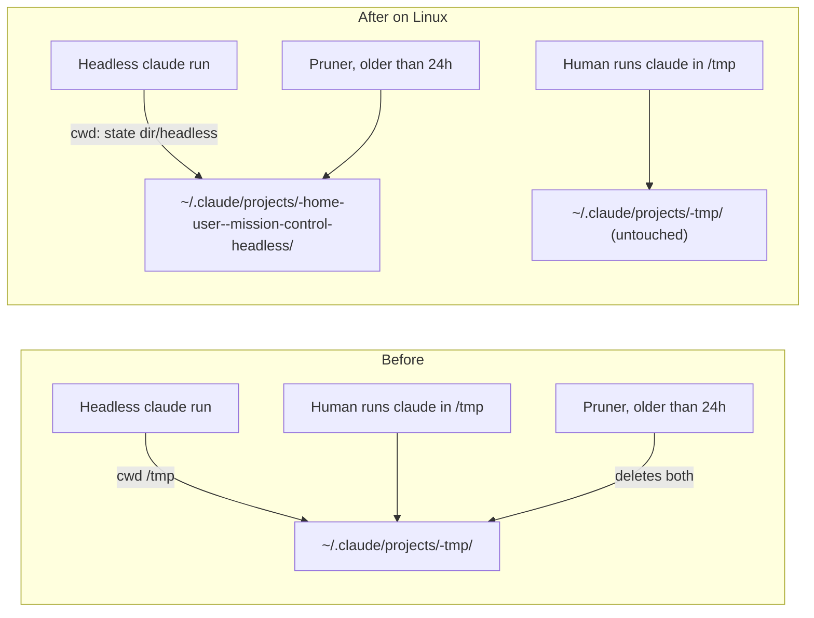
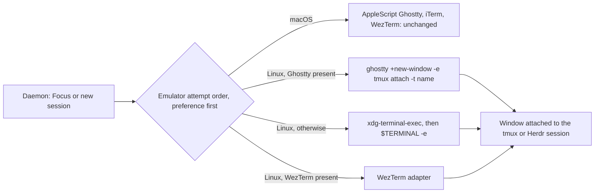
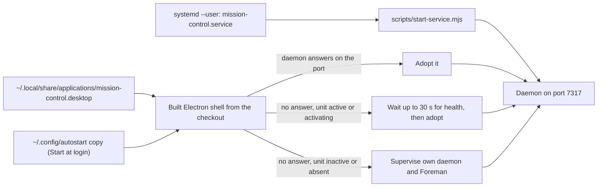

# Linux readiness: remove Mission Control's macOS assumptions

Status: approved 2026-10-12 after a three-round interview with the human (decisions D1 to D22
below) and a plan review that approved it as written. Follow-up chosen in the review: Create
tickets after the plan merges, so Mission Control slices it into tickets in a linked follow-up
task once this plan's pull request merges. Amended the same day in plan-validation repair
round 1 (R1 to R5), repair round 2 (R6 to R11) and repair round 3 (R12 to R14), all below.
Not implemented.

## Goal

Mission Control was built and run on macOS. Its operator now runs it on Linux. This plan
records every place the repository assumes macOS, what each one does on Linux, and how each
gets fixed, so that **Linux is a first-class platform with no silent breakage** (D1): every
feature either works on Linux or is hidden or labeled as unavailable there, and nothing
appears to work and then fails.

macOS behavior does not change (D3). Linux is added as rows in the existing platform seams, or
as explicit platform branches where no seam exists, and every Linux branch has a twin unit
test pinning the macOS result (D22).

## Where things stand (verified 2026-10-12 on `main` at `b030421d`)

**The operator's machine.** Arch Linux x86_64, KDE Plasma on Wayland, zsh, Node 26 through
mise, Claude Code at `/opt/claude-code/bin/claude`. Installed: Ghostty 1.3.1, tmux, a running
Herdr server, `xdg-open`, `systemd-inhibit`, `notify-send`, `wl-copy`, `lsof`. Not installed:
WezTerm. Mission Control runs as `make start` (daemon, Vite, Foreman and Electron under
electronmon) from `~/Dev/mission-control`; the daemon reports v1.26.0 on port 7317.

**The platform seams.** Fork feature #422 ("Platform seams") put process inspection
(`src/server/process-inspection/`), process lifetime (`src/server/platform/process-lifetime.ts`),
the executable environment (`src/server/platform/executable-environment.ts`) and native addon
sources (`scripts/native-addon-sources.mjs`) behind one per-platform map each. Every map is
empty, so Linux resolves to the POSIX row, which was written on and for macOS. A Linux row
plugs in there. #422's contract says "each seam's platform-selection map is empty", so any
ticket that adds a Linux row also changes #422 (see [Fork tracking](#fork-tracking)).

**Already Linux-aware, not to be re-fixed.**

- Process groups and tree kills (`process-lifetime.ts`); `ps` flags on procps-ng 4.0.7; TTY
  matching of `pts/N`; check identity from `/proc` (`src/server/workflows/check-identity.ts`);
  evidence images verified through `/proc/self/fd` (`src/server/workflows/images.ts`).
- The state-lock addon builds and loads on Linux (`flock`, `renameat2`, `linkat`).
- tmux and Herdr adapters. Herdr explicitly allows Linux (`src/server/terminal/herdr.ts:22-28`).
- Resume guard and leases: `LC_ALL=C`, uid, mode and symlink checks
  (`src/server/terminal/resume-lease.ts:44-60`).
- The browser open target uses `xdg-settings`, `gtk-launch` and `xdg-open`
  (`src/server/open-targets/browser.ts:116-167`).
- Symlinked temp dirs: every comparison is `realpath`-based; nothing hardcodes `/private`.
- The archive watcher falls back from recursive watch; the conductor tail tolerates a zero
  birth time.
- Keep Awake reports "unavailable" with a reason instead of failing, and its native build is
  skipped on Linux.
- The interrupt shortcut (⌃C) already yields to a text selection, so Ctrl+C still copies on
  Linux (`src/web/lib/keybindings.ts:352,732`).
- Electron: every menu accelerator is `CmdOrCtrl`; `shell.openExternal`, notifications,
  single-instance reveal and the integrations installer work.
- Paths: state lives in `~/.mission-control`; temp files use `os.tmpdir()`; nothing writes to
  `~/Library`.
- CI runs unit, build-smoke and e2e on `ubuntu-latest`; Electron renderer and geometry tests
  run there under `xvfb-run -a` with `--no-sandbox`.
- Shipped `skills/`, `hooks/`, `integrations/`, `personas/` and `actions/` contain no BSD-only
  shell flags or macOS paths.

## Decisions

| ID | Question | Decision | Round |
|---|---|---|---|
| D1 | Standard Linux is held to | First-class, no silent breakage: a Linux implementation where a standard freedesktop equivalent exists, otherwise hidden or labeled unavailable | 1 |
| D2 | Target environments | Generic freedesktop/systemd (XDG dirs, `xdg-open`, D-Bus, `systemd-inhibit`), verified manually on Arch KDE Wayland; CI covers ubuntu | 1 |
| D3 | Protecting macOS | macOS unchanged; Linux added as seam rows or explicit platform branches; tests pin both platforms | 1 |
| D4 | Fork ledger | New fork feature `fork:linux-support` with its own tracking issue | 1 |
| D5 | Windows | Leave the door open (use the seams), do no Windows work | 1 |
| D6 | Plan shape | One plan; findings grouped by subsystem; fixes ordered by severity tier | 1 |
| D7 | Install on Linux | The source checkout is the Linux install; no packaged Linux app. `install-service` gains a systemd `--user` unit; "Start at login" writes XDG autostart; `make install`, `make app`, `make install-app`, the updater and `recover-database` refuse Linux with a clear "macOS packaged app only" message. Updating is `git pull` | 2 |
| D8 | ⌘ shortcuts on Linux | The `cmd` token means the platform primary modifier: Command on macOS, Ctrl elsewhere. Keycaps show "Ctrl" off macOS. Stored bindings keep working | 2 |
| D9 | Focus and "open a terminal" on Linux | A spawn-only Linux Ghostty adapter plus a generic `xdg-terminal-exec` / `$TERMINAL` fallback. iTerm, cmux and AppleScript Ghostty are marked macOS-only. Per R2, iTerm and cmux are marked through `unsupportedReason`. AppleScript Ghostty is macOS-only because it is the macOS adapter, and Ghostty itself stays supported on Linux through the spawn adapter | 2 |
| D10 | Keep Awake on Linux | A `systemd-inhibit --what=idle:sleep` child tied to the daemon's lifetime, behind the existing provider interface | 2 |
| D11 | Electron window on Linux | Native window-manager frame; auto-hidden menu bar (Alt reveals) with a Linux menu template; the traffic-light inset is removed | 2 |
| D12 | Setup remedies on Linux | Instruction rows, no one-click install. macOS-only rows (iTerm2, cask installs) are hidden. The install allowlist is unchanged | 2 |
| D13 | Platform-neutral defects (headless cwd, deny list, `/tmp` ownership) | Fix everywhere when the macOS effect is identical; Linux-only otherwise | 2 |
| D14 | `lsof` | Declare it as a Linux prerequisite (Setup row, `make init` check), fix the `(readlink: Permission denied)` parse bug, and switch Makefile targets from `lsof` to probing `/api/health` | 2 |
| D15 | Tray-less desktops | An Integrations button in Settings; on Linux, closing the window quits unless a tray host is detected | 2 |
| D16 | Linux CI coverage | Un-skip the real-shell e2e specs on Linux under `xvfb-run`; install tmux in the unit shards; platform-pinned unit tests for every new Linux branch. A Linux Keep Awake e2e was not chosen | 2 |
| D17 | Docs | Inline Linux notes in each doc, plus one platform-support matrix in `docs/setup.md`; one AGENTS.md sentence on the sanctioned Linux test setup | 2 |
| D18 | Fixes made without a separate decision | Confirmed as listed in [Fix groups](#fix-groups) (marked "default fix") | 2 |
| D19 | Desktop shell outside development | A built (non-dev) shell launched from a `.desktop` entry that a new Make target installs. "Start at login" toggles an XDG autostart copy of that entry. Updating is `git pull && make build` | 3 |
| D20 | "Reset checkout" (⌃R) on Linux | No default binding off macOS; it stays in the session's action menu and can be bound in Keyboard settings | 3 |
| D21 | Existing `~/.claude/projects/-tmp/` transcripts | Leave them alone; stop pruning `-tmp` on Linux; docs say old headless transcripts can be removed by hand | 3 |
| D22 | Verifying "macOS unchanged" | Injected-platform unit tests on ubuntu CI only; no Mac and no macOS CI shard | 3 |

### Repair round 1 clarifications

These come from the plan-validation review on 2026-10-12. None changes a human decision.

| ID | Issue | Resolution |
|---|---|---|
| R1 | F5 expected a Setup row reading "macOS only" for iTerm2 on Linux, while D12 and F6 hide it | The rule now follows D12. Setup omits rows for a backend unsupported on the platform (F6). Terminal pickers keep their existing disabled-with-reason display (F5). DOC9 is about the troubleshooting doc entry, not the Setup row |
| R2 | No group owned Linux detection of an installed Ghostty (TM2), and F5 put `unsupportedReason` on Ghostty, which would have disabled its own Linux adapter | F5 owns the detection: a bare `ghostty` candidate with PATH search on Linux, and macOS unchanged. Ghostty gets no `unsupportedReason`; iTerm and cmux do |
| R3 | F4 (T1) named F12's (T3) un-skipped spec as its test | F12 lands first, ahead of its tier. A spec blocked only by an F4 defect keeps a Linux skip that names F4, and F4 removes it |
| R4 | F7's systemd unit (T2) shipped before F10's (T3) cgroup escape, so a unit restart could kill every agent | The `systemd-run --user --scope` wrapper moves from F10 into F7 and ships with the unit |
| R5 | F4 (T1) needs PNGs that only the F11 (T4) `gen-icons` fix can render | The `gen-icons` Linux fix (I7) moves from F11 into F4 |

### Repair round 2 clarifications

These come from the second plan-validation review on 2026-10-12. The packet arrived truncated
partway through its fourth requested change, so R9's scope beyond the visible text, and R10 and
R11, come from the judge's summary. None changes a human decision.

| ID | Issue | Resolution |
|---|---|---|
| R6 | The daemon's display environment under the systemd unit was unspecified, so Focus could work after `enable --now` and fail after a reboot | F7: `WantedBy=default.target`; a Linux `graphicalSessionEnv()` reads the user manager's environment at each GUI spawn; a named no-display error; logout and linger behavior stated; manual Focus check after a fresh login |
| R7 | The shell's supervise branch could race the unit at login | F7: on Linux the shell asks `systemctl --user is-active` before supervising and waits to adopt an activating unit; state-lock contention exits 75, which the unit does not restart on and the shell answers by adopting; manual checks for supervise-alone and exactly one daemon at login |
| R8 | Makefile kill paths had no PID source once `lsof` went away | F10: daemon PIDs come from `/api/health`'s `pid` and the existing `pkill` patterns; Vite keeps `lsof` with an explicit message when it is missing; one manual check per target |
| R9 | The moved state root had no single resolver, refusal behavior or upgrade path | F2: one `agentRuntimeRoot()` with an env override the daemon hands every child; fail-closed refusal with a named message; dual write to an owned legacy capability root while it exists |
| R10 | The tray-host probe mechanism was unspecified | F8: `busctl --user ... NameHasOwner org.kde.StatusNotifierWatcher`, at startup and on each close; any failure counts as no tray |
| R11 | F1's headless cwd might fall inside an F2 deny rule | F1's cwd is never an Inspector cwd. Checking found a real interaction instead: pooled worktrees live in the state dir. F2's Linux state-dir rule excludes `worktree-pools`, macOS stays unchanged, and the existing macOS effect is recorded as S13 |

### Repair round 3 clarifications

These come from the third plan-validation review on 2026-10-12. The packet arrived truncated
inside its third requested change; the visible text was enough to act on. None changes a human
decision.

| ID | Issue | Resolution |
|---|---|---|
| R12 | R7's exit 75 and the `MainPID` check assumed the unit's main process is the daemon, with no citation | Cited: `scripts/start-service.mjs` imports the daemon into its own process after a child native build, so its exit status reaches systemd directly and its pid is `MainPID`. Nothing changes |
| R13 | `graphicalSessionEnv()` preferred the daemon's own display, which goes stale under the unit after re-login or with linger | Under the unit the manager's environment comes first; outside it the daemon's own does. The variables come as one set from a single source, and a source whose display socket is gone is skipped, so the named error fires. Tests cover a stale own display |
| R14 | GUI programs the daemon spawns directly (terminal raises, `xdg-open`) stayed in the unit's cgroup, so a restart closed them | F7's scope wrapper now covers every `graphicalSessionEnv()` spawn as well as the tmux and Herdr servers. The restart check now includes a Focus-opened terminal window and an open-target browser |

## Severity tiers

| Tier | Meaning |
|---|---|
| T1 | Harm or daily breakage: data loss, a security control that does nothing, or a core interaction that does not work |
| T2 | A feature that is missing or broken on Linux |
| T3 | Degraded: works on the operator's box, fails on a minimal or differently configured Linux |
| T4 | Cosmetic copy, styling and documentation |

## Findings by subsystem

Each finding names its location at `b030421d`, what it assumes, what happens on Linux, its
tier, and the fix group that resolves it.

### Server runtime (`src/server/`, `src/shared/`)

| # | Location | macOS assumption | On Linux | Tier | Fix |
|---|---|---|---|---|---|
| S1 | `src/server/claude-cli.ts:74`, `src/server/goal/prune.ts:10-30` | `HEADLESS_CWD = tmpdir()`, and "`$TMPDIR` is normally unset for an interactive shell, so a real session's cwd is a repo" | `tmpdir()` is the shared `/tmp`. The pruner deletes every `*.jsonl` older than 24h in `~/.claude/projects/-tmp/` (302 entries on this box), including sessions the human started from `/tmp` | T1 | F1 |
| S2 | `src/server/llm/codex.ts:363`, `src/server/llm/codex-sdk.ts:54`, `src/server/harness/pi/model-catalog.ts:277` | One-shot model runs use the temp dir as cwd | `/tmp` is world-writable, so a planted `/tmp/AGENTS.md` can inject instructions | T1 | F1 |
| S3 | `src/server/inspector/worker.ts:309-312` | Deny rules `//Users/*/.aws/**`, `.ssh`, `.claude`, `.mission-control` | Homes are `/home/<user>`, so the four rules match nothing. `~/.claude/.credentials.json` holds the OAuth token in plaintext on Linux, and `**/credentials*` does not match a dot-prefixed name | T1 | F2 |
| S4 | `src/server/agent-subprocess-env.ts:35,88,94,154,231`, `src/shared/harness-runtime.mjs:208,232`, `src/server/scouts/submission-auth.ts:94,124` | `mkdirSync(join(tmpdir(), ...), {mode: 0o700})` accepts an existing directory owned by anyone | `/tmp` is shared: another local user who pre-creates the root can swap the launch wrapper or read the loopback token. Arch also ages `/tmp` out after 10 days | T1 | F2 |
| S5 | `src/server/keep-awake.ts:109-131,216` | Only darwin gets a provider (IOKit); the command seam passes caffeinate's `-i -w <pid>` | Keep Awake is permanently unavailable | T2 | F9 |
| S6 | `src/server/process-inspection/posix.ts:139,156,193`, `src/server/executables/catalog.ts:124-126` | `lsof` is always present | `lsof` is not in Arch `base`. Without it, worktree occupancy is "unknown", so release and cleanup are refused indefinitely, and Codex rollout attribution is lost. No Setup row declares it | T3 | F10 |
| S7 | `src/server/process-inspection/posix.ts:144-150` | Every `n` record from `lsof` is a path | For same-user unreadable processes `lsof` prints `n/proc/<pid>/cwd (readlink: Permission denied)` with exit 0, which is stored as a cwd and fails open | T3 | F10 |
| S8 | `src/server/process-inspection/posix.ts:95-96,171,188`, `src/server/discovery/processes.ts:191-194` | `ps lstart` parsed with `Date.parse` and no `LC_ALL=C` | A non-English `LC_TIME` yields start time 0 and launch verification fails | T3 | F10 |
| S9 | `src/server/platform/executable-environment.ts:34,49-59` | One POSIX row: `/Applications`, `/opt/homebrew/*`, and `/bin/zsh` when `SHELL` is unset | Under systemd or a launcher without `SHELL`, the login-shell PATH read tries zsh, which may not exist. No linuxbrew, nix, snap, cargo or bun dirs | T3 | F10 |
| S10 | `src/server/terminal/*` (multiplexer server spawn) | A detached, `setsid` process outlives its launcher | systemd kills by cgroup. This box's Herdr server lives in a Ghostty surface scope, so closing that terminal, or stopping a future systemd unit, can kill the server and every agent in it | T3 | F7 |
| S11 | `src/server/discovery/processes.ts:47-52` | Wrapper list includes `caffeinate` and `gtimeout` | No `systemd-run`, `systemd-inhibit`, `setsid`, `flatpak-spawn`; native matching still finds the agent | T4 | F11 |
| S13 | `src/server/inspector/worker.ts:309-312`, `src/server/config.ts:26` | The `//Users/*/.mission-control/**` deny rule covers the whole state dir | The default worktree pool lives inside the state dir, so on **macOS** the Inspector is denied the files of a pooled worktree it reviews. This is a macOS observation; Linux avoids it through F2's carve-out (R11) | n/a | Out of scope (macOS unchanged, D3) |
| S12 | `src/server/keep-awake.ts:73`, `src/server/index.ts:924-926`, `src/shared/update-copy.ts:26-59`, `src/server/open-targets/browser.ts:168-171`, `src/server/discovery/tty.ts:10` | Copy and comments say "this Mac", "Dock", "personal Applications folder", "desktop build is macOS-only", "ttysNNN" | Misleading text | T4 | F11 |

### Terminals (`src/server/terminal/`, `src/shared/terminal.ts`)

| # | Location | macOS assumption | On Linux | Tier | Fix |
|---|---|---|---|---|---|
| TM1 | `src/shared/terminal.ts:45`; `src/server/terminal/ghostty.ts:222-223`, `iterm.ts:238-239`, `cmux.ts:700-705` | `EMULATOR_IDS = ["wezterm","ghostty","iterm"]`; Ghostty, iTerm and cmux are driven through `/usr/bin/osascript` | WezTerm is the only emulator that can open a window. With tmux or Herdr and no WezTerm, `targets.ts:137-148` reports "sessions open detached - install a terminal that can show one". Dispatch still works detached; Focus, raise and the new-session launcher do not | T2 | F5 |
| TM2 | `src/server/executables/catalog.ts:92-111`, `src/server/terminal/bin.ts:107,179,182` | Exclusion relies on `.app` candidate paths; no `unsupportedReason` (compare `herdr.ts:24-28`) | Setup lists the installed Ghostty as "missing" and offers `brew install --cask ghostty`; iTerm and cmux read "not installed" instead of "macOS only". Setting `GHOSTTY_BIN` makes every call fail on a missing `osascript` | T2 | F5 |
| TM3 | `src/server/terminal/home.ts:313-314` | The dispatch error suggests "tmux, herdr, cmux, wezterm, ghostty, iterm" | Recommends backends that cannot work | T4 | F5 |
| TM4 | `src/server/terminal/wezterm-socket.ts:52-66` | `link(path, alias)` follows a symlink (Darwin) | Linux `link()` does not. If WezTerm reports its `default-<class>` symlink, the alias is not a socket and WezTerm silently goes unavailable. Unverified: WezTerm is not installed on this box | T3 | F10 |
| TM5 | `src/server/setup/service.ts:45` | cmux services offered with no platform gate | Only reachable if cmux were installed; fails on `osascript` | T4 | F5 |

### Electron shell (`src/main/`, `src/preload/`, `build/`)

| # | Location | macOS assumption | On Linux | Tier | Fix |
|---|---|---|---|---|---|
| E1 | `src/main/window.ts:104-105` | `titleBarStyle: "hidden"` plus `trafficLightPosition` | Per Electron's docs, "hidden" without `titleBarOverlay` is a frameless window on Linux with no close, minimize or maximize buttons | T1 | F4 |
| E2 | `src/web/styles.css:3891-3894`, `src/main/startup-page.ts:32`, `src/web/main.tsx:15-17` | An 84px (108px on the startup page) left inset for traffic lights; `is-desktop` does not know the OS | Wasted space, and the drag region assumes no native title bar | T1 | F4 |
| E3 | `src/main/menu-template.ts:119-139,159` | macOS app menu roles (`about`, `services`, `hide`, `hideOthers`, `unhide`) and `windowMenu` with `zoom` | Inert items; the menu bar is not drawn at all for a frameless window | T2 | F4 |
| E4 | `src/main/tray.ts:34,50`, `build/tray-icon.svg` | `setTemplateImage(true)` recolors a black glyph; `tray.setTitle(" N")` shows the needs-you count | A black icon on a dark panel; no count beside the icon (`setTitle` is darwin-only) | T2 | F4 |
| E5 | `src/main/window.ts` (no `icon:`), `build/icon.icns` only | The `.app` bundle supplies the icon | Generic Electron icon in the task switcher | T4 | F4 |
| E6 | `src/main/tray.ts:59-64` | "Start at login" via `app.setLoginItemSettings` | darwin and win32 only: the checkbox is always unchecked and clicking does nothing | T2 | F7 |
| E7 | `src/main/index.ts:278-280`, `src/main/window.ts:172-177`, `src/main/tray.ts:65` | Closing hides the window to a tray that always exists; "Install Claude integrations" lives only in the tray menu | On a desktop with no StatusNotifier host (stock GNOME) the hidden window can only be reopened by launching a second instance, and integrations install is unreachable. KDE is fine | T2 | F8 |
| E8 | `src/main/startup-handover.ts:69-71,130-135`, `src/main/bundle-version.ts:37-43`, `src/main/install-identity.ts:30-63`, `src/main/migration-integration-ports.ts:39,65-72` | `.app` bundle layout, `Info.plist`, `/usr/bin/open`, `/Applications` | Only reachable from a packaged app, which Linux will not have (D7) | n/a | F7 (guard) |

### Install, service, update and build tooling (`scripts/`, `Makefile`, `package.json`, `electron-builder.yml`, `native/`)

| # | Location | macOS assumption | On Linux | Tier | Fix |
|---|---|---|---|---|---|
| I1 | `package.json:51`, `electron-builder.yml:69-99`, `Makefile:39,107,112`, `scripts/install-app.mjs:168,527,647-649,1131-1133,1230`, `scripts/init-prerequisites.mjs:24-29`, `scripts/install.sh:6-9` | `electron-builder --mac`, arm64 only, `release/mac-arm64/Mission Control.app` | `make install`, `make app` and `make install-app` fail partway with "Install it on an arm64 Mac" or an `hdiutil` error; `make help` lists them with no caveat | T2 | F7 |
| I2 | `scripts/install-service.mjs:12-15,28-95` | launchd plist and `launchctl` | Exits 1: "adapt it to a systemd user unit" | T2 | F7 |
| I3 | `src/main/updater.ts:625-644,1382`, `scripts/apply-update.mjs:331-335`, `scripts/app-bundle-swap.mjs` | Packaged `.app`, Apple silicon, `open` relaunch | Disabled with a reason in dev mode today; unreachable without packaging | n/a | F7 (guard) |
| I4 | `scripts/recover-database.mjs:373-458,728-730` | Managed-install receipt, `PlistBuddy`, `osascript`, `open` | Refuses: "supported only on macOS" | T2 | F7 (guard) |
| I5 | `Makefile:47,71,88,94` | `lsof -ti tcp:PORT` | Without `lsof`: `make status` says "not running", `make up` reports a false bind failure, `make claude` restarts a live daemon, `make stop-all` leaves Vite up | T3 | F10 |
| I6 | `scripts/init.mjs:88-96`, `scripts/init-prerequisites.mjs:33,62-69` | Toolchain check only where Keep Awake compiles (darwin); "Xcode command line tools" wording | The required state-lock addon compiles on Linux too. With no C++ toolchain, `make init` prints "✓ Xcode command line tools available", `node-gyp` fails with a warning, and the daemon later refuses to start | T3 | F10 |
| I7 | `scripts/gen-icons.mjs:6,36,60` | `iconutil`; "brew install librsvg" | Throws after the iconset, leaves `build/icon.iconset/` behind, never renders tray PNGs | T4 | F4 |
| I8 | `scripts/demo/launch.mjs:646-647` | Opens the browser only on darwin | Prints the URL only | T4 | F11 |
| I9 | `scripts/lib.mjs:9` | `which` exists | Not in Arch `base`; `worktree-setup.mjs` silently skips `npm ci` | T3 | F10 |

### Web UI (`src/web/`)

| # | Location | macOS assumption | On Linux | Tier | Fix |
|---|---|---|---|---|---|
| W1 | `src/web/lib/keybindings.ts:163,218,450-465` | `chordFromEvent` maps `metaKey` to `cmd`; ⌘K and ⌘F are defaults | Settings search and find-in-conversation only answer **Super**+K and Super+F, which KDE and GNOME take | T1 | F3 |
| W2 | `src/web/lib/card-shortcuts.ts:103-105`, `src/shared/protocol.ts:3531-3538`, `src/web/lib/keybindings.ts:557-561` | 12 card jumps on ⌘1 to ⌘=, reserved and on by default | Super+1..9 launch apps (GNOME) or switch taskbar entries (KDE); cannot be rebound; every card still shows a ⌘ keycap | T1 | F3 |
| W3 | `src/main/menu-template.ts:47-53,111-117`, `src/web/App.tsx:2493-2495` | Releasing `CommandOrControl+0/-/=` hands the keys to the page's ⌘ handlers | The menu gives up Ctrl+0/-/= while the page listens for Super: zoom does nothing on Fleet | T1 | F3 |
| W4 | `src/web/lib/keybindings.ts:395`, `src/web/App.tsx:3529-3535,4493`, `src/main/menu-template.ts:146-147` | "Reset checkout" on ⌃R, distinct from reload on ⌘R | Once `cmd` means Ctrl, a destructive action shares Ctrl+R with reload | T1 | F3 |
| W5 | `src/web/lib/keybindings.ts:496-509,726`, `src/web/lib/context-actions.ts:275,299`, `src/web/components/KeyboardPanel.tsx:196`, `src/web/lib/board-card.ts:82`, `src/web/App.tsx:4028-4029`, `src/web/lib/settings-search.ts:231-232` | Keycaps always draw ⌘ ⌃ ⌥; copy says "⌘V", "Settings (⌘,)", "needs ⌘ or ⌃" | Linux users read Mac glyphs for keys they do not have | T1 | F3 |
| W6 | `src/web/components/KeepAwakeControl.tsx:31,33,207` | "Keep this Mac awake" | Mac copy on a permanently disabled switch | T4 | F9 |
| W7 | `src/web/components/ProductIssueModal.tsx:568-571` | "Open this report in the Mission Control desktop app" | Becomes true once the Linux desktop entry exists (D19); no change needed beyond F7 | n/a | F7 |
| W8 | `src/web/styles.css:105` | `ui-monospace, "SF Mono", "JetBrains Mono", Menlo, monospace` | Falls through to whatever `monospace` is | T4 | F11 |
| W9 | `src/web/lib/format.ts:254-263` | `shortenCwd` only shortens `/Users/<name>` | `/home/<user>` paths show in full in the console and conductor | T4 | F11 |
| W10 | `src/web/components/WorkflowLibrary.tsx:836-841` | Redo is only Ctrl+Shift+Z | Ctrl+Y, the usual Linux redo, does nothing | T4 | F11 |

### Setup (`src/shared/setup-catalog.ts`, `src/server/setup/`)

| # | Location | macOS assumption | On Linux | Tier | Fix |
|---|---|---|---|---|---|
| U1 | `src/shared/setup-catalog.ts:274,298,310,322,378,402`, `src/server/setup/install.ts:29-50` | Remedies are `brew install [--cask]`; the grammar allows only `brew` and `npm` | "Run in a terminal" runs `brew install ...` and exits 127; casks do not exist on Linux; the iTerm2 row is shown at all | T2 | F6 |
| U2 | `src/server/setup/index.ts:135`, `src/server/task-sources/jira.ts:105,684,695,1442` | "(requires Homebrew)", `brew install ankitpokhrel/jira-cli/jira-cli` | Wrong guidance | T4 | F6 |
| U3 | `src/shared/setup-catalog.ts:555`, `src/server/environment/claude-hooks.ts:242` | "press Install Claude integrations in Settings" | There is no such button in Settings on any platform | T2 | F8 |

### Tests and CI (`test/`, `e2e/`, `.github/`)

| # | Location | macOS assumption | On Linux | Tier | Fix |
|---|---|---|---|---|---|
| C1 | `e2e/specs/desktop-startup.spec.ts:10`, `e2e/specs/product-issue-preload.spec.ts:13` | "the desktop shell requires the macOS GUI" | Nothing boots the real Electron main process on Linux, which is how the operator runs it | T3 | F12 |
| C2 | `.github/actions/run-unit-shard/action.yml` (no tmux), `.github/workflows/ci.yml:630-631` (e2e only) | tmux is present | 13 real-tmux cases in `test/tmux-kill.test.ts` and one in `test/inject-prompt-submit.test.ts` may skip silently | T3 | F12 |
| C3 | `test/keybindings.test.ts:131,144`, `test/card-shortcuts.test.ts:49-52`, `test/app-menu-template.test.ts:124-145`, e2e `press("Meta+k")` (26), `Meta+f` (15), `Meta+1` (7) | ⌘ is Meta | Pass only because headless Chromium has no window manager; they pin the defect W1 to W3 | T1 | F3 |
| C4 | `test/init-prerequisites.test.ts:77-84` | "Xcode toolchain only where a native build happens", justified by Keep Awake | Pins the wrong rationale behind I6 | T3 | F10 |
| C5 | `e2e/specs/setup-*.spec.ts`, `test/setup-catalog.test.ts:18`, `test/setup-install-argv.test.ts:60-82` | Setup remedies are brew | CI asserts the brew output on Linux | T2 | F6 |

### Docs and agent guidance

| # | Location | Problem | Tier | Fix |
|---|---|---|---|---|
| DOC1 | `README.md:3-16,140-144,353-366` | Install is "macOS app (Apple Silicon)" only; terminal list has no platform caveat | T4 | F13 |
| DOC2 | `CONTRIBUTING.md:20-25,61,65,70-74,95-96` | No Linux prerequisites; "Electron geometry checks on macOS" | T4 | F13 |
| DOC3 | `AGENTS.md:139` | "Do not ... add Chromium flags" contradicts the Linux `--no-sandbox` every Electron test uses; nothing says `xvfb-run -a` when there is no display | T4 | F13 |
| DOC4 | `docs/setup.md:12-131` | No Linux prerequisites; brew remedies; iTerm2 row unqualified | T4 | F13 |
| DOC5 | `docs/overview.md:152-163,264-279`, `docs/configuration.md:199,276,286,293` | Always-on is launchd only; no Linux notes for `make desktop` | T4 | F13 |
| DOC6 | `docs/desktop-and-packaging.md:3` | "or as a macOS Electron app" | T4 | F13 |
| DOC7 | `docs/harnesses-and-terminals.md:18,48,169-195,263,369` | Says Linux shares the POSIX row without saying it is macOS-shaped; Focus on Linux needs WezTerm | T4 | F13 |
| DOC8 | `docs/ui.md:304-312,1572,1606-1645` | ⌘K and ⌘1 to ⌘= described as the app's in the desktop app | T4 | F13 |
| DOC9 | `docs/troubleshooting.md` | No Linux entries (Electron sandbox and user namespaces, toolchain, no display, lsof); the iTerm2 troubleshooting entry is not marked macOS-only | T4 | F13 |
| DOC10 | `docs/setup-guide.html:365-366,387` | "The browser version runs anywhere"; "an install command on every row" | T4 | F13 |

## Fix groups

Ordered by tier, as D6 asks. Each group is a candidate ticket, or a small set of them; the
follow-up task slices them. "Default fix" marks an item D18 confirmed without its own
question. Every group that adds a Linux branch also adds a twin test pinning the macOS result
(D22), and every UI change carries a Playwright spec, per AGENTS.md.

### T1: harm or daily breakage

#### F1. Headless runs leave the shared temp dir (S1, S2)

- On Linux, `HEADLESS_CWD` becomes a private directory under the state dir,
  `<state dir>/headless` (mode 0700, created on demand). `runClaudeText`, the Codex runners and
  the Pi model catalog use it as their cwd. On macOS it stays `tmpdir()` (D13: moving it would
  move macOS transcripts to a new encoded project dir).
- The pruner derives its directory from `HEADLESS_CWD` through `claudeProjectDir`, so on Linux it
  prunes the new encoded dir and never touches `~/.claude/projects/-tmp/` again. Existing `-tmp`
  transcripts are left alone (D21); the docs and the PR say they can be removed by hand.
- The "Deliberately accepted" comment in `goal/prune.ts` is rewritten: on Linux the directory is
  now exclusively Mission Control's.
- **Tests:** platform-injected unit tests for the cwd choice and the pruned directory on both
  platforms; a pruner test proving a `-tmp` transcript older than 24h survives on Linux.



#### F2. Inspector deny list and private state dirs (S3, S4)

- **Deny rules.**
  - The `.ssh`, `.aws` and `.claude` rules are built from `os.homedir()`
    (`//${home}/.ssh/**`) instead of `//Users/*`, and `**/.credentials.json` is added. On macOS
    these resolve to the same paths, so they apply everywhere (D13).
  - **The state-dir rule differs by platform (R11).** The Inspector's cwd is the PR's worktree or
    repo root (`liveDir`, `src/server/inspector/worker.ts:340-344`), and the default worktree pool
    lives inside the state dir (`WORKTREE_POOLS_DIR`, `src/server/config.ts:26`). A blanket
    `//${home}/.mission-control/**` rule would therefore deny the Linux Inspector the worktree it
    is reviewing, which today's inert Linux rules do not.
  - On Linux the state-dir rule is built from the resolved state dir (`stateDir()`, which honors
    `MISSION_HOME`). It has one rule per top-level entry of that dir **except `worktree-pools`**.
  - On macOS the rule stays `//Users/*/.mission-control/**`, unchanged, because a carve-out
    would change macOS behavior (D13). That rule also covers macOS pooled worktrees today; this
    is recorded as S13 and left out of scope.
  - F1's headless cwd (`<state dir>/headless`) is never an Inspector cwd. A grant always carries
    the worktree or repo root (`src/server/llm/claude-sdk.ts:186` falls back to `HEADLESS_CWD`
    only without a grant), and headless runs hold no tools. That it sits under the state-dir
    rule is therefore correct and harmless.
  - `llm-runner-contract.test.ts` pins the exact rendered string per platform and is updated
    with it.
- **One resolver for the private roots (R9).** The roots are derived in three places today:
  - `DISPOSABLE_STATE_ROOT` (`src/server/agent-subprocess-env.ts:35`), used by the daemon only;
  - `isolatedScoutSubmissionCredentialPath` and `sessionScoutCredentialDirectory`
    (`src/shared/harness-runtime.mjs:208,232`), used by the daemon and by MCP children that
    resolve their own credential path;
  - `scouts/submission-auth.ts:94,124`, which writes through the harness-runtime paths.

  They are replaced by one `agentRuntimeRoot(name)` in `src/shared/harness-runtime.mjs`, which
  every process imports. The resolution order is:
  1. `MISSION_AGENT_RUNTIME_DIR`, which the daemon sets to the root it resolved, both in every
     launch env and in the `env` of the MCP config it hands an agent, so a child never
     re-derives a different root;
  2. on Linux, `$XDG_RUNTIME_DIR/mission-control` (per-user, 0700, not aged out);
  3. `tmpdir()`, which is macOS's only source, so macOS is unchanged.
- **Ownership check, everywhere (D13).** The resolver `lstat`s the root and refuses it unless
  `uid === getuid()`, it is not a symlink, and `(mode & 0o077) === 0`. That is the rule
  `resume-lease.ts:44-60` already applies. On macOS's private `$TMPDIR` it is a no-op.
- **Refusal.** A refused root fails closed and never falls back to another directory, so an
  attacker cannot steer the choice:
  - in the daemon, the launch or credential provisioning that needed it fails with "Mission
    Control refused `<path>`: owned by uid N with mode M; remove it and retry", surfaced through
    the existing launch-error path (`src/server/terminal/launch-error.ts`);
  - in an MCP child, the credential read returns empty, which is today's "no credential
    provisioned" path, and the daemon's log names the refused root.
- **Upgrade of in-flight sessions.**
  - Disposable state homes keep today's lifetime: the old daemon's exit hook removes its live
    homes (`agent-subprocess-env.ts:hookProcessCleanup`), as on any restart. On Linux,
    `reconcileDisposableAgentStateHomes` sweeps both the new root and the legacy
    `/tmp/mission-control-agent-state`.
  - Capability files are the one cross-version reader: an MCP child started before the upgrade
    keeps resolving the legacy `/tmp/mission-control-agent-capabilities` path. On Linux, while
    that legacy root exists and passes the ownership check, the daemon writes each capability
    file to both roots. The legacy root disappears at reboot on tmpfs `/tmp` (Arch), or through
    `systemd-tmpfiles` ageing elsewhere, and the dual write stops when it is gone.
- **Tests:**
  - deny-rule rendering per platform, including that the Linux rules do not cover
    `worktree-pools`;
  - the resolver order (env override, `XDG_RUNTIME_DIR`, temp dir) on both platforms;
  - an MCP child given `MISSION_AGENT_RUNTIME_DIR` reads the credential the daemon wrote;
  - the ownership check refuses a foreign-uid, group-writable or symlinked root with the
    message above;
  - the Linux dual write to an existing, owned legacy root, and no write to a foreign one.

#### F3. Primary-modifier shortcuts (W1 to W5, C3)

- One platform-aware canonicalization applies to both stored bindings and key events: on
  macOS, `cmd` is Command and `ctrl` is Control; elsewhere both tokens mean Ctrl and compare
  equal (D8). Conflict detection and `reservedChordReason` compare canonical chords, so a Linux
  conflict between a literal `ctrl` and a `cmd` binding is reported. Stored bindings keep their
  text and keep working.
- The client platform is the browser's, not the daemon's: the preload exposes
  `process.platform` to the Electron renderer, and a browser falls back to
  `navigator.userAgentData.platform` then `navigator.platform`. One helper owns this, and every
  keyboard and keycap site uses it.
- Keycaps and copy render `cmd` as "Ctrl" off macOS. The hardcoded strings in W5 go through the
  same helper. Settings search keywords gain "ctrl" variants.
- Card jumps become Ctrl+1 to Ctrl+= off macOS, which makes the menu's
  `CommandOrControl+0/-/=` release (W3) consistent with what the page listens for.
- "Reset checkout" has no default binding off macOS (D20). It stays in the session's action
  menu and is bindable. The empty-fleet hint ("Press ⌘R or Ctrl+R to refresh") stays correct.
- **Tests:** `keybindings`, `card-shortcuts` and `app-menu-template` unit tests for both
  platforms; e2e specs switch `Meta+` to Playwright's `ControlOrMeta+`, which now exercises the
  Linux path on CI; a spec asserting a "Ctrl" keycap and that Ctrl+K opens Settings search.

#### F4. Electron window and tray on Linux (E1 to E5, I7)

- Off macOS the window uses the native frame (`titleBarStyle: "default"`, no
  `trafficLightPosition`) with `autoHideMenuBar: true`, so Alt reveals the menu (D11). macOS
  keeps `hidden` plus traffic lights.
- The preload exposes the platform; `main.tsx` adds `is-mac` or `is-linux` beside `is-desktop`,
  and the traffic-light inset and the topbar drag region apply only under `is-mac`. The startup
  page's 108px margin gets the same split.
- A Linux menu template: File (Settings, Quit), Edit, View, Help; no `about`, `services`, `hide`, `hideOthers`, `unhide` or `zoom` roles.
  The macOS template is untouched.
- Default fix: `scripts/gen-icons.mjs` renders `build/icon.png` (512px) and the Linux tray PNGs
  (light, and badged) from SVG sources in `build/` first, and skips `iconutil` off macOS with a
  distro-neutral hint (I7). The PNGs come out of the generator, never by hand, so F4 owns this
  fix: it is the group that needs them.
- Default fix: `build/icon.png` is passed as the window `icon` on Linux.
- Default fix: the light Linux tray PNG is chosen by platform (template images stay on macOS),
  and the badged tray image is swapped in when the needs-you count is above zero, since
  `setTitle` is darwin-only.
- **Tests:** menu-template and window-options unit tests for both platforms; `desktop-startup`,
  which F12 (landing before F4, see [Order and dependencies](#order-and-dependencies)) runs on
  Linux, boots this shell there; if F12 had to leave it skipped pending F4, F4 removes that skip;
  manual verification on KDE Wayland with a screenshot of the framed window and the tray.

### T2: features missing or broken on Linux

#### F5. Terminals that can raise a session on Linux (TM1 to TM3, TM5)

- A **spawn-only Linux Ghostty adapter**: on Linux the `ghostty` emulator raises a multiplexer
  session by running `ghostty +new-window -e <attachArgv>` (Ghostty 1.3 supports `+new-window`
  on Linux). During shaping, `ghostty +new-window --help` printed nothing and may have opened a
  plain window, which suggests `+new-window` can ignore arguments it does not take. The ticket
  therefore verifies that `-e` reaches the new window before relying on it, and otherwise uses
  `ghostty -e <attachArgv>`. Both run through F7's scope wrapper. Its list, write and
  capture capabilities are `null`; the multiplexer already provides them. On macOS the
  AppleScript adapter is unchanged.
- A **generic Linux emulator**, appended to `EMULATOR_IDS` (append-only, per the change
  contracts, so `TERMINAL_BACKEND_IDS` grows at its end): it raises through
  `xdg-terminal-exec <attachArgv>`, then `$TERMINAL -e <attachArgv>`. It is unsupported on macOS
  and is not listed there at all, in Setup or in the pickers, so the macOS UI is unchanged. It
  comes after Ghostty in the attempt order; the terminal preference picker still wins.
- **Ghostty detection on Linux (TM2).** `GHOSTTY_BIN`'s executable spec gains a Linux
  resolution: a bare `ghostty` candidate with PATH search, so `/usr/bin/ghostty` resolves. The
  comment in `src/server/terminal/bin.ts` withholds that candidate only because no Linux
  adapter could use it; the spawn-only adapter can. On macOS the `.app` candidate and
  `searchPath: false` are unchanged. An installed Ghostty therefore resolves as present on
  Linux, and Setup marks its row satisfied instead of missing.
- Default fix: `unsupportedReason` on iTerm and cmux off macOS ("requires macOS"), following
  `herdr.ts:24-28`. Ghostty gets none: it is supported on both platforms, through the
  AppleScript adapter on macOS and the spawn-only adapter on Linux.
- What `unsupportedReason` does in each surface, as one rule:
  - **Setup** omits the row on Linux (D12; F6 implements it).
  - **Terminal pickers** keep their fixed list and show iTerm and cmux disabled with
    "requires macOS". This is the pickers' existing pattern for a target with an `unavailable`
    reason (`TerminalPreferencePicker.tsx:115-131`).
  - The **dispatch error list** in `home.ts:313-314` and the cmux services in
    `setup/service.ts:45` are filtered by the same reason.
- **Tests:**
  - adapter argv and capability declarations on both platforms;
  - executable-resolution unit tests: on Linux a `ghostty` on PATH resolves as present, and on
    macOS PATH is still not searched;
  - the targets view reports "raised in Ghostty" on Linux with Ghostty present and no WezTerm;
  - an e2e assertion that the terminal picker shows iTerm2 disabled with "requires macOS" on
    Linux;
  - manual Focus on a Herdr and a tmux session on the operator's box.



#### F6. Setup remedies on Linux (U1, U2, C5)

- Each catalog remedy gains a platform: `brew` remedies are macOS-only. On Linux a missing tool
  shows an instruction row (package name, "install it with your distribution's package
  manager", and a docs link) with no "Run in a terminal" button (D12). `npm install -g` rows
  stay where they already work.
- Rows for a backend that is unsupported on the platform are omitted from Setup on Linux
  instead of shown as needs-setup (D12). Today that is iTerm2 and cmux, through F5's
  `unsupportedReason`. No cask remedy is offered on Linux.
- The Ghostty row resolves through F5's Linux detection: satisfied when Ghostty is installed,
  otherwise a Linux instruction row. The WezTerm row works the same way.
- The install grammar in `setup/install.ts` is unchanged (D12).
- The "(requires Homebrew)" Node guidance and the Jira `brew install` messages become
  platform-aware copy.
- **Tests:**
  - catalog unit tests per platform;
  - `setup-install-argv` keeps its brew cases under `darwin`;
  - the Setup e2e specs assert on Linux CI that there is no iTerm2 row and that the Linux
    instruction rows show for missing tools.

#### F7. The source checkout as the Linux install (E6, E8, I1 to I4, W7)

- **systemd user unit.** `install-service` on Linux writes
  `~/.config/systemd/user/mission-control.service`, which runs the existing
  `scripts/start-service.mjs` (daemon only, as launchd does today) with the resolved Node. It runs
  `systemctl --user daemon-reload` and `enable --now`; `--uninstall` reverses it. Logs go to
  journald. macOS keeps launchd. The unit:

  ```ini
  [Service]
  ExecStart=<resolved node> <checkout>/scripts/start-service.mjs
  WorkingDirectory=<checkout>
  Restart=always
  RestartSec=2
  RestartPreventExitStatus=75
  [Install]
  WantedBy=default.target
  ```

- **Graphical environment under the unit (R6).** The unit carries no display variables, and it
  is wanted by `default.target`, not `graphical-session.target`, because a window manager that
  never reaches `graphical-session.target` would never start it.
  - Every GUI program the daemon spawns goes through one `graphicalSessionEnv()` helper. That
    covers `xdg-open` and `gtk-launch` in `open-targets/browser.ts`, F5's `ghostty` and
    `xdg-terminal-exec` / `$TERMINAL` adapters, and WezTerm on Linux.
  - **Two sources, chosen per spawn (R13).** One source is the user manager's current
    environment, read with `systemctl --user show-environment` at that spawn. The other is the
    daemon's own environment. Each spawn takes `WAYLAND_DISPLAY`, `DISPLAY`, `XAUTHORITY`,
    `DBUS_SESSION_BUS_ADDRESS`, `XDG_CURRENT_DESKTOP` and `XDG_SESSION_TYPE` **as one set from a
    single source**, never mixing the two, so a stale `XAUTHORITY` cannot pair with a live
    `DISPLAY`. The order:
    - Under the user manager (the unit; systemd sets `INVOCATION_ID`), the manager's current
      environment comes first and the daemon's own is the fallback. A service started or
      restarted mid-session inherits the manager's values at that moment, and only the manager
      learns about a later login, so its own copy goes stale.
    - Outside the manager (`make start`, `make up`), the daemon's own environment comes first
      and the manager's is the fallback.
  - **A dead display counts as absent.** A source is usable only when its display socket
    exists:
    - `WAYLAND_DISPLAY` resolves to `$XDG_RUNTIME_DIR/<name>`, or the absolute path it names;
    - a local `DISPLAY` `:N` resolves to `/tmp/.X11-unix/XN`;
    - a remote `host:N` display is taken as present.

    A source whose socket is gone is skipped, so after a logout with linger on, neither source
    is usable and the named error below fires instead of a client connection error.
  - Reading at spawn time covers a unit that started before the desktop imported its
    environment into the user manager. KDE Plasma and GNOME import it at login; other sessions
    run `dbus-update-activation-environment --systemd`, which F13 documents. Because the manager
    comes first under the unit, it also covers a later login with a new display.
  - When neither source has a usable display, the action fails with "No graphical session is
    reachable from the Mission Control daemon: neither the daemon nor the systemd user manager
    has a WAYLAND_DISPLAY or DISPLAY whose socket exists. Log in to a desktop session, or start
    the daemon from one." This appears where Focus and open-target errors appear today.
  - The helper is Linux-only; macOS spawns are unchanged.
- **Lifetime at logout.**
  - Without linger (the default), the user manager stops when the user's last session ends.
    That stops the unit and every `systemd-run --user --scope` server with its agents, which
    matches macOS, where logout ends the LaunchAgent and the session's processes.
  - With linger (`loginctl enable-linger`), the unit and the scoped servers keep running after
    logout. The old display sockets disappear with the session, so GUI actions fail with the
    message above until the next graphical login. After that login, the manager's environment,
    read first under the unit, holds the new display.
  - F13 documents both.
- **Long-lived children leave the launcher's cgroup (S10, R14).** On Linux, when
  `systemd-run` resolves, the following run under `systemd-run --user --scope` in `app.slice`,
  each in its own scope:
  - tmux and Herdr servers that Mission Control starts;
  - every GUI program spawned through `graphicalSessionEnv()`: the `ghostty` raise (both
    `+new-window -e` and the `ghostty -e` fallback), `xdg-terminal-exec`, `$TERMINAL -e`, WezTerm,
    and `xdg-open` / `gtk-launch`, which can start the browser itself when it is not already
    running.

  Without `systemd-run`, they start as today. This lands in F7 with the unit, never after it.
  Otherwise `systemctl --user stop`, or a `Restart=always` restart after a crash, would kill
  every server the daemon started with every agent inside it, and close every terminal window
  Focus opened and any browser an open target started. The same wrapper also takes them out of
  a terminal's surface scope when the daemon runs under `make start`.
- **Desktop entry (D19).** A new Make target builds `dist/` and installs
  `~/.local/share/applications/mission-control.desktop`, which runs the checkout's Electron
  against the built bundles with no `MISSION_DEV_SERVER_URL`. It uses `build/icon.png` from F4.
  Updating is `git pull && make build`.
- **Adopt, wait or supervise (R7).** Today the shell probes `/api/health` once and spawns its
  own daemon when nothing answers (`startDaemon`, `src/main/daemon.ts`). It then starts Foreman
  in both cases (`ownElectronBackgroundStart`, `src/main/daemon-policy.ts`). A unit and an
  autostarted shell both start at login, so on Linux the shell adds one step:
  - **A daemon answers:** adopt it, as today. Quitting the shell leaves an adopted daemon running
    (its `stop` is a no-op).
  - **Nothing answers:** run `systemctl --user is-active mission-control.service` (1 s timeout).
    - On `active`, `activating` or `reloading`, do not spawn. Poll the health probe every 500 ms
      for up to 30 s and adopt. On timeout the startup page says the service is running but not
      answering, and names `journalctl --user -u mission-control`.
    - On anything else (inactive, failed, not installed, or no `systemctl`), supervise its own
      daemon and Foreman as today.
  - **The unit's main process is the daemon (R12).** `scripts/start-service.mjs` builds the
    native addons in a child process, then imports `src/server/index.ts` into its own process
    (`scripts/start-service.mjs:3-5,57-60`: "load the daemon into this process so launchd owns
    and signals its exact PID"). The exit status 75 below is therefore the main process's exit
    status, which `RestartPreventExitStatus` acts on, with no wrapper status to propagate. The
    daemon's `process.pid`, which `/api/health` reports, is the unit's `MainPID`.
  - **State-lock contention gets exit status 75** (EX_TEMPFAIL) instead of today's uncaught
    `contentionError` from `acquireStateOwnership` (`src/server/index.ts:134`). The unit's
    `RestartPreventExitStatus=75` makes a unit daemon that loses the lock stop instead of
    restart-looping into the failed state. On Linux, the shell's supervisor treats 75 as
    "another daemon owns this state": it re-probes and adopts instead of restarting. launchd
    and the macOS shell restart on 75 exactly as they do on today's exit 1, so the macOS effect
    is identical (D13), and the shell's handling of 75 is a Linux branch.
- **Start at login.** On Linux the tray checkbox reads and toggles
  `~/.config/autostart/mission-control.desktop`, a copy of the desktop entry. It is disabled
  with a hint when the desktop entry is not installed.
- **macOS-only refusals.** `make install`, `make app`, `make install-app`, `npm run package`,
  `scripts/install.sh` and `recover-database` refuse Linux up front with one message: "the
  packaged app is macOS only; on Linux run from a checkout (see docs/setup.md)". `make help`
  marks them "[macOS]". The updater's Linux reason says the same. The bundle-path code in E8
  stays darwin-only and is guarded rather than ported.
- **Tests:**
  - `install-service` unit tests for the Linux unit text and the `systemctl` calls through a
    fake (twin of the launchd test);
  - desktop-entry and autostart file contents;
  - refusal messages per platform;
  - the adopt / wait / supervise decision with `systemctl` and the health probe injected, and
    the supervisor's handling of exit 75, on both platforms;
  - `graphicalSessionEnv()` on Linux:
    - under `INVOCATION_ID` the manager's environment wins over a set own environment;
    - outside the manager the own environment wins;
    - a stale own-environment display (socket missing) falls through to the manager's;
    - both sources stale gives the no-display message;
    - the variables come as one set from one source;
  - the scope wrapper's argv for each GUI spawn path and for the tmux and Herdr servers, with and
    without `systemd-run`, and macOS unchanged;
  - manual, on the operator's box:
    - the entry launches from the KDE menu and adopts a systemd daemon;
    - with the unit disabled and no daemon running, the entry supervises its own daemon and
      Foreman, and quitting the shell stops both;
    - with the unit enabled and autostart on, a fresh login yields exactly one daemon: the
      health `pid` equals the unit's `MainPID` from `systemctl --user show -p MainPID`;
    - after a fresh login, with the daemon running only under the unit, Focus raises Ghostty on
      a tmux session;
    - `systemctl --user restart mission-control` leaves running tmux and Herdr sessions, their
      agents, a terminal window opened by Focus, and a browser started by an open target, all
      alive and open;
    - with linger off, logging out ends the unit and the scoped servers.



#### F8. Tray-less desktops (E7, U3)

- Settings gains an Integrations section with Install and Remove buttons that call the existing
  `installIntegrations` and `removeIntegrations` preload bridge, shown only in the desktop shell.
  The copy in `setup-catalog.ts:555` and `claude-hooks.ts:242` then points at it truthfully.
- **Tray-host probe (R10).** The Electron main process runs `busctl --user call
  org.freedesktop.DBus /org/freedesktop/DBus org.freedesktop.DBus NameHasOwner s
  org.kde.StatusNotifierWatcher` through `execFile` with a 1 s timeout. `busctl` ships with
  systemd (D2) and is resolved through the executable catalog.
  - The probe runs at startup and again on each window close, because a tray host can start
    after the shell.
  - The answer `b true` means a tray host exists: closing hides the window to the tray (today's
    behavior, and the operator's on KDE).
  - Anything else (`b false`, a missing `busctl`, an error or a timeout) means no tray, and
    closing the window quits the shell. A probe failure therefore never hides a window the user
    cannot get back.
  - macOS is unchanged.
- **Tests:** an e2e spec for the Settings Integrations section; unit tests for the
  close-behavior decision with the probe injected (true, false, missing, error, timeout) on both
  platforms; a manual check on KDE that closing hides to the tray.

#### F9. Keep Awake through `systemd-inhibit` (S5, W6)

- A Linux provider behind the existing interface (D10): it spawns
  `systemd-inhibit --what=idle:sleep --who="Mission Control" --why=<reason> --mode=block` around a
  command that exits when the daemon's PID does (`tail --pid=<daemon pid> -f /dev/null`), so the
  inhibitor is released if the daemon dies. Turning Keep Awake off kills the child through the
  process-lifetime seam. When `systemd-inhibit` does not resolve, the provider reports
  unavailable with that reason.
- The wire `provider` union gains a Linux value. `MISSION_KEEP_AWAKE_BIN` keeps its meaning (a
  caffeinate-shaped test command), so the existing e2e keeps driving the "on" state.
- Copy becomes "Keep this computer awake" on every platform; the macOS meaning is the same.
- **Tests:** provider selection per platform; the exact `systemd-inhibit` argv; release on off
  and on daemon exit with an injected spawn; manual check that `systemd-inhibit --list` shows
  the lock on the operator's box.

### T3: degraded on a minimal or differently configured Linux

#### F10. Prerequisites and environment (S6 to S9, TM4, I5, I6, I9, C4)

- `lsof` becomes a declared Linux prerequisite: a Setup row and a `make init` check (D14).
- The `lsof` parser treats a non-absolute record, or one containing `(readlink:`, as
  unresolved instead of as a cwd.
- **Makefile without `lsof` for the daemon (D14, R8).** `/api/health` already returns the
  daemon's `pid`. The targets use `curl -fsS --max-time 1`, present on macOS and in Arch `base`:
  - `status` reads the `pid` from `/api/health`, and says "not running" when it does not answer;
  - `up` starts the daemon as today, then polls `/api/health` for up to 10 s instead of
    `lsof`-ing the port after a fixed 1.5 s sleep;
  - `claude` probes `/api/health` to decide whether a daemon is up, so a live daemon is never
    restarted;
  - `stop-all` and `down` keep stopping the daemon, Foreman and electronmon by `pkill -f`
    pattern, as today. Vite has no health endpoint, so `stop-all` keeps
    `lsof -ti tcp:$(WEB_PORT)` for Vite's PID: `lsof` is a declared prerequisite (D14) and
    always present on macOS. When `lsof` is missing it prints "lsof not found: stop Vite on
    :$(WEB_PORT) yourself" instead of skipping silently.
  - The Makefile is shared, and on macOS these probes give the same answers as before.
- Default fix: `make init` checks for a C++ compiler, `make` and `python3` on Linux, keyed on
  the state-lock build target, and prints a Linux-specific line; the Xcode wording is darwin-only.
  `test/init-prerequisites.test.ts` drops the Keep Awake rationale.
- Default fix: a Linux row in the executable-environment seam: the login shell from the passwd
  entry (`os.userInfo().shell`), then `/bin/sh`, instead of `/bin/zsh`; plus
  `/home/linuxbrew/.linuxbrew/bin`, `~/.nix-profile/bin`, `/snap/bin`, `~/.cargo/bin` and
  `~/.bun/bin`.
- Default fix: the POSIX process-inspection runner sets `LC_ALL=C`, as `resume-guard.ts` already
  does. This is the shared POSIX row, so it applies on macOS too (D13: identical effect under an
  English locale, and the same fix for a non-English one).
- Default fix: `wezterm-socket.ts` `realpath`s the selected socket before linking.
- Default fix: `scripts/lib.mjs` `have()` uses `command -v` through `/bin/sh`.
- **Tests:** seam-row unit tests on both platforms; parser cases for the readlink record;
  `make init` preflight per platform; manual Makefile checks on the operator's box with `lsof`
  hidden from `PATH`:
  - `make status` reports the running daemon's pid, and "not running" when it is down;
  - `make up` reports success once the daemon answers;
  - `make claude` with a live daemon does not restart it (the health pid is unchanged);
  - `make stop-all` with Vite running stops it when `lsof` is present, and prints the "lsof
    not found" line when it is hidden.

#### F12. Linux CI coverage (C1, C2)

- Lands first, ahead of its tier: it changes only CI and test skips, and F4's real-shell
  verification depends on it (see [Order and dependencies](#order-and-dependencies)).
- The e2e job runs its Electron specs under `xvfb-run -a` with `--no-sandbox` on Linux, and
  `desktop-startup` and `product-issue-preload` drop their darwin skip (D16).
- A spec that fails on Linux only because of a defect F4 fixes (the frameless window or the
  menu) keeps a Linux skip whose reason names F4, and F4 removes it. Any other failure is fixed
  in F12.
- The unit-shard action installs tmux the same way the e2e job does (D16).
- This changes `.github/workflows/ci.yml` and `.github/actions/run-unit-shard/action.yml`, which
  AGENTS.md lists as controlled; this plan is the explicit scope for it. The "Shard budget"
  arithmetic is unchanged: no job is added.
- **Tests:** the CI run itself; `test/init-script.test.ts` still pins the shard budget.

### T4: cosmetic copy, styling and docs

#### F11. Copy and cosmetics (S11, S12, I8, W8 to W10)

- Default fix: neutral copy for every "this Mac", "Dock", "personal Applications folder" and
  ⌘V string, and the stale comments.
- Default fix: monospace stack gains `"DejaVu Sans Mono", "Liberation Mono"` before
  `monospace`.
- Default fix: `shortenCwd` shortens the daemon's home directory rather than `/Users/`.
- Default fix: the demo launcher uses `xdg-open` on Linux.
- Add Ctrl+Y as redo off macOS in the workflow library; add Linux wrappers (`systemd-run`,
  `systemd-inhibit`, `setsid`, `flatpak-spawn`) to the discovery wrapper list.
- **Tests:** an e2e assertion for the neutral Keep Awake copy and a `/home` path shortened in
  the console; unit tests for `shortenCwd` on both home shapes.

#### F13. Docs (DOC1 to DOC10)

- A platform-support matrix in `docs/setup.md`: each feature, macOS, Linux, and how to get it
  on Linux (D17).
- Inline Linux notes where behavior differs: README install and terminals; CONTRIBUTING
  prerequisites (C++ toolchain, `lsof`, tmux, Playwright system libraries) and Electron tests on
  Linux; `docs/overview.md` and `docs/configuration.md` always-on (systemd unit, desktop entry,
  autostart); `docs/desktop-and-packaging.md`; `docs/harnesses-and-terminals.md` (the Linux
  executable row, Ghostty and generic raise); `docs/ui.md` (Ctrl on Linux); `docs/troubleshooting.md`
  (Electron sandbox and user namespaces, missing toolchain, no display, `lsof`, the old `-tmp`
  transcripts from D21); `docs/setup-guide.html` wording.
- One sentence in AGENTS.md: on Linux, `--no-sandbox` and `xvfb-run -a` are the sanctioned
  Electron test setup, and "do not add Chromium flags" refers to the macOS Seatbelt preflight.
- Each fix group's PR updates the docs it changes; F13 covers what no group owns plus the
  matrix.

## Order and dependencies

F12 lands first. Then T1, T2, T3 and T4 follow in order. Within that order:

- **F12 before F4.** F12 changes only CI and test skips. F4's proof that the Linux shell boots is
  the `desktop-startup` spec that F12 runs on Linux.
- F3 and F4 both add the platform to the preload; whichever lands first owns that bridge
  field and the other reuses it.
- **F4 owns the `gen-icons` Linux fix** because it needs `build/icon.png` and the Linux tray
  PNGs that the generator renders.
- F7's desktop entry uses F4's `build/icon.png`.
- **F5 before F6.** F6's Setup rows read F5's `unsupportedReason` (to omit iTerm2 and cmux) and
  Ghostty's Linux detection (to mark an installed Ghostty satisfied).
- **F5 before F7.** F7's `graphicalSessionEnv()` wraps F5's Linux emulator spawns as well as the
  existing open target.
- **F7 carries the scope wrapper** for the tmux and Herdr servers and for every GUI spawn, so no
  systemd unit ships while a unit restart could still kill those servers or close the windows
  the daemon opened.
- F8's close-to-quit only matters once F4's native frame gives Linux a close button.
- F13's matrix is written last, from what the other groups shipped.
- F10's Setup row for `lsof` uses F6's platform-aware catalog rows.

## Fork tracking

- The first implementation PR creates the `fork:linux-support` label and the "Fork feature:
  Linux support" tracking issue, with the full body in the format of
  [docs/fork/README.md](../../fork/README.md), under the standing grant (D4). Intent: Linux is a
  first-class platform with no silent breakage, run from a source checkout. Behavior
  contracts: one line per fix group as it merges. Plan docs: this file.
- Every later PR carries `fork:linux-support` and a "Fork feature changes" section.
- A PR that adds a Linux row to a platform seam (F10's executable-environment row, and F7's
  `systemd-run --scope` wrapper if it is placed in process lifetime) also carries
  `fork:platform-seams` and amends #422's contract "each seam's platform-selection map is empty"
  to name the Linux rows. F10's `LC_ALL=C` changes the shared POSIX process-inspection row, which
  D13 allows because the macOS effect under an English locale is identical; that PR amends #422
  too.

## Verification

- **Per fix group:** the focused unit tests named above, with a darwin twin for every Linux
  branch (D22); Playwright specs for every UI change; `npm run typecheck` and `npm run lint`.
- **On the operator's box (D2):** manual checks named in each group, with screenshots or
  command output attached to the PR, never committed.
- **CI:** ubuntu runs everything; F12 adds the real Electron shell on Linux.

## Out of scope

- A packaged Linux app, Linux self-update, and Linux database recovery (D7).
- Windows work of any kind (D5).
- One-click distro package installs from Setup (D12).
- A `/proc` process inspector replacing `lsof` (D14).
- A Linux Keep Awake e2e through the real provider (D16).
- Explicit verification on X11 or GNOME (D2); fixes follow freedesktop standards so they apply
  there, and F8 covers GNOME's missing tray.
- A macOS CI shard or manual Mac checks (D22).
- Pruning or deleting existing `~/.claude/projects/-tmp/` transcripts (D21).
- Changing macOS's state-dir deny rule so the macOS Inspector can read pooled worktrees (S13).
  It changes macOS behavior, so it needs its own decision (D3, D13).
