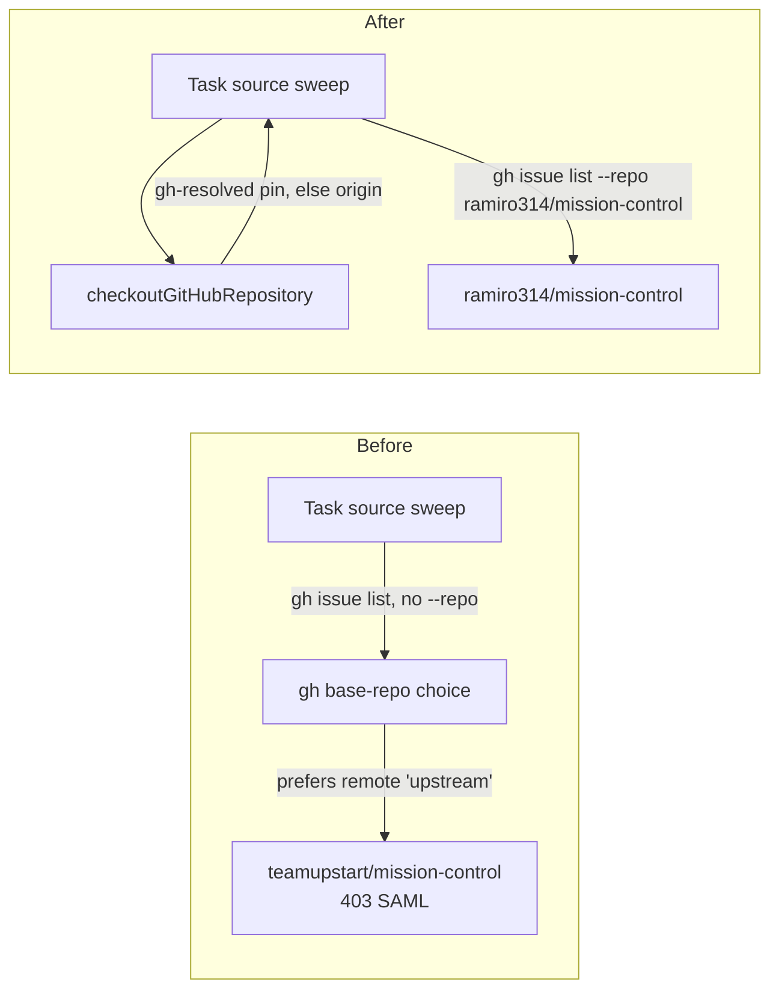

# SAML-safe GitHub calls

Status: approved 2026-10-10. Follow-up: create tickets after this plan merges. Fork feature: extends `fork:sso-free-github-calls` (#398).

Stop every Mission Control GitHub call from wandering to the fork's parent repository. When a
call does reach an organization whose SAML SSO refuses the operator's token, tell the
operator exactly why and how to fix it, instead of handing them a raw GraphQL line.

## The problem

A GitHub issues task source for `~/Dev/mission-control` fails every sweep with:

```
gh issue list failed: GraphQL: Resource protected by organization SAML enforcement.
You must grant your OAuth token access to this organization. (repository)
```

**Root cause.** The checkout's `origin` is `ramiro314/mission-control` and its `upstream` is
`teamupstart/mission-control`. No gh default repository is pinned (`remote.*.gh-resolved` is
unset). A non-interactive `gh` call that names no repository picks a remote called `upstream`
before `origin`. teamupstart enforces SAML SSO and the operator's token is not authorized
there. Probed on 2026-10-10:

- `gh issue list` in the checkout returns the GraphQL SAML error above.
- `gh api repos/teamupstart/mission-control` with the token returns 403 and an authorize link,
  even though the repository is public.
- The same read without a token returns 200.

**Why it keeps coming up.** #399 fixed three call sites: the PR open command, the PR poller
and Foreman's follow-through. Each fix was local. Nothing shared decides which repository a
checkout's `gh` calls target. Nothing stops a new call from leaving the repository out. Each
error path keeps only the first stderr line, so gh's "Authorize in your web browser" link is
lost. Call sites still exposed:

| Surface | Call | Why it reaches teamupstart |
| --- | --- | --- |
| Task source sweep and preflight (`src/server/task-sources/github-issues.ts:110`, `:293`) | `gh issue list` | `--repo` is added only when Repository is filled in. The schema says blank means "the repo gh resolves from origin" (`src/shared/task-source.ts:501`), and in a fork that is false. |
| Create GitHub issue (`github-issues.ts:324-336`, `:452`) | `gh issue create` | Same as the sweep. If SSO were authorized, the issue would land on **upstream**, because `expectedRepo: ""` accepts any repository (`src/server/github/issue-create.ts:12`). |
| Write-back fallback (`github-issues.ts:485`) | `gh issue comment` / `close` | The last fallback, used when the item carries no id or URL, is the same implicit resolution. |
| Agent text: `WRAPUP_PR` (`src/shared/queue.ts:106-110`) | invites `gh pr create` | `gh pr create` always reads `repository.parent`. |
| Agent text: `skills/deflake`, `skills/testing-setup`, `skills/docs-only-ci` | `gh issue view <n>`, `gh pr checks <n>`, `gh api repos/{owner}/{repo}/...` | A bare number or a `{owner}/{repo}` placeholder resolves through gh's base-repo choice. |
| Scripts: `scripts/fork-report.mjs:207-231`, `scripts/fork-delta.mjs:448-451`, `scripts/unit-shard-timings.ts:58` | `gh issue list`, `gh pr list`, `gh run download` | Pass `--repo` only when given one. |
| Product issues (`src/server/product-issues.ts`), updater (`src/main/updater.ts`), `scripts/install-app.mjs` | name `teamupstart/mission-control` | On purpose. Today the refusal is passed through raw, or it reaches the updater as a generic error. |

## Goal and non-goals

**Goal.** No Mission Control GitHub call reaches a repository the operator did not choose.
Every call that is refused by SSO anyway says which repository it tried, which organization
refused, the authorize link, and what to change.

**Non-goals.**

- Authorizing the token for teamupstart SSO. That is the operator's choice and stays outside
  Mission Control.
- Changing `CANONICAL_REPO`. It is the release trust anchor, deliberately not configurable.
- Unauthenticated fallbacks. A fork install updated from upstream releases would lose the
  fork's features.
- Editing the shipped `actions/pull-request.md`. Built-in workflow versions snapshot it, and
  `test/builtin-workflows.test.ts` pins each shipped digest (ffee9412). The action defers to
  the pull-request skill, which already carries the REST open command.
- Inspector calls on a pull request whose URL is on teamupstart. Those name their repository
  on purpose, so they only get the classified error.

## Decisions

Recorded from the grill rounds on 2026-10-10.

| # | Decision | Answer |
| --- | --- | --- |
| 1 | How GitHub calls pick their repository | **Both.** The daemon always passes an explicit repository from one shared resolver, and Mission Control pins gh's default repository per checkout so bare `gh` calls from agents and the terminal also resolve correctly. |
| 2 | What a blank Repository on a GitHub issues task source targets | **The checkout's origin repository**, resolved and shown in the form. Create GitHub issue verifies the created URL against that exact repository. |
| 3 | What a SAML/SSO refusal looks like | **One shared classifier and an actionable message.** It names the repository tried and the refusing organization, keeps gh's authorize link, and says what to change. |
| 4 | Scope | Task sources (sweep, preflight, create, write-back fallback); agent text (`WRAPUP_PR`, deflake, testing-setup, docs-only-ci; the shipped action stays frozen); scripts (fork-report, fork-delta, unit-shard-timings); intentional-upstream callers (product issues, updater, install-app); a regression guard. |
| 5 | Fork feature filing | **Extend `fork:sso-free-github-calls` (#398).** |
| 6 | Resolver precedence | An existing gh default (`gh-resolved`) if one is set, otherwise `origin`. If neither is on GitHub, return a clear error naming the checkout and its remotes. **No implicit gh fallback anywhere**, because an implicit fallback can silently target upstream. |
| 7 | When Mission Control writes the pin | **Automatically**, when a repository is attached or prepared for a task, and only if no pin exists and the checkout has more than one GitHub remote. Never overwrite an existing pin. Log the write once. |
| 8 | How agent text names repositories | **Explicitly**: by URL, or with `--repo` read from `origin`, the way `openPullRequestCommand` does. `WRAPUP_PR` switches to the REST open command. |
| 9 | Stored task sources with a blank Repository | **Stay blank.** Resolve on every sweep, preflight and create. No migration. |
| 10 | Product issues on this fork | Keep the code default. The operator sets `MISSION_PRODUCT_ISSUES_REPO=ramiro314/mission-control` in their environment (fleet). The docs explain the setting for forks. |
| 11 | Updater and install-app on refusal | **Classify the error only.** No fallback. |

## Design

### Flow: a task source sweep, before and after



Before the change, the sweep leaves the repository to `gh`. `gh` prefers the `upstream`
remote and gets a 403. After the change, the sweep asks the resolver first and passes its
answer as `--repo`. `gh` never makes the choice. The same path serves preflight, create, the
write-back fallback and the PR poller.

### 1. One repository resolver

New module `src/shared/github-repository.mjs` (with a `.d.mts` declaration, the same shape as
`pr-command.mjs`). It is pure and browser-safe, so the daemon, Electron main and `scripts/`
all use one copy. It holds:

- `parseGitHubRemoteUrl(url)`, moved from `src/server/inspector/github.ts:143`. The inspector
  re-imports it.
- `pickCheckoutRepository(remotes)`. Its input is the parsed output of
  `git config --get-regexp '^remote\..*\.(url|gh-resolved)$'`. It returns
  `{ ok: true, repo: "owner/name", source: "gh-default" | "origin" }` or
  `{ ok: false, error }`. Precedence follows decision 6:
  1. The remote whose `gh-resolved` is `base`, when its URL is on GitHub. A `gh-resolved`
     value of the form `owner/name` is also accepted; gh stores that form when a remote's
     URL names a renamed or moved repository.
  2. Otherwise `origin`, when its URL is on GitHub.
  3. Otherwise an error. It names the checkout and lists its remotes, for example:

     ```
     No GitHub repository for ~/Dev/x: origin is git@gitlab.com:..., no gh default is set.
     Set Repository on this source, or run `gh repo set-default`.
     ```

`src/server/github/repository.ts` wraps the `git config` read as
`checkoutGitHubRepository(repoRoot)`. It replaces `originGitHubRepository`
(`inspector/github.ts:199`) and `configuredGitHubRepositories` moves beside it. `pr.ts:133`
switches to the new resolver. When the resolver fails, the PR poller now answers `"error"`
instead of running an implicit `gh pr list`.

### 2. Task sources

- **Sweep and preflight.** `ghIssueListArgs` takes the resolved repository and always passes
  `--repo`. A blank `cfg.repo` resolves through `checkoutGitHubRepository(ctx.repoRoot)`. A
  resolver error becomes the sweep's or preflight's error string.
- **Create GitHub issue.** Uses the same resolution. `githubIssueCreateOutcome` receives the
  resolved repository as `expectedRepo`. The `""` wildcard branch in `issue-create.ts` is
  deleted, so no caller can accept an issue created on an unexpected repository.
- **Write-back.** The last fallback in `issueTargetFor` uses the resolver instead of implicit
  resolution.
- **Schema.** The comment on `GithubIssuesConfigSchema.repo` now describes the real rule:
  blank means the gh default, else origin, resolved on every run. Stored blank values stay
  blank (decision 9).
- **Form.** Under a blank Repository field, the source editor shows
  "Resolves to `owner/name` (from origin)" or "(from gh default)". When resolution fails, it
  shows the resolver's error. The value comes from a read-only route field computed with the
  resolver. A filled-in Repository shows nothing extra.

### 3. Pinning gh's default repository

`ensureGhDefaultRepository(repoRoot)` in `src/server/github/repository.ts`:

- Runs only when no `remote.*.gh-resolved` exists, the checkout has more than one GitHub
  remote, and `origin` is on GitHub.
- Then runs `git config remote.origin.gh-resolved base`. This is the same entry
  `gh repo set-default` writes, and it goes into the clone's common config, so one write
  covers every worktree in the pool.
- Logs once per git common directory. It is memoized per daemon run. A failed write is logged
  and never blocks a dispatch, because the daemon's own calls never depend on the pin.

It is called where a repository is attached or prepared:

- `prepareTaskRepositories` (`src/server/task-repository-preparation.ts:75`), for each
  repository in the set. Every dispatched task's repositories pass through it before a session
  starts.
- Task source save and the first sweep of a source, for its `repoRoot`.

The pin is what makes an agent's improvised `gh issue view 12` work. `gh pr create` ignores
it, because gh always reads the parent, which is why decision 8 still applies.

### 4. SAML/SSO refusal classifier

New module `src/shared/github-sso.mjs` (pure; used by the server, Electron main and
`scripts/install-app.mjs`):

- `classifyGitHubSsoRefusal(stderr)` reads the **full** stderr. It returns
  `{ org, authorizeUrl }` or `null`. It matches "Resource protected by organization SAML
  enforcement" and "has enabled or enforced SAML SSO". It reads the organization from
  `The 'X' organization` or from `/orgs/X/sso`, and the authorize URL from the
  `https://github.com/orgs/<org>/sso?...` link that gh prints.
- `ssoRefusalMessage({ target, refusal, remedy })` builds the message. Each caller supplies
  its own `remedy`. For example:

  ```
  GitHub refused teamupstart/mission-control: the teamupstart organization requires SAML SSO
  and this gh token is not authorized for it. Authorize: <link>. <remedy>
  ```

Every call site that currently keeps only the first stderr line runs the classifier on the
full stderr before truncating:

| Call site | Remedy text |
| --- | --- |
| Task source sweep, preflight, create, write-back, linked-issue read | "To use your fork instead, set Repository on this source or pin `gh repo set-default`." |
| Inspector `fail()` (`src/server/inspector/github.ts:64`) | None. The PR URL names the repository. |
| Product issues preflight and create | "Forks: set `MISSION_PRODUCT_ISSUES_REPO`." |
| Updater `runGh` (`src/main/updater.ts:363`) and `scripts/install-app.mjs` | "Updates come from teamupstart/mission-control; authorize to check for them." Classified next to the existing auth classifier (`updater.ts:309`). |

### 5. Agent-facing text

- `WRAPUP_PR` (`src/shared/queue.ts:106`) replaces "open a PR" with `openPullRequestCommand`.
- `skills/deflake/SKILL.md:32` names the issue by URL: `gh issue view <issue-url> --comments`.
- `skills/testing-setup/SKILL.md:214` uses `gh pr checks <pr-url> --watch`, and
  `gh run watch <id> --repo "$repo"`, with `$repo` read from origin.
- `skills/docs-only-ci/SKILL.md:70-71`, `:205`, `:214` replace `{owner}/{repo}` with `$repo`
  read from origin, and name the PR by URL.
- The origin-reading shell line is exported once from `src/shared/pr-command.mjs`
  (`originRepositoryShell`), and `openPullRequestCommand` uses it. Skills are markdown and
  copy the same line; the guard below pins that every copy matches the export.
- `actions/pull-request.md` stays frozen (non-goals).

### 6. Scripts

`scripts/fork-report.mjs`, `scripts/fork-delta.mjs` and `scripts/unit-shard-timings.ts`
default `--repo` from `pickCheckoutRepository` over the cwd's git config, through
`src/shared/github-repository.mjs`. An explicit `--repo` or `GH_REPO` still wins. A resolver
error exits with the resolver's message, not an uncaught `execFileSync` throw.

### 7. Regression guard

`test/github-repo-targeting.test.ts`:

- **Call-site inventory.** It finds every `gh` invocation in `src/` and `scripts/`: calls to
  `ghBin()`, `runGh`, and `"gh"` passed to `run`, `execFile` or `spawn`. Each must appear in
  a table in the test that names how it targets a repository: `--repo` from the resolver, a
  URL, an explicit `repos/<owner>/<repo>` API path, or "no repository" (for `auth status`,
  `--version`, `api user`). A new call site fails the test until someone classifies it.
- **Agent text.** It scans `skills/**/SKILL.md`, `src/shared/queue.ts`, `src/server/task-contract.ts`
  and `src/server/workflows/feedback.ts`. It refuses `gh pr create` (outside
  `opensPullRequest`'s recognizer), `{owner}/{repo}` placeholders, and
  `gh (issue|pr) (view|checks|comment) <number>`. It exempts `actions/pull-request.md`, whose
  shipped text is frozen.
- **Origin-reading line.** Every skill line that reads the repository from origin (section 5)
  must equal `originRepositoryShell` exported from `src/shared/pr-command.mjs`, character for
  character, so the copies cannot drift from the export.

## Operator steps (outside this repository's pull request)

- Set `MISSION_PRODUCT_ISSUES_REPO=ramiro314/mission-control` in `~/fleet` (decision 10). This
  is a separate repository and a separate change.
- Nothing else. Existing blank task sources heal after the next deploy without being edited.

## Documentation

- `docs/configuration.md`: `MISSION_PRODUCT_ISSUES_REPO` gains a sentence telling forks of an
  SSO-enforcing org to set it.
- `docs/troubleshooting.md`: a new "Resource protected by organization SAML enforcement"
  entry. It explains the resolver, the pin, and the remedies by surface.
- `docs/inspector-and-shipping.md` and `docs/sessions.md`: replace the mention of
  `originGitHubRepository` with the shared resolver and its precedence.
- The task sources section of `docs/tasks-and-scheduling.md`: blank Repository means the gh
  default, else origin, and the form shows the result.
- The PR body carries a "Fork feature changes" section for `fork:sso-free-github-calls`.

## Verification

- **Unit (`test/`):**
  - `pickCheckoutRepository` precedence: pin, origin, error, `owner/name` pin value,
    non-GitHub origin.
  - `ensureGhDefaultRepository`: writes only in the ambiguous case, never overwrites, and is
    memoized.
  - `ghIssueListArgs` always carries `--repo`.
  - Create rejects a URL on another repository.
  - `classifyGitHubSsoRefusal` against the real GraphQL and REST stderr captured above.
  - `ssoRefusalMessage` keeps the authorize link.
  - Updater classification.
  - Fork scripts default to origin.
  - The guard test itself, including that each skill's origin-reading line matches
    `originRepositoryShell`.
- **E2E (`e2e/specs/`):** a spec on the task source editor, using the fake `gh` the existing
  task-source specs already use. It asserts:
  - A blank Repository shows "Resolves to ramiro314/mission-control (from origin)" for a
    fixture checkout with both remotes.
  - A fake `gh` that prints the SAML stderr makes the source show the classified message with
    the authorize link, not the raw GraphQL line.
- **Manual:** after deploy, the two failing mission-control sources sweep green with no edit.
  `git config remote.origin.gh-resolved` reads `base` in `~/Dev/mission-control`.

## Risks

- **Writing to the operator's git config.** The pin changes what bare `gh` does in that clone
  for the operator too. Mitigation: only in the ambiguous multi-remote case, never over an
  existing pin, logged once, and undone with `gh repo set-default --unset`.
- **A deliberate pin on `upstream`** makes the resolver target upstream (decision 6). That
  respects the operator's choice, and the classified message then names the pin as the
  source.
- **Call-site guard false positives.** A scanner over source text can misread an unusual call
  shape. Mitigation: the inventory table is explicit and short, and the guard fails loudly
  rather than silently passing.
- **Upstream sync.** The resolver and classifier are new files, and the moved
  `parseGitHubRemoteUrl` leaves a re-export, so upstream edits to `inspector/github.ts` still
  merge.
