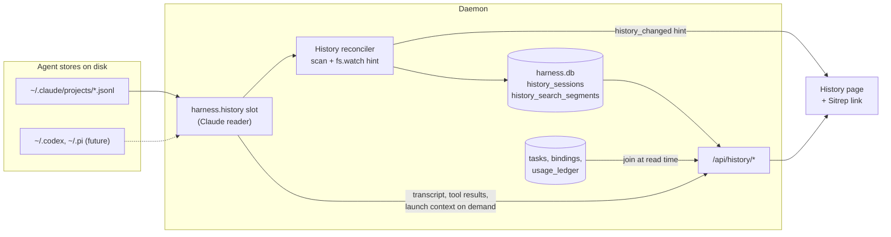
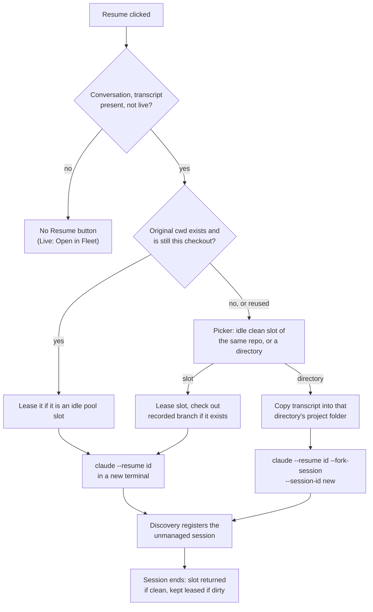

# Session History

## Outcome

Mission Control gains a read-only **History** page that lists every agent session this machine
holds, whether or not Mission Control ever launched or saw it. The operator filters and searches
the list, opens one session to read its conversation, its tool results and subagent runs, and
the context it was launched with (CLAUDE.md, AGENTS.md, memory, standing instructions, skills,
MCP servers, environment, hooks), and resumes a conversation in a new terminal session.

Claude is the first agent with a history reader. The reader is a per-harness capability, so
Codex and Pi gain History by implementing one slot, with no change to the page, the catalog or
the routes.

Mission Control's own records (task title, outcome, PR, workflow, cost) augment a session when
they exist. They are never required: a session Mission Control never touched has a complete
record built from its transcript alone.

The Sitrep's Recent outcomes rows link their task title to that task's session in History.

## What this machine holds

Measured read-only on this machine on 2026-11-02. Every Claude record is version 2.1.296, so
older transcript formats are not represented in this sample.

### Claude Code (`~/.claude/projects`)

| Measure | Value |
|---|---|
| Top-level sessions | 2,626 (filename always equals `sessionId`) |
| Subagent transcripts | 52, under `<sessionId>/subagents/agent-*.jsonl` with a `.meta.json` |
| Size | 1.68 GB, 277,558 lines, 0 malformed; p50 163 KB, p95 3.6 MB, max 17 MB |
| Age | oldest 24 days |
| Full parse of every file | about 4.9 s warm (Python) |
| Head and tail 64 KB of every file | about 0.47 s warm |

**Retention.** Claude Code deletes transcripts older than `cleanupPeriodDays`, 30 by default,
in a silent sweep after a session starts
([settings reference](https://code.claude.com/docs/en/settings-reference),
[data usage](https://code.claude.com/docs/en/data-usage)). The setting is unset here, so the
oldest transcripts on this machine reach the cutoff in about six days.

**Session kinds.** `entrypoint` takes only `cli` and `sdk-ts`, so it cannot separate
`claude -p` from the Agent SDK. The tool set and the `prompt_snapshot.cliPrefix` can.

| Kind | Signal | Sessions |
|---|---|---|
| Interactive | `entrypoint = cli` | 32 |
| SDK | `cliPrefix` starts "You are Claude Code", tool-bearing | about 294 |
| One-shot | "You are a Claude agent", tools empty or only `StructuredOutput` | about 1,437 |
| Reviewer | read-only tools (`Glob`, `Grep`, `Read`, `StructuredOutput`) | about 849 |

88% of the files are one-shot or reviewer runs, most of them Mission Control's own background
work. No transcript marker says "launched by Mission Control": the reliable signal is a join on
`session_agent_bindings.agent_session_id`, which matches 315 of 2,626.

**Fields available for every session.** The common envelope carries `sessionId`, `cwd`,
`gitBranch`, `version`, `entrypoint`, `timestamp` and `isSidechain`. Titles come from
`custom-title` (95) and `ai-title` (present in almost all). `last-prompt` holds the last prompt.
`assistant.message.model`, `requestedModel` and `effort` give the model. `cost-state` carries
`totalCostUSD`, `totalDuration`, `startTime`, `totalLinesAdded/Removed` and per-model usage,
in 2,622 of 2,626. `permission-mode` records the mode; 800 recent sessions recorded only
`default` and `auto`. `pr-link` records PRs. `continued-in.continuedInSessionId` links 3
sessions. There is no `summary` entry and no `forkedFrom`.

**Launch context is recorded as snapshots, with content.** These are `attachment` records:

| Attachment | What it holds |
|---|---|
| `instructions` | `files[{path, type: User / Project / AutoMem, content}]`, with `reason` (`session_start`, `compaction`). The content is what that session loaded: of 1,875 file snapshots, 316 already differ from today's file and 6 files are gone. |
| `prompt_snapshot` | `cliPrefix`, `tools[{name, description, schema}]`, `systemPrompt[]` (the appended system prompt) |
| `skill_listing` | `names[]`, `skillCount`, `content`, `isInitial` |
| `deferred_tools_delta`, `mcp_instructions_delta` | MCP tools added, plus `pendingMcpServers`, `needsAuthMcpServers`, `failedMcpServers`; server instruction blocks |
| `environment` | `workingDirectory`, `isWorktree`, `isGitRepo`, `additionalWorkingDirectories`, platform, shell, OS |
| `session_context` | `gitStatus` at launch |
| `system.stop_hook_summary` | `hookInfos[{command, durationMs}]` |

Skills actually used come from `assistant.attributionSkill` and `<command-name>` tags. Mission
Control's standing instructions also land in the transcript: all 55 rows sampled from
`session_standing_instructions` were found verbatim in their transcripts, so History does not
depend on Mission Control's own 7-day-pruned copy.

`instructions` appears in 1,169 of 2,626 sessions, almost all interactive or tool-bearing. Its
absence is ambiguous (no files, or restricted `--setting-sources`), so a missing record reads
"not recorded", never "none loaded". No SessionStart hook output is recorded.

**Cwd.** The project directory name maps every non-alphanumeric character to `-` and is lossy,
so `cwd` is always read from records, never decoded from the directory name. 165 sessions
change cwd mid-session and stay in their first directory. 12 sessions have a deleted cwd, and
worktree pool slots are reused, so an existing path does not prove the same checkout.

### Codex and Pi

Neither holds any session on this machine (`~/.codex/sessions` has no rollouts and
`state_5.sqlite.threads` is empty; `~/.pi/agent/sessions` is absent). Mission Control already
locates their transcripts for live sessions (`src/server/harness/codex/rollout.ts`,
`src/server/harness/pi/transcript.ts`). No other agent CLI stores sessions here.

## What Mission Control holds today

- **No history surface.** Every transcript reader takes a live `Session`
  (`resolveTranscriptPath` in `src/server/harness/claude/transcript.ts`). Discovery is
  live-process only. There is no sessions table: sessions live in Registry memory and are
  evicted about 8 s after exit.
- **Augmenting records** live in `harness.db`. 290 of 293 tasks have exactly one bound agent
  session; 3 have none.

| Table | Adds | Retention |
|---|---|---|
| `tasks` | title, intent, kind, labels, repo, branch, workflow, outcome, outcome URL | full history |
| `task_work_episode_bindings`, `historical_task_work_episode_bindings` | task to `agent_session_id`, PR URL, merged at, branch | current row replaced on rebind |
| `session_agent_bindings` | Mission Control session id to `agent_session_id` | no pruning found |
| `usage_ledger` | cost and tokens by `note_key` | 180 days |
| `session_standing_instructions` | exact standing instructions | 7 days |

- **Transcript rendering.** `TranscriptPanel` is coupled to a live `Session` and its SSE
  stream. Claude's `toMessage` drops sidechains and `isMeta` records, caps tool input at
  1,800 characters, and renders no tool results. The `TranscriptMessages` window functions are
  path-based and reusable.
- **Resume** goes through `POST /api/sessions/:id/launch`, which 404s for a session outside
  the Registry, and nothing checks that the cwd still exists. `prepareTerminalResume` needs
  only `cwd`, `agentSessionId`, `agent`, `runtime`, `permissionMode` and `id`.
- **Worktree pools.** `leaseAsIs` leases a slot without resetting it but refuses a
  branch-attached slot. Manual leases last until an explicit Return. `worktree_pools` maps a
  pool path to its `main_checkout_root` even after a slot directory is gone. There is no slot
  picker and no route that launches an unmanaged Claude terminal in an arbitrary directory.
- **Indexer precedent.** The Scout archive reconciler (`src/server/archives/reconciler.ts`)
  scans with a debounced `fs.watch` hint, fingerprints unchanged files with one `lstat`, prunes
  only after a complete walk, and writes `archive_search_segments` (literal search on
  JS-folded text, FTS5 deliberately not used).
- **Security.** `/api/*` is bound to loopback with a Host check and no token. The Inspector
  already denies `.claude`, `.codex` and `.pi` because credentials sit beside transcripts.

## Design

### Data and request flow

The catalog stores what a list, a filter and a search need, plus what must survive the
transcript. Conversation, tool results, subagent runs and launch context are parsed from the
transcript on demand and never copied. Mission Control data is joined at read time, so it
augments a record without being part of it.

### The harness `history` slot

Add a nullable `history` sub-object to `HarnessDaemonSlots` (`src/server/harness/types.ts`).
`HARNESSES: Record<AgentType, Harness>` forces every harness to declare it; Codex and Pi declare
`null` in this plan. The slot owns everything agent-specific; nothing outside
`src/server/harness/` branches on agent name.

- `roots()`: directories to scan and watch (Claude: `CLAUDE_PROJECTS_DIR`).
- `enumerate(root)`: transcript files with their fingerprint (size, mtime, inode). Claude
  yields top-level `*.jsonl` only; subagent files belong to their parent.
- `summarize(file, previous?)`: a streaming, incremental parse that returns the catalog fields
  below. Given the previous summary and byte offset, it parses only appended bytes; a shrunk
  file or a changed inode restarts it.
- `messages(entry)`, `toolResult(entry, toolUseId)`, `subagents(entry)`, `launchContext(entry)`:
  on-demand readers over the stored transcript path, built on the existing path-based
  `TranscriptMessages` window functions.
- `resume`: whether and how a cataloged session resumes elsewhere (Claude: same-repository
  worktrees directly; any other directory by copy and `--fork-session`).

The Claude reader keeps today's `CLAUDE_PROJECTS_DIR` (`~/.claude/projects`), so a custom
`CLAUDE_CONFIG_DIR` is not followed, matching the rest of Mission Control. Parsers tolerate
unknown record and attachment types, because only one Claude version was available to measure.

### Catalog

Three tables in `harness.db`, created through the normal `migrate()` upgrade path and owned by a
`HistoryStore`: `history_sessions` and `history_search_segments` below, and
`history_resume_launches`, described under Resume. The daemon is the only writer.

`history_sessions`, one row per `(agent, agent_session_id)`:

| Group | Columns |
|---|---|
| Identity | `agent`, `agent_session_id`, `transcript_path`, `fingerprint`, `parsed_bytes`, `transcript_state` (`present` / `gone`), `gone_at` |
| Place | `cwd` (first), `repo_root` (resolved at index time), `branch`, `entrypoint`, `version` |
| Kind | `kind` (`interactive` / `sdk` / `one_shot` / `reviewer` / `unclassified`) |
| Title | `custom_title`, `ai_title`, `first_prompt` (capped) |
| Time | `started_at`, `last_activity_at`, `duration_ms` |
| Usage | `model`, `cost_usd`, `input_tokens`, `output_tokens`, `lines_added`, `lines_removed` |
| Links | `pr_urls`, `continued_in`, `resumed_from` (set by a History fork), `subagent_count` |

`history_search_segments(agent, agent_session_id, ordinal, text_fold)` holds folded search
text, following `archive_search_segments`: title fields, cwd, repo, branch, and the user
prompts. Conversations index every user prompt. Background runs (one-shot and reviewer) index
only the first prompt, capped, because their prompts are large generated diffs.

**Classification.** The rules are evaluated in this order, and the first match wins:

1. `interactive` when `entrypoint` is `cli`.
2. `unclassified` when the session has no `prompt_snapshot`. Rules 3 to 5 read the snapshot's
   tool list, and a missing snapshot is never read as an empty tool set.
3. `one_shot` when the snapshot lists no tools, or only `StructuredOutput`.
4. `reviewer` when it lists at least one of `Read`, `Glob` or `Grep`, and every tool is in
   `{Read, Glob, Grep, StructuredOutput}`.
5. `sdk` when `cliPrefix` is the Claude Code preset and the tool set is not read-only.
6. `unclassified` otherwise.

Because `one_shot` is tested before `reviewer`, an empty or `StructuredOutput`-only tool set is
never a reviewer. A session is a **conversation** when its kind is
`interactive`, `sdk` or `unclassified`, or when it is bound to a Mission Control task; the
default list shows conversations only. The rules live in the Claude reader, not in shared code.

**Repository resolution**, at index time, in order: a cwd under a worktree pool maps through
`worktree_pools.pool_path` to `main_checkout_root` (a new prefix helper, since pool directories
are `<repo>-<digest>`); a cwd under `worktrees/<taskId>` maps through the task's `repo_root`;
an existing path resolves through `mainRepoRoot`; anything else has no repository and is shown
by its raw cwd. The resolved value is stored, so it survives the directory's deletion.

**Retention.** When a transcript file disappears after a complete scan, its row is kept with
`transcript_state = gone` and `gone_at`. Title, place, time, usage, links and search segments
survive. The conversation, launch context and Resume do not. Rows are never deleted by this
plan.

**Duplicates.** A History Resume into an unrelated directory copies a transcript, so two files
can share a `sessionId`. The canonical file is chosen by a stable rule, never by scan order, so
a fresh or rebuilt catalog picks the same one:

1. A file recorded as a History copy (`history_resume_launches.copy_path`) is never canonical.
2. Of the rest, the canonical file is the one whose project folder is the encoding of the
   session's first recorded `cwd`.
3. If no file qualifies, the one with the earliest first-record timestamp wins, ties broken by
   path.

Every other file with that id is recorded as a copy and does not create a second row. When the
canonical file disappears and a copy remains, the row is marked gone rather than repointed at
the copy.

### Reconciler

A `HistoryReconciler` modelled on the Scout archive reconciler, started after the daemon is
serving:

- Each pass walks every `history.roots()`, costs one `lstat` per unchanged file, re-summarizes
  changed files incrementally, and marks rows gone only after a complete walk.
- **Backfill is newest first** (by mtime) and in small batches. Each batch writes in one short
  transaction and then yields with `await setImmediate`, so the first run over 2,626 files
  never blocks the daemon or SQLite for long. Progress (`indexed`, `total`) is exposed with the
  list.
- `fs.watch` on each root, recursive where the platform supports it, is a debounced hint; the
  periodic scan stays the authority, so a missed event only delays a row.
- After a pass that changed rows, it publishes one coalesced `history_changed` server event.
  The event carries no data; open History pages refetch their current page. The event is added
  to `ServerEvent` and handled in `useEventStream.ts`.

### Routes

All under `/api/history`, loopback-only like the rest of `/api/*`. Sessions are addressed as
`:agent/:id`; `:id` must be a UUID and every file path is resolved from the catalog, never taken
from a request. None of these reads is exposed as an MCP tool.

| Route | Returns |
|---|---|
| `GET /sessions?q&repo&from&to&kind&link&outcome&agent&cursor` | a page of rows (newest activity first), backfill progress, and the retention period |
| `GET /sessions/:agent/:id` | the row, joined Mission Control data, subagent list, live status; or, with no catalog row, a record built from Mission Control data only (see below) |
| `GET /sessions/:agent/:id/messages?cursor` | a transcript window |
| `GET /sessions/:agent/:id/tool-results/:toolUseId` | one tool result, including `tool-results/` sidecar files |
| `GET /sessions/:agent/:id/subagents/:agentId/messages?cursor` | a subagent's transcript window |
| `GET /sessions/:agent/:id/launch-context` | the launch-context sections |
| `GET /sessions/:agent/:id/resume-options` | original-directory status, eligible slots, warnings |
| `POST /sessions/:agent/:id/resume` | launches; body `{backend, target}` |

Query parameters and bodies are parsed with Zod schemas in the shared protocol, through
`parseBody`.

**Mission Control join.** `agent_session_id` joins `task_work_episode_bindings` and
`historical_task_work_episode_bindings` (task, PR, merged at), then `tasks` (title, kind,
outcome, outcome URL, workflow, labels), `session_agent_bindings` (the Mission Control link),
and `usage_ledger` by `note_key` (cost fallback). Live status comes from the Registry by
`agentSessionId`. Cost prefers the transcript's `cost-state` and falls back to `usage_ledger`.

**A bound session with no catalog row.** Claude Code may delete a transcript before the catalog
first indexes it, which is likely for this machine's oldest tasks. When `history_sessions` has
no row for an id, but a task binding or `session_agent_bindings` names it,
`GET /sessions/:agent/:id` returns a record with `catalog: null`, built from Mission Control
data only: task title, kind, outcome, PR, branch, repository and cost. The reconciler does not
invent rows for these sessions. The route returns 404 only when neither the catalog nor
Mission Control knows the id.

## User experience

### Page and navigation

A new top-level **History** segment in `PAGE_SEGMENTS`, after Scouts, with the shortcut `h`
(currently unbound as a bare key) and a hash route in `MissionRoute`
(`#/history?...` for the list, `#/history/claude/<id>` for a session, filters in the URL). The
page follows the Scouts page: `AppPageShell`, a debounced search box, filters that `replace`
the route, and Load more paging.

Adding a page trips the four guards recorded in
`.agents/memory/topbar-page-segment-guards.md`: the exhaustive `AppPageShell` record, tooltip
coverage, the keybindings keydown round-trip, and the segment count pinned in
`e2e/specs/library.spec.ts`, which fails only on CI.

### List

- **Order:** all time, newest activity first, grouped by day, paged.
- **Default:** conversations only. A Kind filter adds background runs (one-shot, reviewer).
- **Filters:** repository (pool paths collapse to their repository), date range, kind,
  Mission Control link (managed by a task, or external), task outcome and PR, and agent. The
  agent filter is hidden while only one harness has a history reader.
- **Search:** titles, paths, branches and user prompts, as indexed above.
- **Row:** the title is the task title when the session is bound to a task, else the custom
  title, the AI title, then the first prompt. It shows repository, branch, kind, model, cost,
  duration and outcome; the full cwd shows on hover. Badges: **Live** for a session the Registry
  holds, **Transcript gone** for a removed transcript.
- **Header:** "Claude Code keeps transcripts for N days" with a link to the
  `cleanupPeriodDays` setting, where N is read from Claude Code's settings, 30 when unset.
  Mission Control never edits that setting.
- **First run:** sessions appear as they are indexed, newest first, under a progress line
  ("Indexing 812 of 2,626 sessions").

### Session detail

A header with title, repository, branch, cwd, kind, model, times, cost and, when it exists, the
task (linking back to it), outcome and PR. Then two tabs:

- **Conversation.** The live view's message rendering, extracted from `TranscriptPanel` into a
  component that takes messages rather than a `Session`, plus: tool results expanded on demand,
  tool input beyond the live cap, compaction boundaries, and each subagent run opening its own
  transcript inline. Read-only: no composer.
- **Launch context.** Each section lists what was recorded, or says "not recorded":
  - Instruction files: CLAUDE.md, AGENTS.md and memory, each with path, scope (User, Project,
    AutoMem), the reason it loaded, and its exact text as loaded by that session.
  - Standing instructions and appended system prompt (`prompt_snapshot.systemPrompt`).
  - Skills available (`skill_listing`) and skills actually used.
  - MCP servers and tools, including failed and unauthenticated servers.
  - Environment: cwd, branch, git status at launch, additional directories, model, effort,
    permission mode.
  - Hooks that ran, with durations.

A session whose transcript is gone shows the header and says the conversation was removed by
Claude Code's retention. A bound session with no catalog row shows the header from Mission
Control data, with no tabs and no Resume. It says the transcript was removed before Mission
Control indexed it.

### Live sessions

A session the Registry holds shows the Live badge and **Open in Fleet** instead of Resume. Its
detail reads the transcript when opened; it does not stream.

### Sitrep

`Task` and `TaskSummary` gain `agentSessionId`, read from the current binding and, when that
row was replaced, the newest historical binding. In Recent outcomes (`ReportPanel.tsx`) the
task title becomes a link to `#/history/<agent>/<agentSessionId>` when the task has a bound
session and its harness has a history reader; otherwise it stays plain text. The link still
works when the transcript is gone, because the record survives. It also works when the
transcript was deleted before it was ever indexed: the detail page then shows the record built
from Mission Control data only. The outcome link, Reschedule and chips are unchanged.

## Resume

- **Eligibility.** Resume appears on conversations (interactive, SDK, unclassified) whose
  transcript is present and which the Registry does not hold. One-shot and reviewer runs stay
  readable without Resume.
- **Launch.** A new **unmanaged** terminal session runs `claude --resume <id>` in the selected
  directory, through `launchManagedAgentTerminal` and `resumeArgvFor`, prepared from the
  catalog row (`cwd`, `agentSessionId`, recorded permission mode) with no task context and no
  Mission Control MCP tools. It does not reopen a finished task. Discovery then registers it
  like any other terminal session, which makes it Live in History.
- **Original directory.** Usable when it exists and is still the same checkout: not a pool
  slot, or a pool slot on the recorded branch that no other owner holds. An idle pool slot is
  leased before launch, so acquisition cannot reset it under the session.
- **Picker.** When the original directory is gone or reused, a dialog offers idle, clean slots
  of the session's repository (`observedIdleRefusal`) and a directory field validated to exist.
  A session with no resolvable repository offers only the directory.
- **Slot target.** A new worktree manager operation leases the slot and checks out the
  session's recorded branch when it exists locally or on the remote; otherwise it leaves the
  slot as it is and the dialog warns that the code may not match the conversation.
  Claude's documented lookup covers a project's git worktrees, so the session resumes with no
  copying.
- **Branch already checked out elsewhere.** Git refuses to check out a branch that is attached
  to another worktree, so the operation reads `git worktree list --porcelain` before it
  touches the slot:
  - When the branch is attached to an **idle slot of the same pool**, the picker offers that
    slot first, marked as holding the branch, and leases it as it stands, with no checkout.
  - When the branch is attached to any **other worktree** (a slot another owner holds, a task
    worktree, or a checkout outside the pool), the chosen slot checks out the branch tip
    detached (`git checkout --detach <branch>`). The dialog warns that the branch is checked
    out in that path, and that commits made here will not move the branch.
- **Directory target.** For a directory outside the session's repository, the transcript is
  copied into that directory's Claude project folder and the session starts with
  `claude --resume <id> --fork-session`. The original is untouched; the fork gets its own id,
  and History records it as resumed from the original. This copy is History's only write into
  Claude's store, and it is an unofficial workaround that may break with a Claude format change.
- **Fork id known before launch.** Mission Control mints the fork's id itself and passes it
  with `--session-id <uuid>`, so the launch is `claude --resume <id> --fork-session --session-id
  <new>`. The id therefore never has to be recovered from a transcript, which carries no
  `forkedFrom` marker. If the CLI refuses `--session-id` together with `--fork-session`, the
  fallback is the Agent SDK's `forkSession(id, { dir })`. It writes the fork into the target's
  project folder and returns the new id, and the session then starts with
  `claude --resume <new>`. In both cases `resumed_from` is written when the launch is recorded,
  not inferred later.
- **Launch record.** Each Resume writes one row to a new `history_resume_launches` table
  before the terminal starts: `launch_id`, `source_session_id`, `expected_agent_session_id`
  (the source id, or the minted fork id), `cwd`, `slot_id` and the worktree lease key (when a
  slot is used), `copy_path` (the transcript copy a directory target wrote, if any),
  `launched_at`, `mc_session_id` (empty until bound) and `state` (`pending`, `expired`,
  `bound`, `ended` or `released`). The slot's lease owner is
  `{kind: "manual", key: historyResumeOwnerKey(launch_id)}`, so the card names its owner.
  The correlation key is `expected_agent_session_id` **together with** `cwd`: a plain
  `claude --resume <id>` keeps the source id, so the id alone cannot tell two launches of one
  session apart.
- **One open launch per session.** While a `pending` or `expired` launch exists for a source
  session, Resume of that session is refused. The refusal names the launch's directory, and
  says the slot is held for an agent that may still appear. The operator either waits, or
  Returns that slot, which closes the launch (`released`) so a new Resume can start. A fork
  launch counts too: its source is still the original session.
- **Binding the discovered session.** When the Registry first holds a session whose
  `agentSessionId` equals a `pending` or `expired` launch's `expected_agent_session_id`, **and
  whose cwd, resolved through symlinks, is that launch's `cwd`**, the launch records the
  session's `mc_session_id` and becomes `bound`. A session matching the id in any other
  directory binds nothing, so it can never release a slot it does not run in.
- **An agent that has not appeared yet.** A launch still unbound after a grace window (two
  discovery sweeps past the launch timeout) becomes `expired`. It is not treated as ended: a
  slow terminal, a cold start or an auth prompt can still produce the agent. An expired launch
  **keeps its lease**, so the pool can never hand out or reset the slot under a late agent. Its
  slot card says "Held for a resumed session that has not appeared" and offers Return, which
  the operator uses when the terminal really failed. If the agent turns up after expiry, it
  binds as above and is then released like any bound launch.
- **Slot release.** When `session_remove` arrives for a bound launch's `mc_session_id`, the
  launch is `ended`. A clean slot is handed back to the pool and the launch becomes `released`.
  A dirty slot stays leased, with its card saying "Kept: uncommitted changes from a resumed
  session", until the operator Returns it. Only a `bound` launch is ever released
  automatically. The **startup twin** runs once the first discovery sweep after startup has
  finished. A `bound` launch with no live Registry session carrying its
  `expected_agent_session_id` ended while the daemon was down, and goes through the same
  release step. A `pending` launch with no live session becomes `expired` and keeps its lease,
  exactly as above. All of these matches use the same id-and-cwd key.
- **Refusals** are explicit: the transcript is gone, the session is live, a `pending` or
  `expired` launch of it already holds a directory, the directory does not exist, the slot is
  no longer idle, or the agent host is unavailable.

**To verify first.** The first implementation ticket runs a token-free probe on Claude Code
2.1.296. It opens each session interactively without sending a prompt, in a scratch
repository, and checks:

1. `claude --resume <id>` from a sibling worktree finds the session. If it does not, a slot
   target uses the same copy and fork path as a directory.
2. `claude --resume <id> --fork-session --session-id <new>` starts the fork under `<new>`. If
   the flags are refused together, the SDK `forkSession` fallback is used.
3. `forkSession(id, { dir })` writes the fork into the project folder of `dir` and returns its
   id.

## Extending to other agents

A harness gains History by implementing its `history` slot: roots, enumerate, an incremental
summarize producing the same catalog row, the on-demand readers, and its resume rule. Codex's
`session_meta` (cwd, git, model, instructions) and `state_5.sqlite.threads` (title,
`first_user_message`, `git_branch`, `tokens_used`) and Pi's session header (`id`, `cwd`) map
onto the same columns. The agent filter appears once a second harness has a reader. This plan
ships no Codex or Pi reader, because there is no real data here to test one against.

## Security and privacy

Transcripts are shown as recorded, at the same trust level as live transcripts today, so
anything a tool printed (including secrets) is visible to anyone who can reach the loopback
API. Mitigations:

- Routes take a harness name and a session UUID; the server resolves the path from the catalog
  and checks it lies under a harness root. No route accepts a path, except the Resume directory
  target, which is validated to exist and only receives a copied transcript.
- None of the History reads is exposed to agents through Mission Control's MCP tools.
- The search index copies user prompts into `harness.db`; this is documented in
  `docs/security.md`.

## Repository changes

| Area | Change |
|---|---|
| `src/server/harness/types.ts`, `harness/index.ts` | `history` slot; Claude implementation, Codex and Pi `null` |
| `src/server/harness/claude/history.ts` (new) | Claude summarize, classify, readers, resume rule |
| `src/server/history/` (new) | `HistoryStore`, `HistoryReconciler`, repository resolution, routes, resume |
| `src/server/db.ts` | `history_sessions`, `history_search_segments`, `history_resume_launches` via `migrate()` |
| `src/server/worktrees/manager.ts` | lease-for-resume with branch checkout, the branch-elsewhere rule and a `historyResumeOwnerKey` owner |
| `src/server/history/resume-launches.ts` (new) | launch record, binding to the discovered session, release on `session_remove` and its startup twin |
| `src/shared/types.ts`, protocol | catalog row, query and resume schemas; `history_changed`; `Task.agentSessionId` |
| `src/web/useEventStream.ts` | handle `history_changed` |
| `src/web/components/history/` (new) | History page, list, filters, detail, launch context, resume dialog |
| `src/web/components/TranscriptPanel.tsx` | extract message rendering into a reusable component |
| `src/web/App.tsx`, `useWorkflowRoute.ts`, `keybindings.ts`, `AppPageShell.tsx` | segment, route, shortcut |
| `src/web/components/ReportPanel.tsx` | Recent outcomes title link |
| `docs/` | new `docs/history.md`; `docs/README.md`, `docs/ui.md`, `docs/security.md`, `docs/database-and-migrations.md`, `docs/sessions.md` |

## Verification

Unit and integration tests in `test/`, run by file with the suite's loader:

- Claude summarize against fixture transcripts for each kind, including unknown record types,
  incremental parsing after an append, a shrunk file, a cwd change mid-session, and missing
  `instructions` reading "not recorded".
- Classification rules in their stated order, including the boundaries: no tools and
  `StructuredOutput` only are `one_shot`, not `reviewer`; `Read` plus `StructuredOutput` is
  `reviewer`; a non-`cli` session with no `prompt_snapshot` is `unclassified` and appears in
  the default list; and a task-bound session counts as a conversation.
- Repository resolution for pool paths with a deleted slot, `worktrees/<taskId>`, plain
  checkouts and unknown paths.
- Reconciler: newest-first batched backfill with progress, gone marking only after a complete
  walk, one coalesced `history_changed` per pass, and duplicate ids: a rebuilt catalog that
  scans the History copy first still picks the original as canonical, and a gone canonical file
  is not repointed at its copy.
- Routes: id validation and containment, filters and paging, Mission Control join present and
  absent, transcript-gone detail, launch-context sections. A bound id with no catalog row
  returns the Mission Control-only record; an id known to neither returns 404.
- Resume: eligibility, refusals, original-directory and reused-slot detection, branch checkout,
  copy and fork for a directory, release of a clean slot and retention of a dirty one, the
  startup twin.
- Branch already checked out elsewhere: an idle pool slot holding the branch is offered first
  and leased as it stands; a branch held by another owner or outside the pool is checked out
  detached in the chosen slot, with the warning.
- Launch correlation: a launch binds only to a Registry session with its
  `expected_agent_session_id` and its `cwd`, so a session with the right id in another
  directory binds nothing; a second Resume of a session with a `pending` or `expired` launch is
  refused until that slot is Returned; the fork path passes the minted id with `--session-id`, or uses
  the `forkSession` fallback's returned id, and writes `resumed_from` at launch; an unbound
  launch expires after its grace window and keeps its lease; an agent that appears after expiry
  still binds and is released when it ends; and the startup twin releases a bound launch whose
  session ended while the daemon was down, while a pending one only expires.
- `Task.agentSessionId` from current and historical bindings.

Playwright specs in `e2e/` against a fake `~/.claude/projects` in the redirected test home
(no model tokens; no `data-testid`):

- History page: default list hides background runs, Kind filter shows them, search by a prompt,
  repository, date range, Mission Control link and task outcome and PR filters, deep link to a
  session, Load more.
- Header and first run: the "Claude Code keeps transcripts for N days" header shows the fixture
  settings' value (and 30 when unset) and links to the setting. The fixture home is seeded
  with enough transcripts, and a test-only batch size small enough, that the first pass spans
  several batches: the progress line appears while indexing, then disappears.
- Live badge: a session the fake agent keeps running shows Live and Open in Fleet, not Resume.
- Detail: conversation renders, a tool result expands, a subagent opens, Launch context shows
  instruction files and "not recorded", a gone transcript shows the retention message, and a
  bound session with no catalog row shows its Mission Control-only header and the
  "removed before Mission Control indexed it" message.
- Resume: original directory, picker with a slot and with a directory, and Open in Fleet for a
  live session. Any new dialog calls `expectContentClearsBorder`.
- Dirty slot: a resumed session whose fake agent leaves uncommitted changes and exits leaves its
  slot card showing "Kept: uncommitted changes from a resumed session"; a clean one returns the
  slot to the pool.
- Sitrep: a Recent outcomes title opens the session in History; a task with no session shows
  plain text; a task bound to a session with no catalog row still links, and opens the Mission
  Control-only record.
- Update `e2e/specs/library.spec.ts`'s segment count and rerun `topbar-one-row.spec.ts`.

Definition of done as in `AGENTS.md`: typecheck, lint, build and smoke, and the e2e specs above.

## Non-goals

- Codex and Pi readers.
- Copying or archiving transcripts to outlive Claude Code's retention, or editing
  `cleanupPeriodDays`.
- Full-text search of assistant replies or tool output.
- Secret redaction.
- Deleting, renaming or tagging sessions from History.
- Reattaching a resumed session to its original task.
- Comparing a session's instruction files with today's files.
- Following a custom `CLAUDE_CONFIG_DIR`.

## Acceptance criteria

1. History lists every top-level Claude session under `~/.claude/projects`, including sessions
   with no Mission Control record, newest activity first, grouped by day, with paging.
2. The default list shows conversations only, and the Kind filter reveals one-shot and reviewer
   runs. Unclassified sessions appear by default.
3. Repository, date range, kind, Mission Control link, task outcome and PR filters work, and the
   agent filter is hidden while only Claude has a reader.
4. Search finds a conversation by any of its user prompts, and a background run by its first
   prompt.
5. A session's detail shows its conversation with on-demand tool results and subagent runs, and
   its launch context, with every absent section labelled "not recorded".
6. A transcript deleted from disk leaves a record marked gone, still searchable and still linked
   from the Sitrep. A task bound to a session that was never indexed still links to a record
   built from Mission Control data.
7. A session bound to a task shows the task's title, outcome and PR; an unbound session has a
   complete record without them.
8. Resume opens an unmanaged terminal session in the original directory when it is usable, in an
   idle same-repository slot on the recorded branch, or in a chosen directory by copy and fork;
   it refuses with a reason otherwise. A branch already checked out in another worktree follows
   the stated rule, and a fork's id is known before launch.
9. A slot taken for Resume returns to the pool when the session ends clean and stays leased
   when dirty, including when the session ended while the daemon was down. The link is the
   launch record's `expected_agent_session_id` together with its `cwd`. A launch whose agent
   never appeared keeps its lease until it binds or the operator Returns it, and blocks another
   Resume of the same session until then.
10. A Recent outcomes task title links to its session in History when one is bound.
11. The list updates within seconds of a new session, and the first backfill shows sessions
    progressively.
12. Codex and Pi declare a `null` history slot, and adding a reader needs no change outside the
    harness.

## Fork feature

This is a new fork feature. Its implementation pull requests carry the `fork:session-history`
label and a "Fork feature changes" section, and the first one creates the label and the
`fork-feature` tracking issue, as `docs/fork/README.md` describes.

## Approved decisions

Recorded from the interview with the operator on 2026-11-02.

### Round 1

| Decision | Answer |
|---|---|
| Default population | Conversations by default, background runs behind a filter |
| When a transcript disappears | Keep the catalog record, mark the transcript as gone |
| Search depth | Titles, paths, branches and every user prompt |
| Filters | Repository, date range, session kind, Mission Control link, task outcome and PR, agent |
| Default window and order | All time, newest activity first, grouped by day, with paging |
| Navigation | New top-level page "History" with its own shortcut and URL |
| Transcript depth | Live view's rendering, plus on-demand tool results and subagent transcripts |
| Launch context | Instruction files; standing instructions and appended prompt; skills; MCP servers; environment; hooks |
| Resume launch | A new unmanaged terminal session running `claude --resume` |
| Directory gone or reused | Other: let me pick another worktree slot (if available) or directory |
| Sitrep link | Make the task title the link |
| Sensitive content | Show it as recorded; routes take session ids only, never paths |
| Agents in v1 | Claude only, behind a per-harness `history` slot |

### Round 2

| Decision | Answer |
|---|---|
| Catalog store | Tables in harness.db, kept up to date by a reconciler |
| Freshness | Scan at startup, watch files, and push a change hint to open pages |
| Index scope | All prompts for conversations; only the first, capped, for background runs |
| Unclassifiable sessions | Show as "Unclassified" in the default list |
| Row title and fields | Task title, else custom title, AI title, then first prompt; plus repo, branch, kind, model, cost, duration and outcome |
| Subagent rows | Only inside their parent session |
| Live sessions | Live badge and "Open in Fleet" instead of Resume |
| Resume eligibility | Conversations only, with a transcript on disk |
| Slot state on Resume | Check out the recorded branch if it exists; otherwise warn and leave the slot as it is |
| Slot release | Automatically when the session ends, if the slot is clean |
| Directory outside the repository | Copy the transcript there and start with `--fork-session` |
| Detail layout | Header with metadata and Resume, then Conversation and Launch context tabs |
| Sitrep rows without a session | Plain text when no session is bound; still a link when the transcript is gone |

### Round 3

| Decision | Answer |
|---|---|
| Claude Code retention | Show the retention period on the History page, and link to the setting |
| Dirty slot at session end | Stays leased, with the slot card showing why, until Returned |
| First backfill | Show sessions as they are indexed, newest first, with a progress line |

### Review repairs (workflow round 1)

The Plan Feasibility Judge asked for five clarifications. None changes a human decision above:

- The branch-elsewhere rule for a slot target (Resume).
- The launch record, its correlation key, the startup twin's test, and a fork id minted before
  launch with `--session-id`, falling back to the SDK `forkSession` (Resume). The chosen
  `--fork-session` behavior stands.
- A Mission Control-only record for a bound session with no catalog row, so the Sitrep title
  stays a link as decided (Routes, Session detail, Sitrep).
- e2e cases for the retention header, backfill progress, Live badge, dirty-slot card, date
  range and outcome filters.
- The order of the classification rules.

### Review repairs (GitHub Inspector on #725)

Four findings over two reviews, none of which changes a human decision above:

- An unbound launch past its grace window expires and keeps its lease instead of being
  released, and a late agent still binds (Resume).
- Classification reads tool lists only from a present `prompt_snapshot` (Catalog).
- The canonical file for a duplicated session id is chosen by a stable rule, not scan order
  (Catalog).
- A launch binds on its expected id together with its `cwd`, and a session with a `pending`
  or `expired` launch cannot be resumed again until that slot is Returned (Resume).

### Assumptions stated during the interview

Presented in round 2 and not contested: transcripts are read from `~/.claude/projects` only
(a custom `CLAUDE_CONFIG_DIR` is not followed); Resume uses the session's recorded permission
mode; cost comes from the transcript's `cost-state`, falling back to `usage_ledger`.
