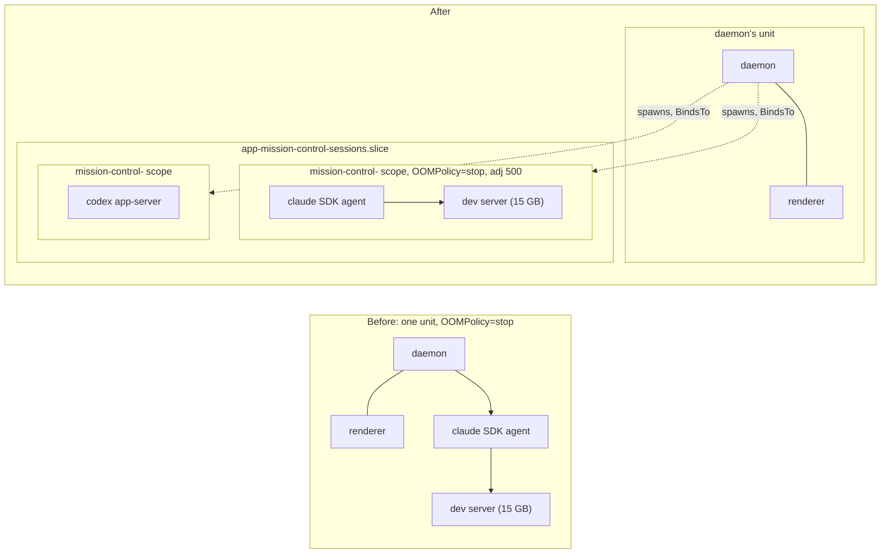
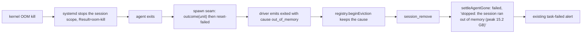

# One systemd scope per agent session, so an OOM stops only that session

Shaped 2026-10-17. Every decision below came from the interview recorded in
[Decisions](#decisions). Fork feature `fork:session-oom-isolation`, an upstream candidate.

On Linux, an SDK agent session, and everything it starts, runs in the daemon's own cgroup. When
one of those processes runs the machine out of memory, the kernel kills that one process, and
systemd then stops the whole unit it was in: the daemon, the dashboard renderer and every other
session go with it. This plan moves each SDK session into a transient systemd scope of its own,
so the unit systemd stops is that session's and nothing else's.

## Goals

- An OOM kill inside an agent session stops that session, never the daemon, the dashboard, or
  another session.
- In a global OOM, the kernel prefers agent sessions over the dashboard renderer and the daemon.
- A task whose session was stopped this way says so: "stopped: the session ran out of memory
  (peak 15.2 GB)".
- Stopping or restarting the daemon still stops its SDK sessions, as it does today.
- macOS and Windows spawn exactly as today. Linux without a systemd user manager makes no scope,
  and its only change is `choom -n 500` in front of the agent, when `choom` resolves.

## Non-goals

- A memory cap (`MemoryMax`/`MemoryHigh`) on sessions.
- Terminal-runtime agents and one-shot runners. See [Known gaps](#known-gaps).
- Resuming or re-dispatching a session automatically after an OOM stop.
- A new wire field, session-card label, or Setup diagnostic.
- Moving the daemon or renderer out of the terminal tab's scope under `make start`.

## What happened on 2026-10-17

From this machine's kernel and user journals:

1. **02:44:04.** A global OOM (`constraint=CONSTRAINT_NONE`). The kernel killed one process:
   `WebKitWebProcess` pid 2140516, 15.2 GB anonymous RSS, `oom_score_adj` 200, in
   `app-ghostty-surface-transient-1003006.scope`. It was a Tauri webview, most likely `tauri dev`
   started by an agent working on OpenDAM.
2. **02:44:04.** systemd: "The kernel OOM killer killed some processes in this unit." The scope
   has `OOMPolicy=stop` (systemd's `DefaultOOMPolicy`), so systemd began stopping the whole scope,
   sending SIGTERM to every process in it: the daemon, the renderer, every SDK agent.
3. **02:44:05.** The Electron main process, in its own `app-mission\x2dcontrol-<pid>.scope`
   (created by Chromium's portal code, not by Mission Control), dumped core.
4. **02:45:34.** "Stopping timed out. Killing.", then "Failed with result 'oom-kill'", with a
   20.5 GB memory peak and a 4.1 GB swap peak.

The kernel picked the right victim. The blast radius came from step 2: whatever the kernel kills,
systemd stops every process that shares its unit. Raising `oom_score_adj` alone cannot fix that,
because the victim would still share the daemon's unit.

## How it works today

**Who shares the daemon's cgroup.** Only SDK-runtime agents and their children. The daemon itself
runs in the terminal tab's scope under `make start`, in `mission-control.service` when installed
as a unit (`scripts/install-service.mjs`), or in the Electron app's process tree. Each of those
units stops whole on an OOM kill.

**Terminal-runtime agents do not.** `inUserScope` (`src/server/graphical-session.ts`) already
starts tmux and Herdr servers in their own `run-*.scope` in `app.slice`, and a WezTerm tab belongs
to WezTerm's GUI. An OOM there stops that server's agents, never the daemon.

**SDK spawn seams, one per harness:**

- **Claude:** the vendor's `spawnClaudeCodeProcess` hook, which `startQuery` in
  `src/server/harness/claude/sdk-deps.ts` installs for interactive sessions only. Catalog probes
  and one-shot queries use the vendor's own spawner.
- **Codex:** `spawnAppServer` in `src/server/harness/codex/sdk-deps.ts`, one server per session.
  The model-catalog probe calls it too.
- **Pi:** no agent process. The SDK runs inside the daemon. Its only children are bash-tool
  commands, which Pi spawns itself through the `spawnHook` passed to `createBashToolDefinition`
  in `src/server/harness/pi/sdk-deps.ts`. The hook may rewrite the command, cwd and env. Pi runs
  each command as `<shell> <args> <command>`, where `{ shell, args }` comes from
  `getShellConfig(shellPath)`, which Pi 0.87.1 exports: `/bin/bash -c`, else `bash` on `PATH`, else
  `sh -c`. Mission Control passes no `shellPath`.

**The exit path.** A driver emits `{ kind: "exited", reason, resumable }`
(`src/server/harness/types.ts`). The supervisor's `pump` (`src/server/sdk/supervisor.ts`) hands it
to `registry.applyDriverEvent`, which discards `reason` and calls `beginEviction`
(`src/server/registry.ts`). That emits `session_exit` at once and `session_remove` 8 s later.
On `session_remove`, `src/server/tasks.ts` calls `agentWentAway` and then `settleAgentGone`, which
writes `failed` with "the agent's session ended with no outcome recorded". The task-failed alert
fires from that status. The Codex app-server's exit is not observed at all today.

**`systemd-run --scope` execs in place.** `child.pid`, `recoveryProcessId`, the `{pid, startMs}`
lifetime, every by-pid kill, `daemonOwnedPids` discovery and session transfer all still see the
agent. `src/server/discovery/processes.ts` already lists `systemd-run` among its wrappers.

**Probed on this machine** (systemd 262, cgroup v2, `memory` delegated to the user manager):

- `systemd-run --user --scope` accepts `OOMPolicy`, `TimeoutStopSec`, `BindsTo` and `After`
  naming the caller's own unit, `MemoryMax` and `MemoryHigh`. It auto-creates
  `app-mission\x2dcontrol\x2dsessions.slice` on first use.
- It refuses `OOMScoreAdjust` ("Unknown assignment"), because a scope has no exec context.
  `choom -n 500 --` (util-linux) sets the value, and children inherit it.
- In a 64 MB test scope, `OOMPolicy=stop` stopped every process in the scope (the stand-in agent
  exited 143). `OOMPolicy=continue` killed only the memory hog.
- A scope started without `--collect` keeps `Result=oom-kill` and `MemoryPeak` after it fails.
  `systemctl --user show` reads them the moment the agent exits, even while a straggler keeps the
  scope `deactivating`. `reset-failed` then unloads it.
- When the agent itself is the victim, the kernel SIGKILLs it directly (exit 137). In five runs a
  read right after the exit already showed `failed` with `Result=oom-kill`. But systemd learns of
  the kill from the cgroup's OOM event, not from the agent's exit, so nothing orders the two.

## Design

### Where the processes live



Before, the OOM kill of the dev server makes systemd stop the daemon's whole unit. After, it stops
session A's scope: session A ends, while the daemon, the renderer and session B keep running.

### 1. The session scope

A new module, `src/server/platform/session-scope.ts` (next to `process-lifetime.ts`), owns how a
session's process is wrapped. It reuses `userManagerReachable` from `graphical-session.ts`, which
becomes an export, rather than restating it. It resolves `systemd-run`, `systemctl` and `choom`
through `locateExecutable`.

```ts
interface SessionScope {
  /** Settles once this daemon run's probe has decided what `wrap` may use. Never rejects. */
  ready(): Promise<void>;
  /** The argv to spawn in place of `[bin, ...args]`, and the scope's unit when one was made. */
  wrap(bin: string, args: readonly string[], env: NodeJS.ProcessEnv, label: string):
    { bin: string; args: string[]; unit: string | null };
  /** After the wrapped process exited: whether its scope was stopped for an OOM kill. Never throws. */
  outcome(unit: string): Promise<{ oomKilled: boolean; peakBytes: number | null } | null>;
}
```

All three methods land in slice 1 (see [Delivery order](#delivery-order)). `wrap` is synchronous,
because Claude's `spawnClaudeCodeProcess` hook must return its child synchronously. So each seam
awaits `ready()` in the async step before its spawn: `startQuery` for Claude, `connect` for
Codex, and the session factory in `createRuntime` for Pi. Every seam that wraps a
long-lived process (the Claude hook, `spawnAppServer`) calls `outcome` when that process exits,
whatever the reason. `outcome` reads the scope's verdict at once, and it resets a failed unit as
soon as systemd has finished stopping it. So a failed scope is not left loaded until the next
daemon start, unless the daemon itself exits first. Slice 3 adds no systemd read of its own: it only carries the result `outcome`
already returned into the `exited` event.

On Linux, with `systemd-run` resolved and the user manager reachable, `wrap` returns:

```
systemd-run --user --scope --quiet
  --unit=mission-control-<instance>-<label>-<nonce>
  --slice=app-mission\x2dcontrol\x2dsessions.slice
  -p OOMPolicy=stop -p TimeoutStopSec=10s
  -p BindsTo=<daemon unit> -p After=<daemon unit>
  -- choom -n 500 -- <bin> <args...>
```

| Part | Why |
| --- | --- |
| Own scope, no `--collect` | Bounds the OOM blast radius to the session. A failed scope keeps its `Result` until `outcome` reads it, and `outcome` resets it once systemd has finished stopping it. A scope that ends cleanly is collected by systemd as usual. |
| `--unit=mission-control-<instance>-<label>-<nonce>` | `<instance>` is the first 8 hex characters of the SHA-256 of this daemon's resolved state home. Every daemon sharing the user manager therefore names its scopes apart: worktree daemons under `make start`, the installed service, and test and e2e daemons. `<label>` is the session's id, `sdk:` prefix stripped. The nonce stops a resumed session's new scope from colliding with its predecessor's. An operator can tell which session a scope belongs to in `systemctl --user status`. |
| Dedicated slice | One place that lists every session and their total memory, with room for a later aggregate cap that does not touch the scopes. |
| `OOMPolicy=stop` | Explicit, so a user's `DefaultOOMPolicy=continue` cannot change it. An OOM kill anywhere in the session stops the whole session. |
| `TimeoutStopSec=10s` | The incident's stop took 90 s to finish. A session being stopped has nothing to flush for that long. |
| `BindsTo`/`After` the daemon's unit | Today `systemctl --user stop` or `restart` of `mission-control.service` kills SDK children through the unit's cgroup. Once they leave it, only this keeps that true. The unit is the leaf of the daemon's own `/proc/self/cgroup` when it is a `.service` or `.scope` of this user manager. Otherwise both properties are omitted, and the session relies on stdin EOF and `stopAll`, as an unscoped child does today. |
| `choom -n 500` | In a global OOM, agents (500) outrank the renderer (Chromium sets 300) and the daemon (inherited, 200 on this machine). Children inherit it. It applies even when no scope can be made, as long as `choom` resolves. |

**Fallbacks.** Each is decided once per daemon run:

- **Not Linux:** nothing is wrapped and nothing is logged.
- **Linux, `systemd-run` missing or the user manager unreachable:** no scope. `choom` still
  applies when it resolves. One log line.
- **The full property set refused by this systemd:**
  - **When and what.** Once per daemon run, starting at daemon startup, the probe runs
    `<runtime> -e ""` in a throwaway `--collect` scope with the full property set.
  - **Which runtime.** `<runtime>` comes from `resolveOwnedRuntime` (`src/shared/owned-runtime.mjs`),
    chosen the way `resolveMissionMcpRuntime` in `src/server/mission-mcp.ts` already chooses it:
    `process.execPath`, plus `ELECTRON_RUN_AS_NODE=1` when that is the Electron app binary. That
    is the packaged app's case, where the daemon is an Electron `utilityProcess`.
  - **Timeout.** The probe runs through `run()` with a 5 s timeout.
  - **On refusal** it probes again without `OOMPolicy`. The scope still keeps the daemon out of
    the session's unit, but an older systemd may not stop the session whole. If that is refused
    too, or a probe times out, there is no scope, and one log line names what was dropped or that
    the probe timed out.
  - **Why.** A wrapper that cannot start must never become a session that cannot start, and the
    probe is what guarantees it: no session start waits on it for longer than its timeout.
- **`choom` missing:** no `oom_score_adj` change, mentioned in the same log line.

**Startup hygiene.** On Linux with the manager reachable, the daemon resets failed
`mission-control-<instance>-*.scope` units, its own instance's only, left by a previous run that
died before reading them. It never touches another daemon's failed scope. So a second daemon
that starts between an OOM stop and the owning daemon's `outcome` read cannot wipe that
`Result=oom-kill`.

**Test scopes stay apart from the operator's.**

- **Under the test runner.** `sessionScope` follows the boundary `launchHome` already draws in
  `src/server/terminal/home.ts`. Built on its production deps, it returns every command unwrapped
  while `underTestRunner()` (`src/server/util/test-runner.ts`) is true, and a daemon a test spawns
  inherits that signal.
- **Where this stops.** Like `openDb`, this is not a sandbox. A test that spawns plain `node` and
  strips `NODE_TEST_CONTEXT`, `MISSION_TEST_STATE` and the inherited home has built the daemon's
  own launch, so `underTestRunner()` cannot see it. `test/daemon-keep-alive.test.ts` and
  `test/daemon-state-ownership.test.ts` do this today. Any SDK session such a daemon started would
  be wrapped for real. Its scopes still carry the `<instance>` of its own temp state home, so they
  never collide with, or get reset by, the operator's daemon, and its reset never touches the
  operator's scopes.
- **Tests that need the wrapping** inject their own deps:
  - the unit tests inject fakes;
  - the Linux real-systemd test injects the real `systemd-run` and `systemctl`, with an
    `<instance>` derived from its own temp home, so its scopes and its reset are disjoint from the
    operator's.
- **The e2e daemon** is not under the test runner, so `e2e/fixtures/fake-agents.ts` points
  `MISSION_SYSTEMD_RUN_BIN`, `MISSION_SYSTEMCTL_BIN` and `MISSION_CHOOM_BIN` at pass-through fakes
  for every spec, the same way it already fakes the agent CLIs.

**`choom` becomes a registered executable**, per the
[change contracts](../../agent-guides/change-contracts.md#executable-and-child-process-changes):
append `choom` to `EXECUTABLE_IDS` in `src/shared/executables.ts`, and add its `ExecutableSpec` to
`src/server/executables/catalog.ts` with the `CHOOM_BIN` override suffix. It is not
operator-facing, so it gets no Setup row. `src/server/discovery/processes.ts` adds `choom` to its
wrappers next to `systemd-run`.

### 2. Where each harness wraps

Each harness wraps at the spawn seam it already owns, through the one shared helper. No route,
supervisor or registry code branches on the agent.

- **Claude.** Inside the `spawnClaudeCodeProcess` hook. The hook spawns the wrapped argv, and the
  vendor gets the same child it gets today: pid, stdio, signal and exit. The hook also listens for
  that child's exit and calls `outcome`. `startQuery`'s params carry the session's label. Catalog
  probes and one-shot queries install no hook and stay unwrapped.
- **Codex.** `spawnAppServer` takes an optional label. `connect` passes the session's, and the
  model-catalog probe passes none and stays unwrapped. `spawnAppServer` gains the exit listener it
  lacks today, and that listener calls `outcome`.
- **Pi.** The existing bash-tool `spawnHook` rewrites `command` to
  `exec <systemd-run ...> -- <choom -n 500> -- <shell> <args> '<command>'`, quoted with the existing
  `shellCommand`. `<shell> <args>` is exactly what Pi's exported `getShellConfig` returns for the
  `shellPath` Mission Control passes to `createBashToolDefinition` (none today). The command
  therefore runs in the scope under the same shell Pi would have used, `/bin/bash -c` on a normal
  Linux machine, never a substituted `/bin/sh`. When that config uses stdin transport (Pi does so
  only for a legacy WSL bash on Windows), the hook leaves the command unwrapped.
  Each command gets its own scope named `mission-control-<instance>-<session>-<nonce>-<n>`. `<nonce>` is minted
  once per session launch, as it is for session scopes, and `<n>` counts that launch's commands.
  So a resumed session's command can never collide with a command scope a previous run left
  active, for example a backgrounded dev server after a `tsx watch` restart. The scopes carry the
  same properties plus `--collect`. An OOM stops only that command: Pi sees it exit 143, and the
  session continues. Pi's process-group kill still reaches the command, because the scope does
  not change its process group.

### 3. Reporting an OOM stop



Steps 1 and 5 land in slice 1 with `outcome`. Steps 2 to 4 land in slice 3.

1. The spawn seam (the Claude hook, `spawnAppServer`) hears its child exit and calls
   `outcome(unit)`. Within a 2 s budget, it reads
   `systemctl --user show <unit> -p ActiveState -p Result -p MemoryPeak` to decide the verdict:
   - **`Result=oom-kill`:** returns at once. This is the case where the kernel killed a child and
     systemd then stopped the agent, so `Result` was set before the agent exited.
   - **`active` or `deactivating` with any other `Result`:** polls every 100 ms until the unit
     reads `failed` or `inactive`, or reads `oom-kill`, or the budget runs out. This covers the agent
     itself being the kernel's victim: SIGKILLed directly, its exit can reach the daemon before
     systemd has handled the cgroup's OOM event.
   - **Budget runs out:** the last read decides, so a unit still `active` because a straggler
     outlived a clean exit reads as not OOM-killed.
   - **Reset, after the verdict.** `outcome` returns the verdict as soon as it is known and resets
     the unit in the background.
     - Why it waits: a straggler such as a dev server can keep an OOM-stopped scope
       `deactivating` for up to `TimeoutStopSec` after the agent exits, and `reset-failed` does
       nothing on a unit that is not yet `failed`.
     - So the reset polls every 500 ms, for up to 15 s (`TimeoutStopSec=10s` plus a margin),
       until the unit reads `failed` or `inactive`, then runs `systemctl --user reset-failed <unit>`.
     - A unit not settled by then, or one whose daemon exited first, is cleared by the startup
       reset.
2. The driver awaits that outcome before it emits `exited`. The event gains an optional cause:
   `{ kind: "exited"; reason; resumable; cause?: { kind: "out_of_memory"; peakBytes: number | null } }`.
3. `registry.applyDriverEvent` passes the cause to `beginEviction`, still the one eviction path.
   - **Where it is kept.** `beginEviction` records the cause in a registry map keyed by session
     id, and the cause outlives the session row. `remove()` still deletes the row and emits
     `session_remove` as today, and leaves the map entry in place.
   - **How it is read.** `registry.takeExitCause(sessionId)` returns the entry and deletes it.
   - **When it is cleared.** An entry nobody takes, from a session with no task, is dropped 60 s
     after `session_remove`.
   - **On the wire, nothing changes:** `session_exit` and `session_remove` keep their shapes.
4. `settleAgentGone` calls `registry.takeExitCause` for the task's session before it clears
   `sessionId`. A scout's task reaches `settleAgentGone` a beat after `session_remove`, once its
   archive refuses the completion, and it still finds the cause inside that window. With a cause,
   it writes `failed` with "stopped: the session ran out of
   memory (peak 15.2 GB)", plus the existing retained-worktree suffix. The peak is `MemoryPeak` in
   base-1024 units with one decimal, as systemd's own summary prints it. Without `MemoryPeak`
   (older systemd), the parenthetical is dropped. The existing task-failed alert carries the text.
   Nothing resumes automatically.
5. The daemon logs one line per OOM stop, with the session id, the unit and the peak, where the
   seam reads `outcome`.

A session with no task gets only the log line. A merged pull request still outranks this, because
`reconcileMergedTasks` runs first.

**Pi's command scopes are not read back.** Pi spawns those commands itself, and the hook never
sees them exit. systemd's journal records each OOM under its session-named unit, and the agent
sees exit 143. The round 2 option text said the daemon would log it. The plan review settled on
the journal instead. See [Decisions](#decisions).

### 4. Docs

- `docs/harnesses-and-terminals.md`, "Linux display and process scopes": a subsection on session
  scopes. It covers what is wrapped, the argv and its properties, `BindsTo`, `choom`, the fallback
  per platform, and the fact that terminal-runtime agents already live outside the daemon's cgroup.
- `docs/configuration.md`: `MISSION_CHOOM_BIN`.
- `docs/troubleshooting.md`: a new entry, "A task failed with 'stopped: the session ran out of
  memory'". It explains what happened, points at
  `systemctl --user status 'app-mission\x2dcontrol\x2dsessions.slice'` and
  `journalctl --user -u 'mission-control-*'`, and links the known gaps.
- `docs/session-lifecycle.md`: the exit cause that rides `beginEviction`.
- `docs/setup.md`: a row for session memory isolation in the Linux feature table.

## Fork tracking

A new fork feature, slug `session-oom-isolation`. The first implementation pull request creates
the `fork:session-oom-isolation` label and the `Fork feature: Agent session OOM isolation` tracking
issue, following `docs/fork/README.md`. Every pull request of the feature carries the label and a
"Fork feature changes" section.

- **Intent:** an OOM in an agent session stops that session, not the daemon or the dashboard.
- **Behavior contracts:** AC1 to AC9 below.
- **Upstream behavior it assumes:**
  - the vendor `spawnClaudeCodeProcess` hook;
  - `spawnAppServer` being the one Codex spawn;
  - Pi's bash `spawnHook` being able to rewrite `command`, and Pi's exported `getShellConfig`
    naming the shell its bash tool runs;
  - `beginEviction` being the one eviction path;
  - `settleAgentGone` writing the departure text;
  - `underTestRunner()` marking every test worker and the daemons it spawns;
  - `resolveOwnedRuntime` choosing the runtime for Mission-owned scripts under Electron.
- **Upstream surfaces touched:**
  - the three `sdk-deps.ts` files;
  - `harness/types.ts`, `registry.ts` and `tasks.ts`;
  - `graphical-session.ts`;
  - the executable registry and `discovery/processes.ts`;
  - `e2e/fixtures/fake-agents.ts`.
- **Fork-only files:** `src/server/platform/session-scope.ts` and its tests.
- **Plan docs:** this plan.
- **Upstream candidate:** yes. It is generic Linux robustness with no fork-specific behavior.

## Delivery order

Three slices. Each lands green on its own, in this order.

1. **Isolation.** `session-scope.ts` with both `wrap` and `outcome`, the `choom` registration, and
   the Claude and Codex seams with exit listeners that call `outcome`, so a failed scope is read
   and reset as its process exits. Also the per-OOM log line, `BindsTo`, the startup probe (`ready()`,
   the Electron-safe runtime, the 5 s timeout) and fallback log line, the instance-scoped startup reset, the test-runner unwrap and the e2e pass-through
   fakes, the slice 1 unit tests, the Linux real-systemd test, and the docs
   for these. This slice alone fixes the incident.
2. **Pi tool commands.** The `spawnHook` rewrite, its tests and its docs line.
3. **Reporting.** The driver awaiting `outcome` before it emits `exited`, the `exited` cause and its
   carriage through `beginEviction`, the `settleAgentGone` text, the registry and tasks tests, the
   Playwright spec and the troubleshooting entry. It adds no systemd read of its own.

## Verification

Run single files with the suite's loader, for example
`node --test --import ./test/setup-state.mjs --import tsx test/session-scope.test.ts`.

### Unit tests (`test/`, `node:test`)

- **`test/session-scope.test.ts`** (slice 1, `outcome` cases included):
  - **Linux with a manager and every executable:** the exact argv, meaning the unit-name shape, the
    slice, every property, `BindsTo`/`After` taken from a given daemon cgroup, and `choom`.
  - **`BindsTo`/`After` omitted** when the daemon's cgroup leaf is not a unit of this user manager.
  - **Instance prefix:** two state homes give two `<instance>` values, and the startup reset names
    only `mission-control-<instance>-*.scope`.
  - **Under the test runner:** built on production deps, `wrap` returns the command unwrapped;
    injected deps still wrap.
  - **darwin and win32:** argv unchanged, `unit` null, nothing logged.
  - **Linux without `systemd-run` or a manager:** no scope, `choom` applied, exactly one log line
    across two wraps.
  - **`choom` missing:** a scope without `choom`, and the log line says so.
  - **The probe refuses `OOMPolicy`:** it retries without it. If it refuses entirely, unwrapped.
  - **Probe runtime:** with an Electron app binary as `execPath`, the probe runs it with
    `ELECTRON_RUN_AS_NODE=1`. With `node` it adds nothing.
  - **Probe timeout:** a probe that outlives its 5 s timeout leaves every session unwrapped, the
    log line says it timed out, and `ready()` still settles.
  - **`outcome`:**
    - `oom-kill` with a peak gives `oomKilled: true`;
    - the agent killed directly: a unit that reads `active` with `Result=success` first, then
      `failed` with `oom-kill` on a later poll, gives `oomKilled: true`;
    - a unit still `active` when the 2 s budget runs out gives `oomKilled: false`;
    - `success` gives `oomKilled: false`;
    - a `systemctl` failure or timeout gives `null`;
    - `reset-failed` runs only once the unit reads `failed` or `inactive`. A unit `deactivating`
      with `Result=oom-kill` returns its verdict at once and is reset after it turns `failed`. One
      that never settles within 15 s is left to the startup reset.
- **Claude seam** (slice 1): the hook spawns the wrapped argv and returns that child, and the
  child's exit calls `outcome`. `startQuery` awaits `ready()` first. A catalog probe stays
  unwrapped.
- **Codex seam** (slice 1): `spawnAppServer` wraps with a label and does not wrap without one. Its exit
  listener calls `outcome`, and `connect` awaits `ready()` first.
- **Pi seam** (slice 2):
  - the inner shell and its args equal what Pi's `getShellConfig` returns for the same
    `shellPath`, by absolute path when Pi resolved one;
  - the rewritten command is run through Pi's own shell with pass-through fakes for `systemd-run`
    and `choom`. It keeps quotes, `$` and newlines intact, and it runs bash-only constructs:
    `[[ ]]`, an array, `set -o pipefail` and process substitution;
  - the unit name has the shape `mission-control-<instance>-<session>-<nonce>-<n>`, and two launches of the
    same session name their first command differently;
  - a stdin-transport shell config leaves the command unwrapped;
  - the session factory awaits `ready()` before it builds the bash tool.
- **Registry and tasks** (slice 3):
  - an `exited` event with an `out_of_memory` cause fails the task with the out-of-memory text;
  - `takeExitCause` returns the cause once after `session_remove`, and an entry nobody takes is
    gone 60 s later;
  - a scout task that settles a beat after `session_remove` still gets the out-of-memory text;
  - without a cause the text is unchanged;
  - a merged pull request still settles `done`;
  - eviction still goes through `beginEviction` alone.
- **`test/executable-contracts.test.ts`** (slice 1) passes with `choom` registered.

### Linux-only real-systemd test

`test/session-scope-linux.test.ts` skips unless all of these hold:

- the platform is Linux;
- the user manager is reachable;
- `systemd-run` and `choom` resolve;
- the user manager's cgroup delegates the `memory` controller, meaning `memory` is listed in
  `cgroup.controllers` of `user@<uid>.service`.

It is expected to skip on GitHub-hosted CI and
run on a developer's Linux machine. It passes test-only properties (`MemoryMax=64M`,
`MemorySwapMax=0`) through an internal option that production code never sets. It lands in
slice 1, which also delivers the `outcome` it asserts on. It injects its own deps, with an
`<instance>` derived from its temp home. So `underTestRunner()` does not unwrap it, and its real
scopes in the operator's user manager never collide with or reset the operator's.

- The wrapped process's `/proc/<pid>/cgroup` ends in
  `app-mission\x2dcontrol\x2dsessions.slice/mission-control-<instance>-<label>-*.scope`, and its
  `oom_score_adj` is 500. The test process's own cgroup is unchanged.
- A memory-hog child is OOM-killed. The hog allocates at most 512 MB, so it cannot press on the
  machine even if the cap were not applied. The wrapped process then exits from systemd's SIGTERM, its
  sleeping sibling is gone, `outcome` returns `{ oomKilled: true, peakBytes > 0 }`, and after
  `reset-failed` the unit is gone. The test process, standing in for the daemon, is still alive.
- A wrapped process that is itself the hog is SIGKILLed by the kernel (exit 137), and `outcome`
  still returns `{ oomKilled: true }`.
- A straggler that ignores SIGTERM keeps an OOM-stopped scope `deactivating`. `outcome` still
  returns `{ oomKilled: true }` at once, and the unit is gone once the stop timeout has passed and
  the background reset has run.
- `BindsTo`: a stand-in daemon in a scope of its own wraps a sleeper bound to it. Stopping the
  stand-in's scope stops the sleeper's.

### End-to-end spec (`e2e/`, Playwright)

The task-failure text is a UI change, so `e2e/session-oom.spec.ts` covers it in slice 3. It is Linux-only,
because the scope path exists only there, and it spends no model tokens. Every spec already gets
pass-through `systemd-run`, `systemctl` and `choom` fakes from `e2e/fixtures/fake-agents.ts`
(slice 1), so no e2e daemon creates a scope in the operator's user manager. For this spec the
fixture sets:

- a fake `systemd-run` through `MISSION_SYSTEMD_RUN_BIN`, which records its argv and execs what
  follows `--`;
- a fake `choom` through `MISSION_CHOOM_BIN`, which does the same;
- a fake `systemctl` through `MISSION_SYSTEMCTL_BIN`, which answers `show` with `Result=oom-kill`
  and `MemoryPeak=1610612736`, and `reset-failed` with exit 0;
- a runtime directory holding listening `systemd/private` and `bus` sockets, so the manager reads
  as reachable.

The fake `claude` gains a mode that ends the session as a killed process would. The spec
dispatches an SDK task. It asserts that the dashboard shows the task failed with "stopped: the
session ran out of memory (peak 1.5 GB)", and that the recorded `systemd-run` argv names the
sessions slice.

### Gates

`npm run typecheck`, `npm run lint`, `npm run build` and `npm run smoke` (the runtime spawn path
changed), and `npm run test:e2e` for the new spec.

### Acceptance criteria

- **AC1.** On Linux with a user manager, a Claude SDK session's agent and its children run in
  `app-mission\x2dcontrol\x2dsessions.slice/mission-control-<instance>-<session>-<nonce>.scope` with
  `oom_score_adj` 500. The daemon is not in that scope.
- **AC2.** The same holds for a Codex SDK session's app-server. Catalog probes stay unwrapped.
- **AC3.** Each Pi bash-tool command runs in its own scope in that slice with `oom_score_adj` 500,
  under the same shell Pi's bash tool would have used.
  An OOM stops that command only, and the Pi session continues.
- **AC4.** An OOM kill inside a session's scope stops that scope only. The daemon and other
  sessions keep running.
- **AC5.** A task whose session was stopped this way fails with "stopped: the session ran out of
  memory (peak N GB)", visible in the dashboard, and the daemon logs one line. Nothing resumes
  automatically.
- **AC6.** Stopping the daemon's unit stops its session scopes.
- **AC7.** macOS and Windows spawn exactly as today. Linux without `systemd-run` or a user
  manager makes no scope, and its only change is `choom -n 500` in front of the agent, when
  `choom` resolves. On Linux, one log line says when isolation is off or partial. A hung or refused probe
  never delays a session start by more than its 5 s timeout, and never fails one.
- **AC8.** The docs listed above describe the behavior and the per-OS fallback.
- **AC9.** A daemon's startup reset touches only its own instance's scopes. The following are
  always named under their own `<instance>`, so they never collide with or reset the operator's:
  the Linux real-systemd test, a daemon a test spawns, and a scrubbed-environment daemon.
  On production deps, a test worker and any daemon that inherits its test-runner signal create
  no scope at all, and neither does an e2e spec.

## Known gaps

- **Terminal-runtime agents** still share their multiplexer's scope: a tmux or Herdr server's
  `run-*.scope`, or WezTerm's GUI. An OOM there stops that server's other agents, never the daemon.
  A tmux built with systemd support, like this machine's 3.8, already puts each pane in a
  `tmux-spawn-*.scope` of its own.
- **One-shot runners** stay in the cgroup of whoever spawned them, the daemon or the Foreman
  worker. That covers `claude -p`, `codex exec`, LLM jobs, Inspector and Foreman's runners.
- **Pi's agent loop runs in the daemon**, so Pi's own memory is the daemon's.
- **No memory cap.** A runaway still drives the machine into a global OOM, and the desktop may
  thrash before the kernel acts. Only its session dies.
- **Under `make start`,** the daemon, renderer, Vite and Foreman worker still share the terminal
  tab's scope with anything else run in that tab.
- **The Electron main crash** that followed (the core dump at 02:44:05) is not addressed.
- **GitHub-hosted CI has no user manager**, so the real-systemd test skips there. The argv and
  flow tests run everywhere.
- **A daemon restart inside the 8 s linger loses the exit cause**, which is held only in memory.
  The startup reconcile then fails the task with the generic "no outcome recorded" text. The
  per-OOM log line, written when `outcome` read the scope, still records the OOM.
- **A session's scope survives a daemon that dies without its unit stopping**, as with a
  `tsx watch` restart. The agent exits on stdin EOF, as an unscoped child does today.

## Decisions

### Round 1 (2026-10-17)

| Question | Answer |
| --- | --- |
| Raise `oom_score_adj` as well as the scope? | Scope + `oom_score_adj` 500 via `choom` |
| What happens to the rest of a session after an OOM kill in its scope? | Stop the whole session (`OOMPolicy=stop`) |
| Memory cap on the scope? | No cap in this plan |
| Which spawns get a scope? | Claude SDK sessions, Codex SDK sessions, Pi bash-tool commands (one scope per command). Not terminal-runtime agents or one-shot runners |
| How is an OOM-stopped session reported? | Task failure text + daemon log line, no new wire field |
| Bind the scope to the daemon's unit? | Yes: `BindsTo` the daemon's unit |
| How visible is the fallback? | One daemon log line on Linux only |
| How does the real-systemd test run? | Linux-only, skipped without a user manager |

The per-session scope itself was not put to a vote. The journal shows that `oom_score_adj` alone
cannot fix the incident.

### Round 2 (2026-10-17)

| Question | Answer |
| --- | --- |
| Which slice do the scopes go in? | A dedicated `mission-control-sessions` slice under `app.slice` |
| A Pi bash command is OOM-killed: then what? | Only that command stops, and the Pi session continues |
| What happens to the task after an OOM stop? | It fails with the out-of-memory text. No automatic resume |
| Upstream candidate? | Yes |

### Plan review (2026-10-17)

| Question | Answer |
| --- | --- |
| The daemon cannot see a Pi bash command exit. How is a Pi command's OOM recorded? | systemd journal only, as written. The round 2 Pi option had said the daemon would log it, but Pi spawns those commands itself, so the daemon never sees them exit |
| What happens after this plan is approved? | Create tickets after the plan merges |

Revision 1 was approved as a complete bundle. Revision 2 records this review and changes nothing
else.

### Plan validation repair round 1 (2026-10-17)

The Plan Validation Local v3 judges found two inconsistencies. Revision 3 fixes both and changes
nothing else.

- **Slice 1 depended on `outcome`, but `outcome` was assigned to slice 3.**
  - The dependency: slice 1's unit tests and its Linux test assert on `outcome`, and slice 1 drops
    `--collect`, so without a read its failed scopes would stay loaded until the next daemon start.
  - The fix: `outcome` (the `systemctl show` read, `reset-failed` and the per-OOM log line) and the
    seams' exit listeners that call it now land in slice 1. Slice 3 only carries the result into
    the `exited` event and the task text.
  - The Delivery order, the Verification lists and the `SessionScope` description now say so.
- **The fork-tracking behavior contracts named AC1 to AC7.** They now name AC1 to AC8, so the docs
  requirement is a contract a sync keeps true as well.

### Plan validation repair round 2 (2026-10-17)

The Plan Feasibility judge raised two blocking Pi-seam findings. Revision 4 fixes both. It also
takes up the judge's non-blocking notes, and changes nothing else.

- **The rewrite hard-coded `/bin/sh`.**
  - The problem: where `/bin/sh` is not bash, for example dash on Debian and Ubuntu, bash syntax
    in a Pi command would break.
  - The fix: the rewrite now re-invokes exactly the `{ shell, args }` that Pi's exported
    `getShellConfig` returns, and leaves a stdin-transport config unwrapped.
  - The slice 2 test asserts that shell and runs bash-only constructs through the rewrite.
- **Pi command scopes had no nonce.**
  - The problem: a resumed session's command N could collide with an active scope a previous run
    left behind, and systemd-run would refuse to start it.
  - The fix: Pi command units are now `mission-control-<session>-<nonce>-<n>`, and the slice 2 test
    pins that shape.
- **Non-blocking notes:**
  - the property probe runs the daemon's own Node instead of `/bin/true`;
  - the Linux real-systemd test also requires a delegated `memory` controller;
  - the test caps its memory hog at 512 MB.
- **Propagated to:** How it works today, the fork tracking assumptions, and AC3.

### GitHub Inspector finding on PR #550 (2026-10-17)

The finding was *Startup reset-failed is not scoped to the daemon that owns the scope* (major).
Revision 5 fixes it and changes nothing else.

- **The problem.**
  - Every daemon on the machine shares one user manager, one sessions slice and one unit-name
    pattern: worktree daemons, the installed service, and test and e2e daemons.
  - Each one reset every failed `mission-control-*.scope` at startup. So a second daemon starting
    before the owning daemon's `outcome` read could wipe `Result=oom-kill`, and the task would
    read "no outcome recorded".
  - Separately, nothing stopped test and e2e daemons from creating scopes in the operator's user
    manager.
- **The fix.**
  - Every unit name carries `<instance>`, a hash of the daemon's resolved state home, and the
    startup reset names only `mission-control-<instance>-*.scope`.
  - `sessionScope` built on production deps stays unwrapped under `underTestRunner()`, as
    `launchHome` does.
  - The Linux real-systemd test injects its deps with its own instance.
  - The e2e fixture fakes `systemd-run`, `systemctl` and `choom` for every spec.
  - The new AC9 holds both properties, and the fork contracts now name AC1 to AC9.
- **Superseded.** The Pi unit-name shape recorded in repair round 2,
  `mission-control-<session>-<nonce>-<n>`, gains the same `<instance>` prefix.

### GitHub Inspector finding 2 on PR #550 (2026-10-17)

The finding was *AC9 overstates test isolation from the operator's user manager* (minor).
Revision 6 fixes it and changes nothing else.

- **The problem.** AC9 claimed no test or test-spawned daemon creates a scope in the operator's
  user manager. Two cases contradict that:
  - the Linux real-systemd test creates real scopes there on purpose;
  - `test/daemon-keep-alive.test.ts` and `test/daemon-state-ownership.test.ts` strip
    `NODE_TEST_CONTEXT` before spawning `node`, so `underTestRunner()` cannot see those daemons.
- **The fix.**
  - AC9 now states what the design gives. Every such scope is named under its own `<instance>`
    and never collides with or resets the operator's. "No scope at all" is claimed only on
    production deps under the test-runner signal, and in e2e specs.
  - The test-runner bullet gains a "Where this stops" note on scrubbed spawns, in the shape
    AGENTS.md uses for `openDb`.
  - The heading over that list no longer claims more than the design gives.

### GitHub Inspector finding 3 on PR #550 (2026-10-17)

The finding was *Property probe runs process.execPath without Node mode under Electron* (major).
Revision 7 fixes it and changes nothing else.

- **The problem.**
  - In the packaged app, the daemon is an Electron `utilityProcess`
    (`src/main/utility-supervisor.ts`), so `process.execPath` is the app binary.
    `process.execPath -e ""` would start a second app instead of exiting.
  - The probe also ran on the first `wrap`, which cannot wait on anything: Claude's
    `spawnClaudeCodeProcess` hook is synchronous.
- **The fix.**
  - The probe runtime comes from `resolveOwnedRuntime`, with `ELECTRON_RUN_AS_NODE=1` under
    Electron, as `resolveMissionMcpRuntime` already does.
  - The probe starts at daemon startup and runs through `run()` with a 5 s timeout. A timeout
    leaves sessions unwrapped, with a log line.
  - `SessionScope` gains `ready()`. Each seam awaits it in its async step (`startQuery`, `connect`,
    the Pi session factory), and `wrap` stays synchronous.
  - Tests cover the Electron `execPath`, the timeout and the awaits. AC7 now bounds how long the
    probe can delay a session start.
- **Superseded.** Repair round 2's note that the probe runs `process.execPath -e ""` now reads
  `<runtime> -e ""` with the runtime above.

### GitHub Inspector finding 4 on PR #550 (2026-10-17)

The finding was *AC7 says no-systemd Linux spawns unchanged, but the fallback still wraps in
choom* (minor). Revision 8 fixes it and changes nothing else.

- **The problem.** The goal and AC7 said Linux without `systemd-run` or a user manager spawns
  exactly as today. The fallback and its unit test still put `choom -n 500` in front of the agent
  there.
- **The fix.** It keeps `choom`, as the approved design already does: a raised `oom_score_adj`
  still steers the kernel toward agents in a container with no systemd. The goal and AC7 now say
  that such a machine makes no scope and changes only that. "Exactly as today" now covers macOS
  and Windows alone, and the fallback and test text stand as written.

### GitHub Inspector finding 5 on PR #550 (2026-10-17)

The finding was *outcome read races systemd when the agent itself is the OOM victim* (major).
Revision 9 fixes it and changes nothing else.

- **The problem.** The plan said `Result=oom-kill` is always set before the agent exits. That
  holds only when the kernel kills a child and systemd then stops the agent. When the kernel kills
  the agent itself, its exit can reach the daemon before systemd has handled the cgroup's OOM
  event. A single read would then see `Result=success` on a still-`active` unit, and the task would
  read "no outcome recorded".
- **The fix.**
  - `outcome` returns at once on `oom-kill`. On a unit still `active` or `deactivating`, it polls
    `ActiveState` and `Result` every 100 ms within the existing 2 s budget before it decides, and
    `reset-failed` runs in every case.
  - A unit test covers an `active`-then-`failed` sequence and a unit that outlasts the budget.
  - The Linux test covers a wrapped process that is itself the SIGKILLed hog.
  - A probe on this machine (five runs of a self-OOMing scope) already read `failed oom-kill`
    straight after the exit. It is recorded as observed, not as a guarantee.

### GitHub Inspector finding 6 on PR #550 (2026-10-17)

The finding was *No named channel from the eviction cause to settleAgentGone* (minor). Revision
10 fixes it and changes nothing else.

- **The problem.** `remove()` deletes the session row before it emits `session_remove`, and the
  event carries only `{ id }`. So `settleAgentGone`, reached through `reconcileTasksBoundTo`, had
  nowhere named to read the cause from. A daemon restart in the 8 s window was also unaddressed.
- **The fix.**
  - `beginEviction` records the cause in a registry map, and `registry.takeExitCause(sessionId)`
    returns it once and deletes it.
  - An entry nobody takes is dropped 60 s after `session_remove`. That window also covers the
    scout path, which settles a beat later.
  - `settleAgentGone` takes the cause before it clears `sessionId`, and the wire shapes do not
    change.
  - The restart case is stated as a known gap rather than made durable: the cause is in memory
    only, and the per-OOM log line still records the OOM.
  - Tests cover the take-once read, the 60 s drop, and the late scout settlement.

### GitHub Inspector finding 7 on PR #550 (2026-10-17)

The finding was *reset-failed can run before an oom-killed scope reaches failed* (minor). Revision
11 fixes it and changes nothing else.

- **The problem.** On `Result=oom-kill`, `outcome` returned at once and ran `reset-failed`. But a
  straggler can keep the scope `deactivating` for up to `TimeoutStopSec`, and `reset-failed` does
  nothing on a unit not yet `failed`. The scope would then stay loaded until the next daemon start,
  which contradicted the plan's own claim.
- **The fix.**
  - `outcome` still returns the verdict at once.
  - It now resets the unit in the background. The reset polls every 500 ms, for up to 15 s, until
    the unit reads `failed` or `inactive`, then runs `reset-failed`. The startup reset clears any
    unit left after that.
  - The "never left loaded" claim now says "unless the daemon itself exits first".
  - A unit test covers the deactivating-then-failed reset and the 15 s give-up. A Linux case
    covers a straggler that ignores SIGTERM, the case probed earlier on this machine.
- **Superseded.** Finding 5's note that `reset-failed` runs in every case now reads: the reset runs
  in every case, once the unit has settled.
