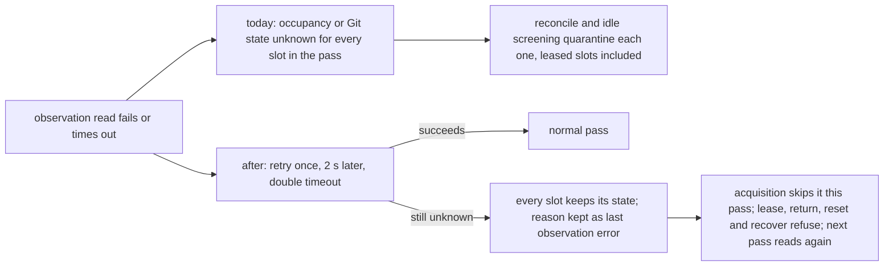
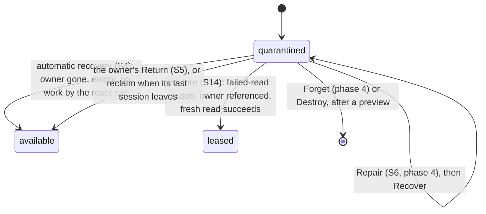

# Make worktree slots survive large monorepos

**Status:** Shaped with the operator in two interview rounds (2026-10-28 and 2026-10-29). Revision 1 was approved on 2026-10-29. Revision 2 repairs three findings from the Plan Validation review: the reset rule now counts the ignored entries a reset really discards, phase 1 produces the blocking path its card shows, and a check tree's lease settles before its registration is pruned. Approval is the Mission Control plan review of this exact revision.\
**Scope:** native worktree pools, check fallback trees, slot observation and recovery, the Worktrees slot card, the dev-mode daemon log\
**Builds on:** `docs/plans/disk-reclaim/plan.md` (approved 2026-10-26, shipped as #602, #604, #608, #609, #611 and #615)\
**Amends:** disk-reclaim D6, D10, D11 and D20, and four documented rules in `docs/worktrees-and-checks.md` (see [What this changes in earlier decisions](#what-this-changes-in-earlier-decisions))\
**Delivery:** one plan in six phases; tickets are sliced from it after it merges

## Goal

upstart-web-frontend (uwf) is a yarn berry monorepo whose slots each carry 5.7 to 28 GB of
`node_modules`. A fresh slot takes 10 to 13 minutes of yarn before it can be leased. In the
operator's words: "I cannot afford to destroy 13 to recover the slot, it takes 20 mins every
time I need to setup an upstart-web-frontend slot."

uwf had 12 quarantine episodes across at least 10 of the 15 slots it ever created, and some
slots sat quarantined for about 14 days. Most of those quarantines came from a read that failed
under load rather than from anything wrong with the slot, and the usual way out was Destroy.

After this work:

1. A read that fails or times out never quarantines a slot. Only a proven fault does.
2. A quarantine that no longer applies clears by itself, without discarding work and without
   losing the warm install.
3. Every quarantined slot has a way out from its card, and those exits keep the install
   wherever they can: Recover, Return, and Repair first, with Forget and Destroy last.
4. Nobody edits SQLite or runs `git worktree` by hand to get a slot back.
5. The slot card, the daemon log, and a durable history say what happened to a slot and why.
6. A new slot can seed its install from a quarantined sibling instead of running yarn from
   scratch.

## What we know

The evidence was gathered on 2026-10-27 and re-checked against `main` at `79ac4e8f`, the
operator's running build, on 2026-10-28.

| # | Finding | Basis | Confidence |
| --- | --- | --- | --- |
| F1 | In uwf slots 13 and 14, the only ignored entry outside `REGENERABLE_IGNORED_PATHS` is `.yarn/install-state.gz`. Slots 10 to 12 also hold ignored `.idea/`, `apps/personal-loans/tsconfig.tsbuildinfo` and `e2e/test-results/`. Each of these makes automatic Recover and settled-tree reclaim read the slot as holding work. The list is fixed in `src/server/git/worktree-return-safety.ts`. | `git --no-optional-locks status --ignored=matching` in each slot; the source file | Verified |
| F2 | A pool reset runs `checkout --force --detach`, then `reset --hard`, then `clean -fd`, never `-fdx`. It keeps an ignored file only while that file stays ignored. Checkout overwrites an ignored path that the target commit tracks. `clean -fd` runs after checkout, under the target's `.gitignore` files, so it deletes an entry the target no longer ignores. Recover's work check (`WorktreeManager.slotWork`) still counts ignored files as work it would discard. | `worktrees/git.ts` `reset`, `docs/agent-guides/architecture.md` | Verified |
| F3 | `run()` reports a child killed by its timeout as code 1, empty stderr and `outcomeUnknown: true`, and `failure()` in `worktrees/git.ts` prints only "exit 1". uwf 14 ("git status failed: exit 1") and mc 12 ("git symbolic-ref HEAD failed: exit 1") have that exact shape: a `symbolic-ref --quiet` that really exited 1 with nothing on stderr would have been read as detached, not failed. The same `git status` now answers in under 1 s, and load average passed 100 while installs ran. | `src/server/util/exec.ts`, `worktrees/git.ts` `detachedAt` and `failure`, live timings | Inferred, about 85%: these were 15 s timeouts |
| F4 | `NativeWorktreeGit.status` runs without `--no-optional-locks`, so it may take `index.lock` to refresh the index. If it is killed mid-refresh, the lock can be left behind, and the next reset then fails with "Unable to create '...index.lock': File exists". | `worktrees/git.ts` `status`; `worktree-activity.ts` documents the same hazard | Inferred, about 60%: the mechanism is verified, but no instance was caught |
| F5 | One failed listing, or one PID whose cwd `lsof` omitted, makes occupancy unknown for every target (`inspectWorktreeOccupancy`). `reconcilePool` then quarantines every slot whose occupancy or Git state is unknown, leased ones included. `screenIdleSlots` does the same to available siblings, during seed-source selection as well. | `worktrees/occupancy.ts`, `worktrees/manager.ts` | Verified |
| F6 | An owner's own return accepts a quarantined slot (`WorktreeStore.markReturning` takes `leased` or `quarantined`). The card nonetheless offers only Destroy on a quarantined slot whose owner is referenced (`operations.ts`). | Code | Verified |
| F7 | Live state at 23:14 on 2026-10-28: uwf 13 and 14 were available again. uwf 10 was returned by its finished task and then quarantined at 19:28 as "available slot is occupied or dirty"; it is now empty and clean. uwf 11 and 12 belong to cancelled tasks whose SDK sessions are still `running`, each with a live `claude` process and its MCP children inside the slot. | Read-only database query, `lsof -d cwd`, `ps` | Verified |
| F8 | A seed source must be an idle **available** sibling (`WorktreeManager.seedSources`). With most of a pool quarantined there is none, so seeding never ran ("No idle sibling could be seeded from"). The uwf claim's `seed.paths` already lists its `node_modules` trees and `.yarn/install-state.gz`. | Code, the operator's `worktrees` config | Verified |
| F9 | Quarantined slots count toward `maxSlots` (`WorktreeStore.reserveNew` counts every row). | Code | Verified |
| F10 | A check fallback tree is returned with `git worktree remove --force`. Once the tree's `.git` is gone, Git refuses with "validation failed", the lease stays `returning`, and every pass retries it. The sweep leaves the tree alone because the lease still names it. On 2026-10-27 there were 8 such uwf trees, holding 22 GB. | `workflows/check-lease.ts`, `worktrees/orphan-sweep.ts`; the count comes from the investigation | Verified in code |
| F11 | `quarantine()` logs nothing. The dev daemon (`tsx watch` under `make start`) writes only to its terminal, and `~/.mission-control/daemon.log` was last written on Oct 19. Only Electron's `startDaemon` and the installed service write that file. | Code, `package.json`, the file's mtime | Verified |
| F12 | The slot card renders `quarantineReason ?? diagnostic ?? processes.reason` (`WorktreeSettingsPanel.tsx:761`), so whenever a reason exists, the detail (Git's stderr, for example) is hidden. | Code | Verified |
| F13 | `knownOwner` is not wired (`occupancy.ts` defaults it to `() => null`), and the Claude background-process classifier in `harness/claude/detect.ts` plays no part in occupancy. | Code | Verified |

How often slots broke. There is no history table, so these counts were rebuilt from 29 hourly
database backups (Sep 30, Oct 16, Oct 19, then hourly on Oct 26 and 27). A slot that came and
went between two backups does not appear.

| Quarantine reason | Episodes | Cause after F3 to F5 |
| --- | --- | --- |
| Occupancy unknown: `cwd listing omitted N ps-listed PID(s)` | 9 | One unresolved PID quarantined a whole pass |
| Occupancy unknown: `process listing ... killed before it answered` | 6 | A `ps` timeout under load |
| `slot Git state is unknown` (exit 1) | 4, plus 2 on Oct 28 | A Git read killed by its 15 s timeout |
| `slot Git registration is bare, locked, or prunable` | 3 | Interrupted or broken registration; each took 35 min to 3.5 h by hand |
| `worktree reset failed` (stale `index.lock`) | 1, plus one in the disk-reclaim audit | A Git process killed while holding the lock |

## Adopted decisions

Every decision below was made by the operator in the shaping interview. Round 1 took place on
2026-10-28 and round 2 on 2026-10-29. Round 1's form was delivered twice, because the first
send failed in transit, and both copies came back with the same answers.

| ID | Decision | Answer |
| --- | --- | --- |
| S1 | Whether ignored files block an action that only resets a pool slot | **No.** Only actions that delete a folder count ignored files. Recover, automatic recovery and pool-slot reclaim check tracked, untracked and unpushed work only |
| S2 | How a deleting action learns which ignored paths are regenerable | The built-in list **plus the pool claim's `seed.paths`**. No new setting |
| S3 | What a failed or partial read does | **Retry once, then leave every slot as it was.** A failed read never quarantines. Only a proven fault does, and every transition still refuses on unknown |
| S4 | Which quarantines automatic recovery also clears, under the existing safety line | **Occupancy unknown, Git state unknown, and an available slot that was occupied or dirty**, once a fresh read proves the slot empty and clean. `index.lock` stays as it is |
| S5 | A quarantined slot whose owner is still referenced | The card **names the owner** and says its return brings the slot back; **Return is offered**; and a cancelled or failed task's slot is **reclaimed as soon as its last session leaves** |
| S6 | The way out for a missing, prunable or locked registration | **Repair in place**, with a previewed **Forget** as the fallback |
| S7 | How far the `index.lock` fix goes | `--no-optional-locks` on **every observation read** in `worktrees/git.ts`, and observation **skips a slot whose lock is held** |
| S8 | A process in an available slot | **Reported, with Kill**, through the same guarded route; **known processes are named**; an occupied available slot is **skipped, not quarantined** |
| S9 | Open terminal on an available slot | **Takes a manual lease**, returned from the card |
| S10 | Visibility and history | The slot card shows the reason, the detail, the last automatic-recovery refusal with its blocking path, and the occupants. Timeouts are named as timeouts. Log lines for quarantine and recovery. A durable dev-mode daemon log. An append-only slot history. Provisioning, claim and seed timings. Persisted operation results. **Telemetry is not included** |
| S11 | A check return whose tree Git no longer recognizes | **Delete the folder, prune its registration, and complete the lease** |
| S12 | Making a fresh slot cheaper | **In scope:** an unoccupied, ownerless quarantined slot whose install is `current` may serve as a read-only seed source |
| S13 | Whether quarantined slots count toward `maxSlots` | **They keep counting.** Fewer quarantines, cleared faster, are the fix |
| S14 | A slot quarantined only by a failed read whose owner is still referenced | **It goes back to `leased`** once a fresh read succeeds. The tree is not touched |
| S15 | An occupant that is a live Mission Control session | The card **names the session and links to it. No Kill** |
| S16 | What the Open terminal lease does to the tree | **Nothing.** The slot is leased exactly as it stands: no reset and no claim |
| S17 | Whether registration repair runs without an operator | **Automatically only for Git's own fixes** (`git worktree repair`, and unlocking a stale `initializing` lock). Re-registration and Forget run only from the card |
| S18 | History retention | **90 days, capped at 2,000 rows per pool**, oldest dropped first |
| S19 | Where history and timings appear | A **History** disclosure on the slot card, the last **timings and seed outcome** on the card, and a **pool-row summary**: median fresh-slot time and seed hit rate over the last 10 new slots |
| S20 | How operation results relate to history | **One store.** Each finished operation writes one history entry per slot it touched |
| S21 | The dev-mode daemon log | **`~/.mission-control/daemon.log`**, rotated at 10 MB with 3 old files kept |
| S22 | Delivery | **One plan in six phases, stopping new quarantines first** |

These follow from the answers above; they were not asked:

- **No new problem kind.** A process in an available slot is an `orphan-process` by definition,
  because the slot has no owner, so the existing bannered problem (disk-reclaim D25) covers it.
  Warm and claim processes stay excluded, as they are today.
- **A dirty available slot still quarantines.** Changed tracked files in a slot nobody leased are
  a proven fault. A slot that is merely occupied is skipped.
- **One retry, inside the same pass.** It comes after a 2 s pause, with double the timeout. An
  unresolved PID is re-read on its own before the whole listing counts as unknown.
- **Repair and Recover refuse a slot with an occupant or a live owner.** Moving a folder aside,
  or resetting it, would pull the tree out from under a running session.
- **Kill's guarded return keeps its stricter check.** A safe Kill of a live task still counts
  every ignored file, as disk-reclaim decided. S1 changes only Recover, automatic recovery and
  settled pool-slot reclaim.
- **S1 counts what the reset really discards** (added in revision 2, after the Plan Validation
  review). A reset keeps an ignored entry only while it stays ignored. The reset rule therefore
  counts an ignored entry as work when either of these holds, unless the entry is regenerable:
  - the target commit tracks a path at or under it, which checkout overwrites;
  - the target's ignore rules no longer ignore it, which `clean -fd` deletes.

  This only narrows what automatic recovery may touch, so the operator's answer and safety line
  stand as given.

### What this changes in earlier decisions

| Earlier rule | Where | Now |
| --- | --- | --- |
| "Clean" means no ignored file outside `REGENERABLE_IGNORED_PATHS` (D6, D10, D20) | disk-reclaim plan; `docs/worktrees-and-checks.md` Recover and Task worktree retention | For an action that resets a pool slot, ignored files are not work, except an ignored entry that the reset would overwrite or delete and that is not regenerable (S1) |
| The regenerable list is fixed (D11, and the "clean" note) | disk-reclaim plan; Orphan tree sweep, Unowned trees | For actions that delete a folder, the regenerable set also includes the pool claim's `seed.paths` (S2) |
| Automatic recovery covers only `index.lock` (D10) | disk-reclaim plan; Recover | It also covers occupancy unknown, Git state unknown, and occupied or dirty, under the same safety line (S4) |
| "Reconcile ... keeps uncertainty quarantined"; "Startup reconciliation uses the same fail-closed rules" | `docs/worktrees-and-checks.md` Native pools and the operations list | Uncertainty leaves a slot as it was. Such a slot is never leased, reset or returned while unknown, and it is never quarantined for being unknown (S3) |
| An orphan process lives in a pool slot only while that slot holds the finished owner's lease, or holds no lease and is quarantined | `docs/worktrees-and-checks.md` Orphan processes | Also a slot that is available and holds no lease (S8) |
| A seed source is an idle available sibling | `docs/worktrees-and-checks.md` Seeding | Also a quarantined sibling that meets S12 |
| Open terminal opens a shell in the slot and nothing more | `docs/worktrees-and-checks.md` Settings > Worktrees | On an available slot it first takes a manual lease, as the slot stands (S9, S16) |

## Design

The six phases follow S22. Each one ships on its own and leaves `main` working.

### Phase 1: stop false quarantines

1. **Timeouts are named as timeouts.**
   - `run()` (`src/server/util/exec.ts`) adds two fields to its result: `timedOut`, set when Node
     killed the child at `timeoutMs`, and `signal`.
   - `failure()` in `worktrees/git.ts` reports "`<step>` timed out after `<n>` s" or
     "`<step>` was killed by `<signal>`", and only otherwise the stderr or the exit code.
   - The process-inspection and orphan-sweep messages follow the same rule. No worktree message
     ever reads "exit 1" for a command that did not exit.
2. **One retry.** These reads retry once in the same pass, 2 s later, with double the timeout:
   - an occupancy inspection whose listing or cwd read fails;
   - `NativeWorktreeGit.list`;
   - `inspect`;
   - an owner lookup that throws.

   A PID that the cwd listing omitted is first re-read on its own (`readCwds([pid])`). Only a PID
   that is still unresolved, and still alive with the same start time, makes the listing unknown.
3. **Unknown never quarantines.** Every place that quarantines because a read failed now leaves
   the slot in its state. These are `reconcilePool` (including its pool-wide `failPool` for
   "Git worktree registrations are unknown" and an unreadable marker) and `screenIdleSlots`, which
   covers acquisition, Warm targets and seed-source selection.
   - The failed reason is written to the slot's `last_error` as "Last observation failed:
     `<reason>`", the card shows it, and the next successful read clears it.
   - Acquisition does not lease a slot it could not prove idle in this pass. Lease, return,
     reset, Recover, Prune and Destroy still refuse on unknown, exactly as they do today.
   - The reasons that count as observation failures live in one exported set in a new
     `src/server/worktrees/quarantine-reasons.ts`. The writer and phase 2's matcher both use it,
     so they cannot drift. The set includes the reason strings that older builds wrote with the
     same meaning, so rows already in the database qualify without a migration.
   - Proven faults still quarantine:
     - an inexact path;
     - a missing registration once listing has succeeded;
     - a bare, locked or prunable registration;
     - a different common directory;
     - an interrupted provisioning, prune or return;
     - a dirty available slot;
     - an available slot whose HEAD moved;
     - an available slot carrying active lease identity;
     - an incomplete identity;
     - a leased slot whose owner is positively gone;
     - every reset or verification failure;
     - an identity or a marker that is missing or belongs to another pool.
   - A reservation that a read refused **before anything changed** goes back to available. One
     whose mutation outcome is unknown is still quarantined.
4. **An occupied available slot is skipped.** Reconcile splits "available slot is occupied or
   dirty" in two. Occupied leaves the slot available, and acquisition passes over it. Dirty still
   quarantines.
5. **Observation takes no Git locks (S7).**
   - Every read in `worktrees/git.ts` that observation uses (`status`, `rev-parse`,
     `symbolic-ref`, `worktree list` and the default reads) passes `--no-optional-locks` before the
     subcommand. Mutations do not.
   - Inventory (`observeStatus`) does not read Git in a slot whose slot lock is held. It shows the
     slot as **busy**, naming the operation or claim that holds it, alongside its last durable
     facts. Reconcile and acquisition already take the slot lock and are unchanged.
6. **Log lines.** These lines go through `console`, which phase 5 makes durable:
   - every quarantine: `[worktrees] quarantined <pool> slot <n>: <reason> (<detail>)`;
   - every recovery and every return to `leased`;
   - every automatic-recovery refusal and every "left unchanged after a failed read", logged
     only when the slot's reason changes, so a 5-minute pass repeating the same refusal stays
     quiet.
7. **Work checks name what blocks them.** `worktree-return-safety.ts` gains
   `worktreeWork(path, options)`. It returns the first entry that blocks, as its path and its kind
   (tracked, untracked, ignored or unpushed), instead of a sentence.
   - In this phase it applies exactly today's rule, the one `regenerableIgnored` gives, so no
     decision changes.
   - `worktreeReturnBlocker` and `WorktreeManager.slotWork` become thin wrappers over it.
   - Automatic recovery records the blocking entry with each refusal. The lock check already
     names the lock path for a lock-caused refusal.
   - Phase 2 adds the reset and delete rules to this same function.
8. **The card shows what it knows.** `WorktreeSettingsPanel` shows each of these on its own line:
   - the reason and the detail;
   - the last automatic-recovery refusal, with the exact path that blocked it: the entry
     `worktreeWork` returned, or the lock path;
   - the known occupants, with PID, command (bounded to 512 bytes) and start time.

   The inventory carries a bounded occupant list for each slot, which already exists inside the
   manager.

### Phase 2: clear what remains

1. **Two work rules, chosen by what the action does.** Phase 1's `worktreeWork` gains the
   options `rule`, `regenerable` and `targetCommit`, and still returns the first blocking entry
   with its path and kind. `worktreeReturnBlocker` keeps today's rule for safe Kill and the other
   callers.
   - **Reset rule** (the slot keeps its folder). Work is:
     - a staged or unstaged tracked change;
     - an untracked file that is not ignored, other than the allowed conductor scratch;
     - an unpublished commit;
     - an ignored entry that the reset would overwrite or delete, unless it is in the regenerable
       set described under the delete rule. Checkout overwrites an ignored entry when
       `targetCommit` tracks a path at or under it. `clean -fd` runs after checkout, under the
       target's `.gitignore` files, so it deletes an ignored entry that the target's rules no
       longer ignore.

     How the last item is evaluated, without writing anything in the slot:
     - **Tracked by the target:** one
       `git --no-optional-locks ls-tree -r -z --name-only <target> -- <ignored entries>`. Any path
       it prints overwrites that entry, and a directory entry such as `.idea/` matches every
       tracked path under it.
     - **Not ignored by the target:** first, `git diff --name-only <HEAD> <target>` over every
       `.gitignore` path. The other ignore sources, `info/exclude` and `core.excludesFile`, do not
       change with the commit. When no `.gitignore` differs, no ignored entry can become
       un-ignored. When one does, the target's rules are evaluated in a private temporary
       repository holding:
       - each `.gitignore` blob from the target, at its path;
       - the common directory's `info/exclude`;
       - the slot's effective `core.excludesFile`;
       - an empty file or directory for each ignored entry, so directory-only patterns match as
         they would in the slot.

       `git check-ignore --no-index --stdin -z` then runs over the entries. An entry it does not
       report as ignored is one `clean -fd` would delete. The temporary repository is removed
       afterwards.
     - **Fail closed:** any of these steps that fails or times out counts as work, so ignore
       rules that cannot be evaluated never let a reset run unattended.
     - **The same target:** the check runs against the commit the reset will move to. Automatic
       recovery and settled pool-slot reclaim repeat it inside `resetToDefault`'s `beforeIntent`,
       after the fetch, so a default that moved between the check and the reset is caught. Manual
       Recover's preview names each such entry, and its execute refuses a work set that changed
       since the preview.

     It is used by:
     - manual Recover's discard acknowledgement;
     - automatic recovery;
     - reclaiming a settled task's **pool slot** (`TaskManager.reclaimSettledTreesIfClean`, per
       tree, by the provider recorded on it).
   - **Delete rule** (the folder is removed). Work is everything the reset rule counts, plus any
     ignored file outside the regenerable set. The set is `REGENERABLE_IGNORED_PATHS` plus the
     owning pool claim's `seed.paths`, matched as repository-relative patterns exactly as the seed
     matches them. A tree is mapped to its pool by the Git common directory its `.git` file names;
     a folder with no repository gets the built-in list. It is used by:
     - the orphan sweep;
     - the Unowned trees discard preview and its signature walk, which now also stops at seed
       paths;
     - reclaiming a settled task's disposable or Treehouse tree;
     - phase 4's Forget preview.
2. **Automatic recovery clears more (S4).**
   - `recoverLockQuarantines` becomes `recoverQuarantines`. Its candidates are quarantined slots
     whose reason is lock-caused, an observation failure from the phase 1 set, or "available slot
     is occupied or dirty" and its successor "available slot is dirty".
   - The safety line is unchanged. The slot's active and last-released owners must be positively
     gone, its occupancy known and empty, its registration exact, its fresh Git read must succeed,
     and it must hold no work by the reset rule. The `index.lock` checks apply only to a
     lock-caused quarantine.
   - The slot then takes the ordinary owner-authorized reset and becomes available. Every refusal
     is recorded for the card (phase 1) and, once phase 5 lands, in the history.
3. **Restore to leased (S14).** In reconcile, a quarantined slot goes back to `leased` when all
   of these hold:
   - its reason is an observation failure;
   - its active identity is complete;
   - its owner is positively referenced;
   - a fresh read succeeds (registration exact, Git readable, path and common directory
     matching, occupancy known).

   A new compare-and-swap, `WorktreeStore.restoreLease`, only changes the slot's state, clears
   its quarantine fields, and touches nothing on disk. Dirty and occupied are allowed, because a
   live lease may be both. An owner that cannot be read stays quarantined, and one that is
   positively gone falls to automatic recovery.
4. **Check trees that Git no longer recognizes (S11).** In `CheckLeaseManager`'s return, when
   `handBack` fails, the manager deletes the folder if all of these hold:
   - the folder resolves through `realpath` to a child of `check-worktrees/`;
   - its `.git` file is missing, or names a Git directory that is gone or points elsewhere;
   - the attempt's process group is proven empty;
   - a fresh occupancy read of the folder is known and empty.

   The steps run in this order:
   1. The folder is deleted, without following symlinks.
   2. The lease settles as `returned`, which clears its `stuck-return` problem.
   3. #611's scoped prune runs. It skips any path a `held` or `returning` lease names, so it
      can remove the registration only once step 2 has settled the lease.

   If the prune fails, the registration stays prunable, and the next sweep removes it, because no
   row names the path any more. If the deletion fails, the lease stays `returning` and the return
   is retried, as today. A tree that Git still recognizes keeps today's path, and so does a
   native check slot, which is a pool slot and goes through Recover or Repair.

### Phase 3: owned and occupied slots

1. **Owned quarantines (S5).**
   - The slot card names the owner (task title, session, manual or check) and says: "Its owner's
     return brings this slot back".
   - `operations.ts` offers **Return** on a quarantined slot whose active owner is referenced.
     Its preview is the owner's ordinary Return preview, so a task Return lists every tree the
     task holds, and it is refused while a process is inside.
2. **Reclaim when the last session leaves.**
   - TaskManager subscribes to the durable `session_remove` event. When the removed session's cwd
     lies inside a tree held by a cancelled or failed task, it runs
     `reclaimSettledTreesIfClean` for that task. That function already re-reads occupancy and
     refuses while anything is still inside.
   - The startup twin that architecture.md requires already exists: the restart-settle pass
     calls the same function.
3. **Occupants of available slots (S8).**
   - `finishedTrees` (`orphan-processes.ts`) also lists available slots with no active lease, and
     skips a slot while a claim runs in it.
   - Their processes become `orphan-process` problems, and the existing guarded
     `POST /api/worktrees/processes/kill` can stop them. Acquisition already skips these slots
     (phase 1).
4. **Known processes are named.** `knownOwner` is wired in the occupancy dependencies with a
   label per process:
   - a process that belongs to a registered Mission Control session, or descends from one (a
     terminal pane's process, or an SDK supervisor child);
   - a Claude Code background process found by the `harness/claude/detect.ts` classifier, and
     its descendants, such as MCP servers;
   - an IDE helper, matched by a small table of executable names.

   A name never makes a process safe to ignore: occupancy, every refusal and the orphan report
   all count named processes exactly as before.
5. **A live session is not killed from a card (S15).** A process named as a live Mission Control
   session shows the session's name with an **Open session** link and no Kill. The Kill route
   refuses such a PID with 409, "belongs to live session `<name>`; end it from the session", so a
   session still leaves only through `Registry.beginEviction`.
6. **Open terminal takes a lease (S9, S16).** On an available slot,
   `POST /api/worktrees/:slotId/open` first calls a new `WorktreeManager.leaseAsIs`:
   - Under the slot lock, it applies acquisition's idle rule (`idleSlotRefusal`) with a fresh
     screening.
   - It then reserves the slot and runs `finalizeLease` for a manual owner `manual:terminal-<id>`,
     with no reset and no claim. HEAD and every file stay as they were.
   - The shell opens only once the lease is held, and the card shows the slot as a manual lease,
     labelled "Terminal from Settings", with Return.
   - A slot that is not idle is refused with acquisition's reason. Open terminal on a leased or
     quarantined slot still opens a shell without taking a lease. Shell exit does not return the
     lease, which is the existing manual-lease rule, and the stale-lease flag (D7) still applies.

### Phase 4: registration repair and Forget

1. **Git's own fixes, run automatically and from the card (S17).** Two new slot actions, `repair`
   and `forget`, go through the existing preview and execute routes. Each maintenance pass, and a
   card Repair, tries Git's own fixes on a slot quarantined for its registration. This applies
   only when no owner is referenced, no process is in the slot, no claim runs, and no Git process
   has its cwd in the slot:
   - a registration locked `initializing` (left by an interrupted `git worktree add`) is unlocked
     with `git worktree unlock`;
   - a `.git` file that is missing or wrong, while the administrative directory
     (`<common>/worktrees/<name>`) still names this path, is fixed with `git worktree repair`;
   - a registration Git calls prunable because its `gitdir` points elsewhere is fixed with
     `git worktree repair <path>` from the main checkout.

   The slot then takes automatic recovery's checks and reset. If it holds work by the reset rule,
   it stays quarantined as "registration repaired; holds work" until a manual Recover.
2. **Re-register in place, from the card only.** This covers a registration that is gone while
   the folder remains.
   - The preview names the path and the commit to register at (the slot's `current_head_sha`,
     or else the pool's default). It also says that tracked and untracked files are checked once
     the slot is registered again, and that ignored files stay.
   - Execute moves the folder's entries to `<pool>/.repair-staging/<id>/`, on the same volume,
     writing a `repair.json` intent there first.
   - It then runs `git worktree add --detach --no-checkout <slot path> <sha>`, moves every entry
     except `.git` back, and reads the index from HEAD.
   - It then checks the slot with the reset rule. A slot with no work takes the ordinary reset
     and becomes available. A slot with work stays quarantined as "registration repaired; holds
     work", with that work intact.
   - A repair cut off by a restart is finished by the next reconcile. Before anything else reads
     the slot, reconcile moves every staged entry back, guided by `repair.json`. Leftover repair
     staging is cleaned the way seed staging already is.
3. **Forget is the fallback.** It is offered when Repair refuses or cannot prove a result: the
   folder is gone, the common directory differs, the registration belongs to another path, or a
   prune was interrupted with files still present.
   - The preview names the path and states that the folder and the slot row are deleted. It
     lists the work it can see (the delete rule when Git can read the tree, otherwise up to ten
     files, as Unowned trees does), and Execute requires the discard acknowledgement.
   - Execute rechecks the owner, the occupancy and the claim. It then deletes the folder without
     following symlinks, removes any registration that names the path, and deletes the row
     through a new `WorktreeStore.forget(slotId, version)`. The ordinal high-water mark stays, so
     the ordinal is never reused. No SQL runs outside `WorktreeStore`.
   - Repair, re-registration and Forget each refuse a slot with an occupant, a live or unknown
     owner, or a running claim.

### Phase 5: history, the dev log, timings and operation results

1. **`worktree_slot_history`.** A new table, created in `src/server/db.ts` next to its upgrade
   path, with an index on `(pool_id, at)`.
   - **Columns:**
     - `id`, `pool_id`, `slot_id`, `ordinal`, `at`;
     - `kind`: one of `transition`, `operation`, `observation`, `claim`, `seed`, `provisioning`.
       The list is append-only;
     - `from_state`, `to_state`, `reason`, `detail` (bounded to 2 KB);
     - `operation`, `outcome`, `actor` (`automatic`, `operator` or `owner`), `duration_ms`;
     - `meta` (bounded JSON).
   - **Transitions** are written by `WorktreeStore` in the same transaction as the change they
     record: quarantine, `restoreLease`, `markReturning`, `completeRelease`, the reserve and
     finalize steps, prune, `forget`, and the rest. History therefore cannot drift from the slot
     row, and a transition that fails writes nothing.
   - **Observation entries** are written only when a slot's failed-read state starts or clears,
     never on every pass.
   - **Detail** never carries a claim variable value. It stores a failing step's command (bounded
     to 512 bytes) and its redacted reason, never the output tail.
   - **Retention** (S18): each maintenance pass drops rows older than 90 days and anything beyond
     2,000 rows per pool, oldest first. A destroyed or forgotten slot's rows stay until they age
     out.
   - **API:** `GET /api/worktrees/:slotId/history`, paged 50 entries at a time and parsed through
     a shared schema in `src/shared/`.
2. **Operation results go into the same store (S20).** Every finished operation writes one
   `operation` entry per slot it touched, with its outcome: done, refused with its reason, partly
   done, or failed. This covers Return, Destroy, Prune, Warm, Recover, Repair, Forget and Kill.
   The operations list above the pools keeps its current behavior, and dismissing an entry there
   leaves the history alone. An Unowned trees operation has no slot and is logged only.
3. **Timings (S19).**
   - **What is recorded:** a provisioning entry (from reservation to granted lease, for a new
     slot and for a reused one), a claim entry (duration and outcome), and a seed entry (its
     source slot, or why there was none, and its duration).
   - **The card** shows the last of each, and **History** lists every entry.
   - **The pool row** shows the median fresh-slot provisioning time and the seed hit rate over
     its last 10 new slots, both computed from history.
4. **The dev-mode daemon log (S21).**
   - A new `src/server/daemon-log.ts` appends the daemon's stdout and stderr to
     `$MISSION_HOME/daemon.log` and rotates it to `daemon.log.1` through `daemon.log.3` once it
     passes 10 MB. The size is checked before each write batch.
   - It writes only when the daemon's launcher does not already capture its output. Electron's
     `startDaemon` and the installed service set `MISSION_DAEMON_LOG_CAPTURED=1`, so the packaged
     app's log is unchanged and nothing is written twice.
   - Electron main's `logMain` keeps appending to the same file, and append-mode writers survive
     a rotation.
   - The new variable is listed in `docs/configuration.md`.

### Phase 6: seeding from quarantined slots

- `seedSources` keeps idle available siblings first, ranked as today. When there is none, it
  falls back to quarantined siblings that meet all of these:
  - `deps_state` is `current`;
  - no active or last-released owner is referenced (a positive read);
  - occupancy is known and empty;
  - no claim is running in the slot;
  - the slot is not already held by another seed.
- A quarantined source cannot be leased, so the seed holds the source's **slot lock** for the
  clone instead of a `warm` lease. Nothing can Recover, Repair, Forget or Destroy it meanwhile,
  and the source stays quarantined with its files unchanged.
- Everything else about seeding stays the same: copy-on-write only, ignored-only paths proven in
  the target, staging and then rename, one deadline, and inheriting the fingerprint only on a
  complete seed.
- Every seed records its source and outcome in the history (phase 5), which is where the pool
  row's hit rate comes from.

## Acceptance criteria and the tests that pin them

Unit tests live in `test/` and use `node:test`, with `renderToStaticMarkup` for markup. Every UI
change also gets a Playwright spec in `e2e/specs/` against the fake agents, selecting by role,
label or placeholder. A new modal calls `expectContentClearsBorder`.

| ID | Phase | Criterion | Test |
| --- | --- | --- | --- |
| AC1 | 1 | A child that `run()` kills at its timeout reports `timedOut`, and a worktree Git read killed that way reads "git status timed out after 15 s", never "exit 1". A child killed by an outside signal names the signal | `test/exec-outcome.test.ts`, `test/worktree-reconciliation.test.ts` |
| AC2 | 1 | A listing that fails once and then succeeds changes nothing. One that fails twice leaves every slot in its state (leased stays leased, available stays available, quarantined stays quarantined), records "Last observation failed" on each, and is cleared by the next good pass | `test/worktree-reconciliation.test.ts` |
| AC3 | 1 | A PID omitted by the cwd listing is re-read alone. When that resolves it, occupancy is known for every target | `test/worktree-occupancy.test.ts` |
| AC4 | 1 | A Git read that fails twice leaves the slot in its state, and acquisition does not lease it that pass. A proven-dirty available slot is quarantined. A proven-occupied one stays available, is skipped, and lists its occupants | `test/worktree-selection.test.ts`, `test/worktree-reconciliation.test.ts` |
| AC5 | 1 | Seed-source selection and Warm targeting with a failed read quarantine no sibling. A reservation refused before any change goes back to available, while one with an unknown mutation outcome is quarantined | `test/worktree-seed.test.ts`, `test/worktree-manager.test.ts` |
| AC6 | 1 | Every observation argv from `worktrees/git.ts` puts `--no-optional-locks` before the subcommand, and no mutation argv does | `test/worktree-git-observation.test.ts` (new) |
| AC7 | 1 | Inventory runs no Git in a slot whose lock is held, and shows it as busy with its holder | `test/worktree-background-operations.test.ts` |
| AC8 | 1 | Each quarantine, recovery, restore and automatic-recovery refusal logs one line. The same refusal on later passes is not logged again | `test/worktree-recover.test.ts` |
| AC9 | 1 | Under today's rule, `worktreeWork` returns the first blocking entry with its path and kind (tracked, untracked, ignored or unpushed), and `worktreeReturnBlocker` and `slotWork` decide exactly as before. The automatic pass records the blocking entry with each refusal. The slot card shows the reason and the detail on separate lines, the last automatic-recovery refusal with that path (or the lock path), and the occupants with PID, command and start time | `test/worktree-return-safety.test.ts`, `test/worktree-recover.test.ts`, `test/worktree-settings-panel.test.ts`, `e2e/specs/settings-worktrees.spec.ts` |
| AC10 | 2 | Reset rule, against a target whose ignore rules match HEAD's: ignored `.yarn/install-state.gz`, `.idea/`, `*.tsbuildinfo`, `.env` and `.evidence/` are not work. A tracked change, an untracked non-ignored file and an unpushed commit are. Against a target that tracks a file inside the ignored `.idea/`, `.idea/` is work. Against a target whose `.gitignore` no longer ignores `.env` or `.evidence/`, each is work. Against a target that stops ignoring `node_modules/`, it is not work, because it is regenerable. An evaluation step that fails or times out counts as work. Delete rule: in a pool whose `seed.paths` lists `.yarn/install-state.gz` it is regenerable, while `.idea/` and `.env` are work. A pool with no claim uses the built-in list. The blocking path and kind are returned, and the slot's files are byte-for-byte unchanged by the check | `test/worktree-return-safety.test.ts` |
| AC11 | 2 | Manual Recover asks for acknowledgement only for reset-rule work, and names it. That includes a target that un-ignores `.env` and a target that tracks a file inside the ignored `.idea/`, each naming the path. A slot whose ignored files the target keeps ignored and untracked recovers without acknowledgement, and keeps every one of them with the same inode. Execute refuses when the default moved to a target whose work set differs from the preview's | `test/worktree-recover-actions.test.ts` |
| AC12 | 2 | Automatic recovery clears an owner-gone, empty slot quarantined for occupancy unknown, Git unknown, or occupied or dirty. It leaves untouched a slot with reset-rule work, an occupant, a live or unknown owner, or a fresh read that fails, and it never clears a registration or identity quarantine. It refuses a slot whose ignored `.env` the target un-ignores, and one whose ignored `.idea/` holds a path the target tracks, leaving both files unchanged. It also refuses when the default moves to such a target between its check and the reset | `test/worktree-recover.test.ts` |
| AC13 | 2 | A failed-read quarantine whose owner is referenced returns to `leased` with HEAD, index and every file untouched, even when dirty and occupied. One whose owner cannot be read stays quarantined | `test/worktree-reconciliation.test.ts` |
| AC14 | 2 | A settled task's pool slot holding only ignored files is reclaimed at once. Its disposable tree holding `.yarn/install-state.gz`, in a pool whose seed paths list it, is reclaimed. One holding `.env` is listed as `dirty-settled-tree`. The sweep applies the delete rule with the pool's seed paths | `test/task-worktree-retention-cleanup.test.ts`, `test/orphan-tree-sweep.test.ts` |
| AC15 | 2 | A `returning` check lease whose tree lost `.git` is completed. The folder is deleted, then the lease settles `returned` and `stuck-return` clears, then the scoped prune removes the registration in the same pass. With the prune made to fail, the registration is removed by the next sweep. With the deletion made to fail, the lease stays `returning`. It is refused while its process group or any occupant is alive, for a path that resolves outside `check-worktrees/`, and through a symlink. A tree Git still recognizes keeps today's path | `test/workflow-check-lease.test.ts`, `test/orphan-tree-sweep.test.ts` |
| AC16 | 2 | After a maintenance pass, an ownerless quarantined fixture slot holding only `.yarn/install-state.gz` shows available, and one quarantined for unknown occupancy with a live owner shows leased | `e2e/specs/worktree-reclaim.spec.ts` |
| AC17 | 3 | A quarantined slot whose owner is referenced names the owner and offers Return. Return opens the owner's ordinary preview and is refused while a process is inside | `test/worktree-actions.test.ts`, `e2e/specs/worktree-reclaim.spec.ts` |
| AC18 | 3 | Removing the last session in a cancelled or failed task's slot reclaims that task's trees at once when they are clean by their rule. The startup pass does the same | `test/task-worktree-retention-cleanup.test.ts` |
| AC19 | 3 | A process in an available slot with no lease is reported as `orphan-process` and can be killed through the guarded route. A claim's or Warm's process is not reported | `test/worktree-orphan-processes.test.ts` |
| AC20 | 3 | Occupants are named: a session's process and its descendants, a Claude Code background process and its MCP children, an IDE helper. A named process still counts as occupancy everywhere | `test/worktree-occupancy.test.ts` |
| AC21 | 3 | Kill refuses a PID that belongs to a live Mission Control session with 409, and the card shows Open session instead of Kill | `test/worktree-orphan-processes.test.ts`, `e2e/specs/worktree-reclaim.spec.ts` |
| AC22 | 3 | Open terminal on an idle available slot takes a manual lease with HEAD and every file unchanged, and the card shows it leased with Return. On a slot that is not idle it is refused with the reason. On a leased slot it opens with no new lease | `test/worktree-routes.test.ts`, `e2e/specs/settings-worktrees.spec.ts` |
| AC23 | 4 | A slot locked `initializing` with no Git process is unlocked and recovered automatically. One with a missing `.git` file but an intact administrative directory is fixed with `git worktree repair` and recovered | `test/worktree-repair.test.ts` (new) |
| AC24 | 4 | Card Repair re-registers a slot whose registration is gone. `node_modules` and `.yarn/install-state.gz` survive with the same inodes. The slot ends available when it held no work, and quarantined as "registration repaired; holds work", with that work intact, when it did | `test/worktree-repair.test.ts` |
| AC25 | 4 | A re-registration cut off after the move aside is finished by the next reconcile before anything reads the slot | `test/worktree-repair.test.ts` |
| AC26 | 4 | Repair and Forget refuse a slot with an occupant, a live or unknown owner, or a running claim. Forget's preview names the path and what it deletes. Execute removes the folder, the row and any registration naming the path, keeps the high-water ordinal, and refuses a changed preview | `test/worktree-repair.test.ts` |
| AC27 | 4 | Repair and Forget run through their previews from the slot card, and each modal clears its border | `e2e/specs/worktree-reclaim.spec.ts` |
| AC28 | 5 | Every slot state transition writes exactly one history row in its own transaction, and a failed transition writes none. Each finished operation writes one entry per slot it touched, and dismissing it keeps the entry | `test/worktree-history.test.ts` (new) |
| AC29 | 5 | Rows older than 90 days, and beyond 2,000 per pool, are dropped oldest first. A forgotten slot's rows remain until they age out. Detail is bounded and never holds a claim variable value | `test/worktree-history.test.ts` |
| AC30 | 5 | Provisioning, claim and seed durations and the seed outcome are recorded, and the pool summary computes the median and hit rate over the last 10 new slots | `test/worktree-history.test.ts` |
| AC31 | 5 | Opening a database from before this phase creates the table and index, and opening it twice is harmless | `test/worktree-migration.test.ts` |
| AC32 | 5 | Without `MISSION_DAEMON_LOG_CAPTURED`, the daemon appends its output to `daemon.log` and rotates at 10 MB, keeping 3 old files. With it, the daemon writes nothing there | `test/daemon-log.test.ts` (new) |
| AC33 | 5 | The slot card's History disclosure lists recent transitions and operation outcomes, the card shows the last timings and seed outcome, and the pool row shows the median and hit rate | `e2e/specs/settings-worktrees.spec.ts` |
| AC34 | 6 | With no idle available sibling, a qualifying quarantined sibling seeds a new slot while its slot lock is held, and stays quarantined with its files unchanged. An idle available sibling is still preferred. A quarantined slot with an occupant, a referenced or unknown owner, a running claim, or an install that is not `current` is never a source | `test/worktree-seed.test.ts` |
| AC35 | 6 | A slot seeded from a quarantined sibling shows that source in its History and timings | `e2e/specs/settings-worktree-seed.spec.ts` |

## Documentation to update

- `docs/worktrees-and-checks.md`:
  - the reconcile and fail-closed wording (S3);
  - Recover, and automatic recovery's reasons (S1, S4);
  - restoring a slot to leased (S14);
  - Return on an owned quarantine (S5);
  - orphan processes in available slots, named occupants, and the session exception (S8, S15);
  - Open terminal's lease (S9, S16);
  - Repair and Forget (S6, S17);
  - the two work rules in Task worktree retention, Orphan tree sweep and Unowned trees (S1, S2);
  - check trees that lost `.git` (S11);
  - seeding from quarantined slots (S12);
  - history and timings (S18 to S20).
- `docs/agent-guides/architecture.md`, Tasks and worktrees: a pool reset keeps ignored files, a
  failed observation never quarantines, and `session_remove` triggers reclaim for cancelled and
  failed tasks.
- `docs/agent-guides/change-contracts.md`: the `worktree_slot_history.kind` and `actor` values
  are append-only.
- `docs/database-and-migrations.md`: the new table and its retention.
- `docs/configuration.md`: `MISSION_DAEMON_LOG_CAPTURED` and the dev-mode `daemon.log`.

## Expected effect on the operator's machine

Read against the live state on 2026-10-28, these are estimates:

- **Phase 1:** a load spike during installs no longer quarantines anything. The 15 quarantine
  episodes recorded for occupancy unknown and the 6 for "exit 1" would each have retried once,
  and then left their slots as they were.
- **Phase 2:**
  - uwf 10 returns to available on the first pass (no owner, empty, and only ignored files).
  - uwf 11 and 12 return to `leased` under their cancelled tasks.
  - The 8 check trees under `check-worktrees/` are deleted, freeing about 22 GB, and their
    `stuck-return` problems clear.
- **Phase 3:** when the SDK sessions in uwf 11 and 12 end, both slots are reclaimed at once,
  keeping their installs.
- **Phase 6:** a new uwf slot can seed while siblings are quarantined. The pool row then shows
  whether seeding took a new slot from about 11 minutes toward the 6 s that a warm re-lease costs.

## Out of scope

- **Telemetry for worktree lifecycle outcomes.** It was not chosen, and "worktree" remains a
  banned dimension.
- **Changing whether quarantined slots count toward `maxSlots` (S13).**
- **Reserving a dedicated seed-source slot, and guarding claim configuration** (the missing root
  workspace, the CodeArtifact token refresh).
- **The packaged app's log destination**, which is unchanged.
- **Destroy keeping the install.** Destroy still removes the slot and everything in it.
- **The preflight false blocks** listed in the investigation (#1117, #1119, a repository with no
  origin). They are separate issues.
- **Recovering the real quarantine entry times.** They were lost when `quarantined_at` was
  backfilled; history starts when phase 5 ships.
- **The empty ordinal folders under the uwf pool directory** (`1`, `2`, `3`, `5`, `8` and `9`).
  They hold nothing, and no row names them.
- **Claim output on success.** History records a claim's duration and outcome, never its output.
