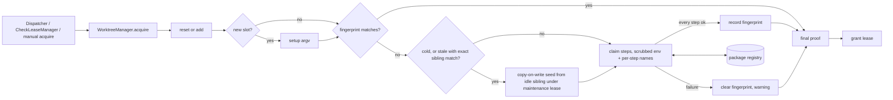
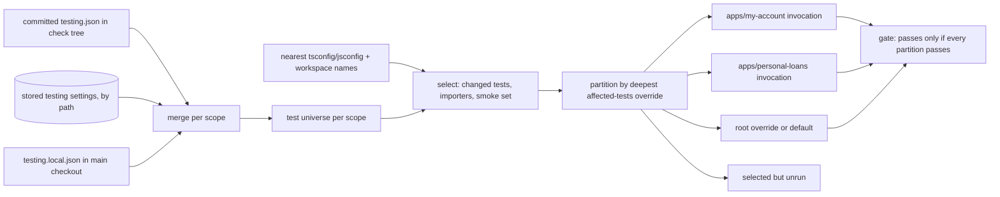
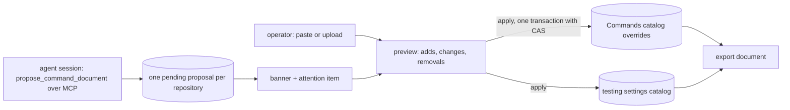

# Worktree claims, Warm, and monorepo testing settings

A pool slot should arrive with the dependencies its commit needs, and a monorepo that will not
commit `.mission/testing.json` should still get an affected-tests gate. This plan adds a
per-pool **claim** that runs on every lease, a **Warm** action that prepares idle slots ahead of
time by cloning dependencies from a sibling, **stored testing settings** per repository and
subdirectory, **per-app affected-test selection**, and **bulk documents** for configuring
Commands and testing settings in one step.

The prompt was `upstart-web-frontend` (uwf), a Yarn 4 and Turbo monorepo with 25 apps and 2
packages. It runs Mission Control Commands per app through repository and subdirectory
overrides in Library › Commands, with nothing committed to uwf. Its checks fail on missing or
stale `node_modules` (seen: `capital-markets` failing on `@octokit/auth-app`). The setup command
cannot install a monorepo, and the affected-tests gate needs a committed file that uwf will not
accept.

Settled through a three-round grilling session (46 decisions, listed at the end). Where the
answer differs from the recommendation offered, the decision table says so. The human approved
the plan as written on 2026-10-13 and chose to create tickets after it merges (see "Plan
review").

## Goals

- A leased slot has dependencies installed for **its** commit, whoever leased it: a task, a
  check, or a manual session.
- A slot whose dependencies already match pays nothing. A cold slot is seeded copy-on-write
  from an idle sibling instead of paying a full monorepo install.
- The registry credential an install needs reaches the install, and nothing else does. In
  particular it does not reach the third-party build scripts the install runs.
- A failed install never removes a slot from the pool, and a check can tell "this branch broke
  its lockfile" from "the registry or the token failed".
- A repository can have an affected-tests gate configured entirely in Mission Control, per app.
- A monorepo change runs each touched app's tests in that app, with that app's import aliases.
- A dozen override rows can be configured from one document, written by the operator or proposed
  by an agent and approved by the operator.

## Non-goals

- Secret storage. Mission Control stores variable **names**, never values. Values come from the
  daemon's environment or the login shell, as decided in round 3.
- Hardening tokenless loopback writes to `/api/*`. This plan corrects the docs that overstate
  the boundary and records the hardening as a follow-up (round 1, `loopback-writes`).
- Jest `moduleNameMapper` resolution. Selection resolves aliases through tsconfig/jsconfig
  `paths` and workspace package names, and nothing else.
- Storing the `flakes` block. Only the CI flake-report action reads it, and CI cannot read
  Mission Control's database.
- Committing uwf's configuration anywhere. uwf is the motivating case. Proof is fixtures and e2e
  (round 3, `uwf-acceptance`).
- Changing when the setup command runs, or its limits. Setup still runs once, on slot creation.
  Only its environment changes (round 2, `setup-env`).

## Background: how things work today

### Pools and leases

- `WorktreeManager.acquire` (`src/server/worktrees/manager.ts:503-776`) screens candidates,
  reserves a slot under the pool lock, then works under the slot lock:
  1. it resets a reused slot (`checkout --force --detach`, `reset --hard`, `clean -fd`) or adds
     a new one;
  2. it runs `setupArgv` **only for a new slot** (`:708-722`);
  3. it proves path, common dir, exact HEAD, clean and detached (`:724-743`);
  4. it grants the lease with `store.finalizeLease`.
- The setup runner (`manager.ts:145-159`) has a 120 s timeout and a 64 KiB `maxBuffer`. An
  overflow counts as a failure, and a failure quarantines the new slot. Its output is discarded
  apart from stderr in `last_error`.
- **Setup runs with the full daemon environment.** `runSetup` passes no `env`, so every
  `*_TOKEN` variable reaches it. Checks get `scrubCheckEnv`
  (`src/server/workflows/check-env.ts:116-148`) followed by `agentSubprocessEnv`. There is no
  allowlist.
- **Occupancy.** Any process whose cwd is inside an *available* slot makes the next `acquire`
  quarantine that slot (`manager.ts:599-601`). Setup argv is explicitly not an "own" process
  (`own-processes.ts:11-14`). Background work in a slot must therefore hold the slot under a
  lease.
- Quarantine has no "unquarantine" action. A slot leaves quarantine only by an owner Return or
  by Destroy.
- `acquire` has three callers:
  - task dispatch (`dispatcher.ts:2437`), which every task kind, ensemble and Foreman dispatch
    reaches;
  - check attempts (`workflows/check-lease.ts:553`);
  - manual leases (`POST /api/worktrees/manual/acquire`, used by `make session`).

  A check the pool refuses falls back to a cold `git worktree add --detach` with no setup
  (`check-lease.ts:434-482`). Pipelines do not use the pool.
- Pool policy `{enabled, maxSlots, setupArgv}` is `WorktreesConfigSchema`
  (`src/shared/protocol.ts:2834-2937`). It lives in the `worktrees` app-config entry, keyed by
  Git common dir, and **settings backups already capture it**. Lowering `maxSlots` never prunes.
- The UI is `src/web/components/WorktreeSettingsPanel.tsx`. Slot actions are Copy path, Open
  terminal, Return and Destroy. The action vocabulary is closed (`return | prune | reconcile |
  destroy | legacyReturn`). Mutations go preview, then execute, through
  `WorktreeOperationsService` (`operations.ts:970-1051`), whose operation views have queued,
  running and failed states and Dismiss, but no output and no cancel. The only event is the
  content-free `worktrees_changed`, and inventory stays out of `MissionState`.
- Nothing records a slot's dependency state. `scripts/worktree-setup.mjs` checks only whether
  `node_modules` exists.

### uwf's installed tree

These facts are from reading the main checkout and pool slots read-only on 2026-10-13.

- Root `node_modules` is 3.1 GB, with `nodeLinker: node-modules`, `nmMode: classic` and
  `enableGlobalCache: true`.
- **Every symlink is relative,** including `.bin` entries and workspace links such as
  `node_modules/uwf-my-account -> ../apps/my-account`. So is every location in
  `node_modules/.yarn-state.yml` and `.yarn/install-state.gz`. A full search found zero absolute
  symlinks. A clone of the dependency trees therefore works in place in a sibling slot.
- Absolute paths appear only in disposable caches: `.next`, and
  `node_modules/.cache/storybook` (135-359 MB per app). Node-gyp `.pyc` files also carry them,
  which is harmless.
- APFS, so `cp -c` (clonefile) works. The pools live on the same volume as `~/code`.
- There are no workspace lifecycle scripts. Third-party ones exist: esbuild, sharp, dd-trace,
  `@datadog/*`, protobufjs, `@bugsnag/cli`, msw, core-js and others. **An allowlisted token is
  visible to every one of them** if the install that runs them has it.
- `.yarnrc.yml` references its two environment variables with `${VAR:-}` fallbacks, so a Yarn
  step run without the token still parses its configuration.
- There is no root `tsconfig.json`. Each app's tsconfig is standalone, with no `extends`, and
  has its own `paths` (`@components/*`, `@hooks/*`, and others).
- The daemon started from a shell has `ARTIFACTORY_AUTH_TOKEN` (checked for presence only). The
  executable locator's login-shell snapshot reads only `PATH` today
  (`src/server/executables/locator.ts:130`).

### Checks and affected tests

- **Command resolution.** `resolveWorkflowCommand` (`src/shared/workflow.ts:3545-3566`) picks
  the longest applicable override. Overrides are keyed by **absolute canonical path**, either
  the main checkout's realpath or a subdirectory below it. The command runs in that
  subdirectory of the leased tree.
- **Run budget.** `maxRuns` counts **executions** (`workflow.ts:3100-3114`). An infrastructure
  retry is the same execution asked again, capped at `MAX_INFRA_ATTEMPTS = 3`
  (`engine.ts:87, 1713`), after which the run blocks with `infrastructure_error`.
- **Testing config.** `readTestingConfig` (`src/server/testing-config.ts:37`) reads the
  committed `.mission/testing.json` from the check tree and `.mission/testing.local.json` from
  the main checkout. A missing committed file skips the gate. `mergeTestingConfig`
  (`src/shared/testing-config.ts:124-146`) replaces key by key, list for list. The schema is
  strict, its keys are `tests.{patterns, includeImporters, smokeSet}` and `flakes.*`, and the
  header calls it a cross-phase contract.
- **Selection.** Selection is **one per repository, at the tree root**
  (`workflows/affected-tests.ts:76, 88`). Files reach `{files}` relative to the override's
  subdirectory, so a file outside it arrives as `../…` (`:163`). Aliases resolve only through
  `<treeRoot>/tsconfig.json`, with no `extends`, no nested tsconfigs and no workspace packages
  (`src/server/test-selection.ts:122-147`).
- **Agent writes.** `set_affected_tests_command` is the only Command write exposed over MCP. It
  is restricted to testing-setup tasks and writes only the repository-root override. **The
  HTTP routes behind it accept any loopback caller without a token** (`routes.ts:1598-1603`),
  and `docs/security.md:3-6` describes the loopback `Host` check.
- **Commands catalog.** It is DB-only: `workflow_commands` and `workflow_command_overrides`,
  edited in `src/web/workflows/CommandLibrary.tsx`, with whole-slot compare-and-swap. There is
  no import or export.
- **Backups.** `src/server/settings-backups/catalogs.ts` captures the Commands catalog. A new
  relational catalog needs a backup domain and a missing-domain migration so older snapshots
  still restore (precedent: `withSlotsAddedSinceSnapshot`, `restore.ts:106-133`).

### Decisions this plan supersedes

- `docs/plans/flake-aware-testing/plan.md:95-96` says "Selection settings are knowledge about
  the project, so they are committed to the repository and reviewed like code." For the
  `tests.*` keys, stored settings now overlay the committed file key by key (round 2,
  `testing-precedence`). The committed file is still read, and is still the only source of
  `flakes`.
- `docs/worktrees-and-checks.md:413-417` says a check is "a build rather than an install". That
  is true only after something has installed, and the claim is that something.
- The "one Command write an agent may make" wording (`src/shared/protocol.ts:6456`,
  `src/server/testing-setup.ts:1`, `routes.ts:5037`) holds for the MCP tool surface only.

## Design

### 1. The claim: dependency steps on every lease

**Settings.** The claim is per pool, with no global default (round 3, `claim-defaults`). It is
stored beside `setupArgv` under `worktrees.repositories[<commonDir>]`, so backups capture it with
no new domain:

```jsonc
"claim": {
  "steps": [
    { "argv": ["yarn", "install", "--immutable", "--mode=skip-build"], "env": ["ARTIFACTORY_AUTH_TOKEN"] },
    { "argv": ["yarn", "rebuild"], "env": [] }
  ],
  "timeoutMinutes": 10,
  "fingerprintPaths": ["yarn.lock", ".yarnrc.yml", "package.json", "apps/*/package.json",
                       "packages/*/package.json", ".yarn/releases/**", ".yarn/patches/**"],
  "seed": {
    "paths": ["node_modules", "apps/*/node_modules", "packages/*/node_modules", ".yarn/install-state.gz"],
    "exclude": ["**/node_modules/.cache"]
  }
}
```

That is the uwf configuration this plan has in mind. It is illustrative and was not run against
uwf. `yarn rebuild` running every skipped build from the cache without the token is the
expectation to confirm when someone configures uwf.

- `steps` is an ordered list of argvs, never a shell (round 3, `claim-steps`). Each step names
  the variables it may receive, and any failing step fails the claim.
- `timeoutMinutes` covers the whole claim. It defaults to 10, and the schema caps it at 240
  (round 2, `claim-limits`, Other answer).
- `fingerprintPaths` and `seed` are explained below. An empty `fingerprintPaths` means the claim
  always runs.
- The schema stays `.strict()` and bounded like `setupArgv` (32 arguments of up to 4096 bytes
  each), with caps on steps, variable names and globs that the slice sets.

**Where it runs.** Inside `acquire`, under the slot lock, after reset or add and after setup on
a new slot, and **before** the final proof. Every lease kind runs it (round 2,
`claim-lease-kinds`):

- task dispatch;
- check attempts;
- manual leases;
- the cold check fallback in `check-lease.ts`, which runs the same claim against its disposable
  worktree.

There is no extra concurrency limit, so parallel checks claim in parallel and the slot count
bounds them (round 2, `claim-concurrency`).

**Environment.** Each step runs with `scrubCheckEnv` then `agentSubprocessEnv`, the same base as
a check (round 1, `deps-env`). On top of that base it gets only the variables its own `env`
list names (round 3, `claim-steps`):

- A value comes from the daemon's environment, else from the login-shell snapshot. The locator's
  shell read is extended to capture the named variables alongside `PATH` (round 3,
  `allowlist-source`).
- The pool settings show each name as **present** or **missing**, never its value.
- The setup command moves onto the same base, with setup's allowlist being the union of names
  the pool lists (round 2, `setup-env`). This is a behavior change for a setup command that
  relied on an unlisted credential, and the release notes say so.

Stdin is closed, as it is for checks.

**Fingerprint.** A slot's fingerprint is a hash over three inputs (round 2, `fingerprint`):

- the git blob ids of every path matching `fingerprintPaths` at the leased commit, read with
  `git ls-tree` from objects, not the checkout;
- every step's argv;
- every step's variable names.

The claim records it on the slot row only after every step succeeds. A claim whose fingerprint
equals the slot's recorded one skips the steps entirely. The slot row gains nullable columns for
the fingerprint, the commit it was taken at, and the last claim's outcome and tail, added in
`migrate()` next to their upgrade path.

**Output and limits.** Each step's output streams into a 4,000-byte tail, the same bound and
`TailRing` as checks (`check-spawn.ts:254`). Output size never fails a claim. A timeout kills
the process group and counts as a failed claim.

**Failure.** A failure is a non-zero exit, a timeout, or a Stop. The slot is **handed over with
a warning and is never quarantined for the exit code** (round 2, `claim-failure`):

- The slot's fingerprint is cleared, so the next claim runs the steps again.
- A **task** lease is granted. The task card shows the warning and tail, and the agent's launch
  prompt gets a short note naming the failing step with its output tail (round 3,
  `agent-warning`).
- A **manual** lease is granted, and the warning is returned to the caller.
- A **check** lease does not run the check's Command. The attempt records a dependency failure
  with the tail, and the verdict rule below decides what it means.
- A claim that leaves a **tracked** file modified, or a branch attached, still fails the final
  proof and quarantines the slot as today. Claim steps must not rewrite tracked files, and
  `--immutable` is how uwf's first step honors that.

**Check verdict on a failed claim** (round 2, `claim-check-verdict`):

- If any `fingerprintPaths` blob differs between the check's head and its merge base with the
  base branch, the change owns the failure. The check fails, with the tail as its output.
- If none differs, it is infrastructure. The engine's existing infrastructure path retries it,
  up to `MAX_INFRA_ATTEMPTS`, and the run budget is handed back, as for a selection that ran
  nothing.
- A pool with no `fingerprintPaths` treats every failed claim in a check as infrastructure
  (round 3, `no-fingerprint-verdict`).

**Stop.** A running claim has a Stop control on its slot card and on the task card of the
dispatch waiting on it (round 3, `claim-stop`). Stop kills the process group and hands the slot
over as a failed claim, so the dispatch continues with the warning.

**What the operator sees** (round 2, `claim-progress-ui`):

- **Slot card.** The slot view gains a dependency state: current, stale versus origin's default
  branch, never installed, installing (with the running step and elapsed time), or failed (with
  the tail). Stale is computed against the last fetched `origin/<default>` ref, so building the
  inventory never fetches. Changes reach the dashboard through the existing `worktrees_changed`
  revision bump.
- **Task card.** The task view carries a provisioning phase while its dispatch waits on a claim:
  "Installing dependencies", with the step and elapsed time. It arrives through the existing
  `task_upsert` event. After the lease, a failed claim leaves a warning on the task.



### 2. Seeding and Warm

**Why a maintenance lease.** Because of the occupancy rule, nothing may run inside an available
slot. Warm and seed sources therefore hold their slots under a new lease owner kind, `warm`,
alongside `task`, `check` and `manual`. A `warm` lease is granted and released through the same
`finalizeLease` and `release` paths, and it is never visible as a task.

**When to seed** (round 3, `warm-seed-when`). A Warm or a claim seeds from a sibling when either
of these holds:

- the target has no recorded fingerprint, because it is new, was never warmed, or its last claim
  failed;
- the target's fingerprint is stale **and** an idle sibling's fingerprint matches the target
  commit's exactly.

Otherwise the claim runs in place, so a small lockfile change stays an incremental install.
Claims seed under the same rule as Warm (round 2, `seed-on-cold-claim`), including the cold
check fallback.

**Choosing the source** (round 2, `warm-source`):

- The first choice is an idle sibling whose fingerprint matches the target commit's. The next is
  the idle sibling most recently claimed successfully.
- The source is held under a `warm` lease for the length of the copy. It returns to the pool
  through the ordinary release path afterwards.
- The main checkout is never a source.
- If no sibling is idle, or no idle sibling has a fingerprint, there is no seed. The claim steps
  run alone.

**Copying** (round 2, `seed-copy`):

- The copy is copy-on-write only: `cp -c -R` on macOS and `cp -R --reflink=always` on Linux.
  Where the filesystem cannot clone, the seed is skipped, never replaced by a byte copy.
- The copy covers only the operator's `seed.paths` globs, matched in the source, and
  `seed.exclude` removes paths from the clone before it is placed.
- Each matched path is cloned into a staging directory in the pool's directory, on the same
  volume and outside the checkout. The existing target path is then removed and the staged copy
  renamed into place. The checkout never holds a half-copied tree.
- After a seed the target inherits the source's fingerprint, and the claim's ordinary skip rule
  decides whether the steps run.
- A failed clone is not a failed claim. The seed is abandoned and its staging removed, and the
  steps run.

**Warm** (round 2, `warm-scope`, `warm-output`; round 3, `warm-target`):

- Warm has two triggers:
  - **Warm** on an available slot's card;
  - **Warm idle slots** on a pool row, which warms every available slot of the pool.
- Both go through preview and execute in `WorktreeOperationsService`, so the action vocabulary
  gains `warm`.
- A Warm takes a `warm` lease on the target, fetches, resets the slot to origin's current default
  branch, seeds or claims under the rules above, then releases.
- The operation view gains a live output tail and a **Cancel** control:
  - The tail is updated with a `worktrees_changed` bump at most once per second while a Warm
    runs.
  - Cancel kills the process group, clears the slot's fingerprint, and returns the slot to the
    pool as available.
- The full log is written under the state directory, at `logs/worktree-warm/<operationId>.log`.
  The operation view links it, and dismissing or pruning the operation prunes the log.
- Warm never touches a leased or quarantined slot. A slot leased while a "Warm idle slots"
  operation is queued is skipped and listed as skipped.

### 3. Stored testing settings

**Catalog** (round 2, `testing-storage`, `testing-flakes`):

- A new table, `testing_settings`, holds `repo_root` (primary key), `settings_json`, `revision`,
  `created_at` and `updated_at`.
- It is keyed by the **same canonical path** as Command overrides, either the main checkout's
  realpath or a subdirectory below it.
- `settings_json` is validated by a new `StoredTestingSettingsSchema` in
  `src/shared/testing-config.ts`. It allows only `tests.patterns`, `tests.includeImporters` and
  `tests.smokeSet`, all optional, `.strict()`, and within the existing limits.
- The committed and local schemas and `mergeTestingConfig` do not change incompatibly. The CI
  action keeps bundling them.

**Layers.**

| Scope | Lowest | Then | Highest |
|---|---|---|---|
| Repository root | committed `.mission/testing.json` (check tree) | stored settings at the root | `.mission/testing.local.json` (main checkout) |
| Subdirectory (`apps/my-account`) | the root's merged result | stored settings at that subdirectory | none |

- Stored settings overlay the committed file key by key (round 2, `testing-precedence`, against
  the recommendation). The local file stays the operator's last word at the root (round 3,
  `testing-layer-order`).
- A subdirectory's stored keys apply **to files inside that subdirectory** (round 3,
  `testing-subdir-semantics`):
  - A key it sets replaces the root's value there.
  - Its `patterns` and `smokeSet` are relative to the subdirectory.
  - A key it does not set falls through to the root.
- Nested subdirectory scopes apply nearest first.
- The local file stays flat and root-only.

**Behavior.**

- The gate runs when any layer exists at any scope. With no committed file and no stored
  settings it is skipped, as today.
- An invalid stored row cannot be saved: the route validates it on write. The committed file's
  rules stay as they are: an invalid committed file fails the gate, and an invalid local file
  makes it unavailable.
- Run detail labels the source of every effective key: `committed`, `stored (<scope>)` or
  `local`. This extends today's `settings.localKeys`.
- `flakes` is never stored, and continues to come from the committed file or its defaults.

**UI.**

- The settings are edited on the **affected-tests** page in Library › Commands
  (`CommandLibrary.tsx`), as a "Testing settings" section listing the root and every
  subdirectory that has stored settings or an affected-tests override.
- Each row edits patterns, includeImporters and smokeSet. A stale save is refused with 409 and
  the row reloads.

**Backups** (round 2, `backups`). A new settings-backup domain, `testing-settings`, with a
missing-domain migration so snapshots taken before it restore with the domain empty.

### 4. Per-app affected-test selection

**Resolving imports** (round 2, `alias-resolution`).

- **tsconfig and jsconfig.** For each scanned file, `test-selection.ts` finds the nearest
  `tsconfig.json` or `jsconfig.json` at or above the file's directory, stopping at the tree root.
  - It follows relative `extends`, and package `extends` it can resolve inside the tree.
  - An unresolvable `extends` is reported in the selection diagnostics, not fatal.
  - It uses that config's `paths` and `baseUrl`. It keeps today's extension and JS-to-TS swaps.
  - It fixes the first-`*`-only wildcard replacement (`:165`).
  - It caches parsed configs per gate.
- **Workspace packages.** The root `package.json` `workspaces` globs (array or `{packages}` form)
  map each workspace's `name` to its directory.
  - A bare specifier `name` resolves through the workspace's `package.json`: a string `exports`
    for `.`, else `main`, else `index`.
  - A specifier `name/sub` resolves inside the workspace's directory.
  - Package `exports` maps beyond a single string are out of scope for this slice and are
    reported in diagnostics.
- Resolution still refuses anything outside the tree.

**The test universe.** Per scope (section 3), the tests are the tracked files matching that
scope's effective `patterns`, resolved relative to the scope that set them. A file belongs to its
nearest scope. `includeImporters` and `smokeSet` apply per scope in the same way.

**Partitioning** (round 2, `selection-unit`). The gate selects once across the repository, then
assigns each selected test to the **deepest affected-tests override** whose subdirectory
contains it:

- A test outside every subdirectory override goes to the repository-root override, or to the
  slot's global default, which runs at the root.
- A test no override or default can run is listed in run detail as **selected but unrun**. The
  gate decides on the partitions that ran (round 3, `uncovered-tests`).
- Each partition runs its own override's command in that override's subdirectory, with `{files}`
  relative to it. `{junit}` gets a temporary path per partition, and results map back to tree
  paths.
- Partitions run **sequentially**, all of them, inside the one check-test lease (round 3,
  `partition-order`). Each partition reruns its failed files once, as today.
- The gate passes only if every partition passes.
- The gate attempt spends **one run** of the budget however many partitions it has (round 3,
  `partition-budget`). An attempt that selects nothing hands the run back, as today.
- Run detail lists each partition: its subdirectory, command, file count, outcome and output
  tail.

Partitioning does not depend on the session's cwd. The change decides which apps run. The
session's cwd still decides which `test`, `lint`, `typecheck` and `build` override a check uses,
as today.



### 5. Bulk documents for Commands and testing settings

**Format** (round 3, `bulk-format`). The format is versioned JSON, with its schema in
`src/shared` beside the other wire contracts:

```json
{
  "version": 1,
  "commands": {
    "lint":           [{ "path": "", "argv": ["yarn", "turbo", "run", "lint", "--filter=...[origin/main...HEAD]"] },
                       { "path": "apps/my-account", "argv": ["yarn", "lint"] }],
    "affected-tests": [{ "path": "apps/my-account", "argv": ["yarn", "test:affected", "--junit-file={junit}", "{files}"] }],
    "test":           [{ "path": "apps/legacy-app", "remove": true }]
  },
  "testing": [
    { "path": "apps/my-account", "settings": { "tests": { "patterns": ["src/**/*.test.{ts,tsx}"] } } },
    { "path": "apps/old-app", "remove": true }
  ]
}
```

- `path` is repository-relative, and `""` is the root.
- The `affected-tests` argv above is a placeholder. A real one must contain `{files}` as a whole
  element and `{junit}` somewhere (`commandTemplateProblem`, `src/shared/workflow.ts:3205`), and
  how an app's Jest writes JUnit to a given path is for whoever configures it.
- The target repository is chosen when the operator imports, or is the proposing session's task
  repository.
- Each entry is checked against the rules its catalog already enforces: the template rule for
  `affected-tests`, duplicate refusal and the override cap.
- A document sets Command overrides for every slot, plus stored testing settings, for **one**
  repository (round 2, `bulk-coverage`). It never touches global defaults, `maxRuns` or pool
  settings.

**Applying** (round 3, `bulk-apply`):

- Rows the document does not mention are untouched. A listed row is added or replaced. Removal
  happens only through an explicit `remove` entry.
- The preview lists every add, change and removal, per slot and for testing settings.
- Apply writes everything in one transaction, using each slot's compare-and-swap and the testing
  catalog's revisions. A preview that went stale is refused with 409 and recomputed.

**Two producers, one screen** (round 2, `bulk-mode`):

- **Import.** The operator pastes or uploads a document in Library › Commands, picks the
  repository and gets the preview.
- **Export.** Library › Commands exports a repository's current overrides and testing settings as
  a document (round 3, `bulk-export`). Export then import round-trips.
- **Proposal.** A new MCP tool, `propose_command_document`, takes a document from a session
  (round 3, `bulk-proposal-rules`):
  - It accepts only the calling session's own task repositories, using the guard
    `set_affected_tests_command` already uses, without the testing-setup label restriction.
  - It never writes a live row. It stores one pending proposal per repository, and a newer one
    replaces it.
  - The proposal shows as a banner on that repository in Library › Commands and as an attention
    item. Opening it leads to the same preview, where the operator applies or dismisses it.
- Pending proposals are machine state and are **not** in backups.

The approval step is a boundary on the MCP surface only. The apply route is under `/api/*`,
which accepts any loopback caller without a token, and the docs say so plainly (section 7).



### 6. Testing setup for a repository that will not commit a file

The "Set up testing" action asks the operator to choose **committed** or **stored** before the
task starts (round 3, `testing-setup-flow`):

- **Committed** is today's path. The agent writes `.mission/testing.json` in its change and
  calls `set_affected_tests_command`, which is unchanged.
- **Stored.** The agent works out per-app overrides and testing settings and submits them with
  `propose_command_document`. The operator applies them from the preview.

The testing-setup skill text and the task's launch prompt carry the choice.

### 7. Docs

- `docs/worktrees-and-checks.md:413-417`. Rewrite "your `node_modules` survives, so a check is a
  build rather than an install". Clean `-fd` preserves whatever is installed, and the claim is
  what makes it current.
- `docs/worktrees-and-checks.md`. Document the claim, fingerprints, seeding, Warm, the claim
  environment and the setup environment change.
- `src/shared/protocol.ts:6456`, `src/server/testing-setup.ts:1`, `src/server/routes.ts:5037` and
  `docs/flaky-tests.md:49-52`. State that `set_affected_tests_command` (and later
  `propose_command_document`) bounds what an agent may do **through MCP**, and that `/api/*`
  routes accept any loopback caller.
- `docs/security.md`. Add that the loopback boundary has no token on `/api/*`, so any local
  process, an agent's shell included, can call settings routes. Link the follow-up.
- `docs/workflows.md` (testing config sections). Cover stored settings, layering, subdirectory
  scopes, partitions and the supersession above.
- Library and settings docs. Cover bulk documents, export and proposals.

## Fork tracking

Fork tracking was settled in round 2 (`fork-slugs`):

| Work | Fork feature |
|---|---|
| Claim, fingerprints, claim environment, setup environment, seeding, Warm | new `fork:worktree-dependency-claims` |
| Stored testing settings, layering, per-app selection, testing-setup stored path | extends #296 `fork:flake-aware-testing` (its behavior contracts change: stored settings overlay the committed file) |
| Bulk documents, export, `propose_command_document` | new `fork:commands-bulk-config` |
| Docs fixes | under the feature whose slice carries them |

Each implementing PR carries its label and a "Fork feature changes" section in the
`docs/fork/README.md` format. The first PR of a new feature creates its label and tracking issue.
This plan's own PR only adds `docs/plans/`, so its section is `none`.

## Delivery order

Each slice stands alone and lands in order (round 3, `delivery-order`). The tickets follow-up
slices within this order.

1. **Claim.** This slice covers:
   - claim settings and schema;
   - the scrubbed environment with per-step names and the login-shell capture;
   - the setup environment change;
   - fingerprints and the skip rule;
   - limits, failure handling, the check verdict rule and Stop;
   - the agent note, the slot and task card states;
   - the cold check fallback;
   - the docs fixes in section 7 that do not depend on later slices.

   This slice alone fixes the observed `capital-markets` failure.
2. **Seeding and Warm.** The `warm` lease kind, copy-on-write seeding for claims and Warm, source
   selection, the Warm operation with tail, log and Cancel, and the slot and pool controls.
3. **Stored testing settings.** The catalog, schema, layering, run-detail sources, the
   affected-tests page section, and the backup domain with its migration.
4. **Per-app selection.** Nearest tsconfig/jsconfig with `extends`, workspace names,
   per-scope test universes, partitions, unrun listing, and partition run detail.
5. **Bulk documents and testing setup.** Format, preview and apply, import, export,
   `propose_command_document` with its banner and attention item, and the testing-setup
   committed-or-stored choice.

## Verification

Proof is fixtures and e2e (round 3, `uwf-acceptance`). Every slice meets the repository's
definition of done: relevant tests, `npm run typecheck`, `npm run lint`, and `npm run build`
with `npm run smoke` for runtime surfaces. UI changes also need `npm run test:e2e` with a
spec, and no `data-testid`.

**Claim (unit, `test/`).**

- Fingerprint skip, and a mismatch running every step.
- A failing step clearing the fingerprint and handing the slot over.
- A dirty tracked file after a claim quarantining as today.
- Timeout and Stop killing the process group.
- Output never failing on size.
- Per-step environments receiving exactly their named variables, with credential-shaped names
  absent otherwise.
- Login-shell fallback for a name missing from the daemon environment.
- Setup on the scrubbed base.
- The check verdict for changed versus unchanged fingerprint inputs, and for no fingerprint
  paths.
- The cold fallback running the claim.
- Every lease kind running it.

**Seeding and Warm (unit).**

- Source selection order.
- The `warm` lease preventing an occupancy quarantine.
- Staging and rename leaving no half tree.
- Exclusions applied.
- No seed where cloning is unsupported, using a fake `cp` that refuses `--reflink=always`.
- Cancel clearing the fingerprint.
- "Warm idle slots" skipping leased slots.

**Testing settings and selection (unit).**

- Layer order and per-key sources.
- Subdirectory scope semantics, including relative patterns and smokeSet.
- The gate running with stored settings and no committed file.
- The schema refusing `flakes`.
- Missing-domain backup migration.
- Nearest tsconfig with relative `extends`.
- Workspace package names, bare and subpath.
- Partitions in a fixture monorepo with two apps and a package.
- One budget run per attempt.
- Sequential execution.
- Selected-but-unrun listing.

**Bulk (unit).**

- Schema validation.
- Merge with explicit removals.
- Template rule enforcement.
- Stale preview 409.
- The proposal guard refusing another repository.
- A newer proposal replacing an older one.
- Export, then import, round-tripping.

**e2e (`e2e/`).**

- Pool claim settings, with present and missing indicators for names.
- The slot card dependency states.
- The task card "Installing dependencies" with Stop.
- Warm and "Warm idle slots", with live tail and Cancel.
- The affected-tests page testing settings section.
- Run detail sources and partitions.
- Import preview and apply.
- Export.
- The proposal banner and attention item, and the Set up testing choice.
- Every new modal, including the document preview, calls `expectContentClearsBorder`.
- Every agent binary stays faked.

## Follow-ups (not in this plan)

- **Tokenless loopback writes.** Require the daemon token, or an equivalent, for writes to
  executable settings: pool policy, Commands, testing settings and bulk apply (round 1,
  `loopback-writes`).
- **Configuring uwf on this machine** with the example above, as operator configuration, once
  slices 1 and 2 land.
- **Jest `moduleNameMapper` resolution**, if tsconfig `paths` turn out to diverge from what an
  app's Jest config maps.
- **Package `exports` maps** beyond a single string, if a workspace needs them.

## Decisions

Recorded as answered. "Rec." marks an answer that took the recommended option.

### Round 1: scope and strategy

| Id | Question | Answer |
|---|---|---|
| `scope` | What the plan covers beyond slot dependencies | Testing settings outside the repository; per-app affected-test selection; bulk configuration of Commands; docs accuracy fixes (bulk was not recommended; the rest rec.) |
| `deps-strategy` | How slots get current dependencies | A claim command on every lease, plus a manual Warm action (rec.) |
| `deps-env` | Environment for dependency commands | Scrubbed like checks, plus a per-pool allowlist of named variables (rec.) |
| `loopback-writes` | Tokenless loopback writes | Correct the docs; record write hardening as a separate follow-up (rec.) |

### Round 2: claim, Warm, testing, bulk, fork

| Id | Question | Answer |
|---|---|---|
| `claim-failure` | A claim fails | Hand the slot over with a warning; never quarantine for the exit code (rec.) |
| `claim-check-verdict` | A failed claim inside a check | Fingerprint inputs changed on the branch versus the merge base means the change failed; unchanged means infrastructure (rec.) |
| `claim-limits` | Timeout and output | **Other:** per-pool timeout, default 10 minutes, max 240; bounded tail, never fail on output size |
| `claim-lease-kinds` | Which leases claim | Every lease kind (task, check, manual), and the cold check fallback (rec.) |
| `seed-on-cold-claim` | Seed cold claims | Yes (rec.) |
| `fingerprint` | Fingerprint and staleness | Git blob hashes of operator-listed path globs at the leased commit, plus argv and allowlist names; shown on each slot card (rec.) |
| `claim-progress-ui` | What the operator sees | "Installing dependencies" on the task card and the slot card, tail on failure (rec.) |
| `claim-concurrency` | Concurrent claims | No extra limit (rec.) |
| `setup-env` | Setup environment | Setup and claim share one environment (rec.) |
| `warm-scope` | Warm triggers | Per slot and per pool (rec.) |
| `warm-source` | Seed source | Matching idle sibling, else most recently claimed idle sibling, held under a maintenance lease; none idle means claim alone; never the main checkout (rec.) |
| `seed-copy` | Seed copy | Copy-on-write only, operator-listed paths with exclusions; no CoW means no seed (rec.) |
| `warm-output` | Observing and stopping Warm | Queued operation with Cancel, live tail, full log under the state dir (rec.) |
| `testing-precedence` | Stored versus committed | **Stored settings overlay the committed file key by key, like the local file** (the recommendation was "committed file wins whole") |
| `testing-storage` | Where stored settings live | Their own catalog keyed by the Command override paths, edited on the affected-tests page (rec.) |
| `testing-flakes` | Which keys are stored | `tests.*` only (rec.) |
| `selection-unit` | Monorepo gate shape | Select once, partition by the deepest affected-tests override, one invocation per partition, gate passes only if all pass (rec.) |
| `alias-resolution` | Alias resolution | Nearest tsconfig/jsconfig following `extends`, plus workspace package names (rec.) |
| `bulk-mode` | Bulk configuration | One document format; operator import and agent MCP proposal; one preview-and-apply screen (rec.) |
| `bulk-coverage` | What a document sets | Command overrides (every slot) and stored testing settings for one repository (rec.) |
| `backups` | Backup coverage | Every new setting, never per-slot state or variable values (rec.) |
| `fork-slugs` | Fork features | New `fork:worktree-dependency-claims`; testing work extends #296; new `fork:commands-bulk-config` (rec.) |

### Round 3: claim details, testing scopes, bulk, delivery

| Id | Question | Answer |
|---|---|---|
| `claim-steps` | One command or steps | Ordered steps, each with its own allowlist; any failing step fails the claim (rec.) |
| `claim-defaults` | Global default for claim settings | Per pool only (rec.) |
| `allowlist-source` | Where values come from | Daemon environment, else the login-shell snapshot; UI shows present or missing, never the value (rec.) |
| `claim-stop` | Stopping a claim | Stop on the slot and task card hands the slot over as a failed claim (rec.) |
| `agent-warning` | Telling the agent | A note in its launch prompt with the failing step and tail (rec.) |
| `no-fingerprint-verdict` | Verdict with no fingerprint paths | Infrastructure (rec.) |
| `warm-seed-when` | Seed or claim in place | Seed when the target has no fingerprint, or it is stale and an idle sibling matches exactly; otherwise claim in place (rec.) |
| `warm-target` | Warm's commit | Fetch, reset to origin's current default branch, then seed or claim (rec.) |
| `testing-layer-order` | Root layer order | Committed, then stored, then local (rec.) |
| `testing-subdir-semantics` | Subdirectory settings | Keys set replace the root's for files inside; patterns and smokeSet relative to the subdirectory; unset keys fall through (rec.) |
| `partition-budget` | Budget for a partitioned gate | One run per gate attempt (rec.) |
| `partition-order` | Partition execution | Sequential, all of them, then the gate decides (rec.) |
| `uncovered-tests` | Selected tests no command can run | Listed as selected but unrun; the gate decides on the partitions that ran (rec.) |
| `testing-setup-flow` | Testing setup without a committed file | Operator chooses committed or stored; stored means a bulk proposal (rec.) |
| `bulk-format` | Document format | Versioned JSON, repository-relative paths, repository chosen on import (rec.) |
| `bulk-apply` | Unmentioned rows | Untouched; explicit removal entries; preview shows every add, change and removal (rec.) |
| `bulk-export` | Export | Yes, from Library › Commands (rec.) |
| `bulk-proposal-rules` | Who proposes | Any session, own task repositories only; one pending proposal per repository; banner and attention item (rec.) |
| `delivery-order` | Order of work | Claim and docs; seeding and Warm; stored testing settings; per-app selection; bulk and testing setup (rec.) |
| `uwf-acceptance` | Proof against uwf | **No, fixtures and e2e only** (the recommendation was a uwf run per slice) |

### Plan review (2026-10-13)

The human reviewed this plan in the Mission Control dashboard. A first review request failed
in transport and got no answer. The second was answered as follows.

| Id | Question | Answer |
|---|---|---|
| `plan-approval` | Is this plan approved as written, including the derived details? | Approve as written |
| `shape-follow-up` | What should happen after this plan is approved? | Create tickets after the plan merges |

The review listed these details for the human to flag, because no grilling round decided them
explicitly. Approval accepts them as written:

- the setup command's allowlist is the union of the variable names the pool's claim steps list;
- the `warm` lease owner kind holds Warm targets and seed sources;
- the Warm log is written to `logs/worktree-warm/<operationId>.log` under the state directory;
- the MCP tool is named `propose_command_document`;
- the claim settings sit beside `setupArgv` in the `worktrees` app-config entry;
- stored testing settings are a `testing_settings` table with a `testing-settings` backup domain;
- the uwf claim example is illustrative and was not run.

Mission Control records the tickets choice. A linked follow-up task slices the merged plan into
tickets in the delivery order above. This planning turn files no tasks.
